# Open Hospital 1.15.2 - Administrator’s Guide

Table of Contents

- [Open Hospital 1.15.2 - Administrator’s Guide](#open-hospital-1152---administrators-guide)
  - [Open Hospital](#open-hospital)
  - [1 Introduction](#1-introduction)
    - [1.1 Main Features](#11-main-features)
    - [1.2 Hardware requirements](#12-hardware-requirements)
    - [1.3 Software requirements](#13-software-requirements)
    - [1.5 Download](#15-download)
    - [1.6 Unpack](#16-unpack)
    - [1.7 Documentation](#17-documentation)
  - [2 Installation](#2-installation)
    - [2.1 OH - CLIENT mode](#21-oh---client-mode)
      - [2.1.1 Prerequisites - Software compatibility matrix](#211-prerequisites---software-compatibility-matrix)
      - [2.1.2 Java Runtime Environment (JRE)](#212-java-runtime-environment-jre)
      - [2.1.3 Database Server](#213-database-server)
        - [2.1.3.1 MariaDB/MySQL - Server installation](#2131-mariadbmysql---server-installation)
        - [2.1.3.2 MariaDB/MySQL - Configuration](#2132-mariadbmysql---configuration)
        - [2.1.3.3 MariaDB/MySQL - Networking](#2133-mariadbmysql---networking)
      - [2.1.4 OH - Database creation](#214-oh---database-creation)
      - [2.1.5 OH - CLIENT configuration](#215-oh---client-configuration)
      - [2.1.6 OH - Startup and run](#216-oh---startup-and-run)
    - [2.2 OH - PORTABLE mode](#22-oh---portable-mode)
    - [2.3 OH - SERVER mode (portable)](#23-oh---server-mode-portable)
    - [2.4 Backup \& Restore](#24-backup--restore)
      - [2.4.1 Backup of database (alternative with MySQL Workbench®)](#241-backup-of-database-alternative-with-mysql-workbench)
      - [2.4.2 Restore of database (alternative with MySQL Workbench®)](#242-restore-of-database-alternative-with-mysql-workbench)
      - [2.4.3 Backup of OH code and settings](#243-backup-of-oh-code-and-settings)
    - [2.5 Folders and directory structure](#25-folders-and-directory-structure)
    - [2.6 Appearance](#26-appearance)
  - [3 Configuration](#3-configuration)
    - [3.1 settings.properties](#31-settingsproperties)
      - [3.1.1 LANGUAGE](#311-language)
      - [3.1.2 SINGLEUSER](#312-singleuser)
      - [3.1.3 AUTOMATICLOT](#313-automaticlot)
      - [3.1.4 LOTWITHCOST](#314-lotwithcost)
      - [3.1.5 PATIENTSHEET](#315-patientsheet)
      - [3.1.6 OPDCHART](#316-opdchart)
      - [3.1.7 ADMCHART](#317-admchart)
      - [3.1.8 DISCHART](#318-dischart)
      - [3.1.9 PATIENTBILL](#319-patientbill)
      - [3.1.10 BILLSREPORT](#3110-billsreport)
      - [3.1.11 BILLSREPORTMONTH](#3111-billsreportmonth)
      - [3.1.12 PHARMACEUTICALORDER](#3112-pharmaceuticalorder)
      - [3.1.13 PHARMACEUTICALSTOCK](#3113-pharmaceuticalstock)
      - [3.1.14 PATIENTEXTENDED](#3114-patientextended)
      - [3.1.15 OPDEXTENDED](#3115-opdextended)
      - [3.1.16 MATERNITYRESTARTINJUNE](#3116-maternityrestartinjune)
      - [3.1.17 LABEXTENDED](#3117-labextended)
      - [3.1.18 LABMULTIPLEINSERT](#3118-labmultipleinsert)
      - [3.1.19 INTERNALPHARMACIES](#3119-internalpharmacies)
      - [3.1.20 MERGEFUNCTION](#3120-mergefunction)
      - [3.1.21 INTERNALVIEWER](#3121-internalviewer)
      - [3.1.22 DOC\_DIR](#3122-doc_dir)
      - [3.1.23 SMSENABLED](#3123-smsenabled)
        - [3.1.23.1 GSM Configuration](#31231-gsm-configuration)
        - [3.1.23.2 SetupGSM utility](#31232-setupgsm-utility)
      - [3.1.24 MAINMENUALWAYSONTOP](#3124-mainmenualwaysontop)
      - [3.1.25 RECEIPTPRINTER](#3125-receiptprinter)
      - [3.1.26 VIDEOMODULEENABLED](#3126-videomoduleenabled)
      - [3.1.27 PATIENTVACCINEEXTENDED](#3127-patientvaccineextended)
      - [3.1.28 ENHANCEDSEARCH](#3128-enhancedsearch)
      - [3.1.29 XMPPMODULEENABLED](#3129-xmppmoduleenabled)
      - [3.1.30 DICOMMODULEENABLED](#3130-dicommoduleenabled)
      - [3.1.31 DICOMTHUMBNAILS](#3131-dicomthumbnails)
      - [3.1.32 DEBUG](#3132-debug)
      - [3.1.33 ALLOWMULTIPLEOPENEDBILL](#3133-allowmultipleopenedbill)
      - [3.1.34 OPENEDBILLSREPORT](#3134-openedbillsreport)
      - [3.1.35 ALLOWPRINTOPENEDBILL](#3135-allowprintopenedbill)
      - [3.1.36 USERSLISTLOGIN](#3136-userslistlogin)
      - [3.1.37 STRONGPASSWORD](#3137-strongpassword)
      - [3.1.38 STRONGLENGTH](#3138-stronglength)
      - [3.1.39 PASSWORDTRIES](#3139-passwordtries)
      - [3.1.40 PASSWORDLOCKTIME](#3140-passwordlocktime)
      - [3.1.41 PASSWORDIDLE](#3141-passwordidle)
      - [3.1.42 PATIENTPHOTOSTORAGE](#3142-patientphotostorage)
      - [3.1.43 SESSIONTIMEOUT](#3143-sessiontimeout)
      - [3.1.44 EXAMINATIONCHART](#3144-examinationchart)
      - [3.1.45 VISITSHEET](#3145-visitsheet)
      - [3.1.46 TELEMETRYENABLED](#3146-telemetryenabled)
      - [3.1.47 PARAMSURL](#3147-paramsurl)
      - [3.1.48 PASSWORDLEASE](#3148-passwordlease)
    - [3.2 database.properties](#32-databaseproperties)
    - [3.3 dicom.properties](#33-dicomproperties)
    - [3.4 examination.properties](#34-examinationproperties)
    - [3.5 log4j2-spring.properties](#35-log4j2-springproperties)
    - [3.6 sms.properties](#36-smsproperties)
      - [3.6.1 skebby-gateway-service](#361-skebby-gateway-service)
      - [3.6.2 textbelt-gateway-service](#362-textbelt-gateway-service)
    - [3.7 telemetry.properties](#37-telemetryproperties)
    - [3.8 txtPrinter.properties](#38-txtprinterproperties)
    - [3.9 xmpp.properties](#39-xmppproperties)
      - [3.9.1 OpenFire Settings](#391-openfire-settings)
    - [3.10 default\_credentials.properties](#310-default_credentialsproperties)
    - [3.11 Bundles](#311-bundles)
      - [3.11.1 New Translations](#3111-new-translations)
    - [3.12 application.properties (REST API) - security hardening](#312-applicationproperties-rest-api---security-hardening)
  - [4 Reports](#4-reports)
  - [5 Installing Open Hospital 1.15.0 in Eclipse EE](#5-installing-open-hospital-1150-in-eclipse-ee)
    - [5.1 Run the Project](#51-run-the-project)
  - [6 Update Open Hospital](#6-update-open-hospital)
    - [6.1 Update Database](#61-update-database)
    - [6.2 Update Client](#62-update-client)
    - [6.3 Update Portable](#63-update-portable)
  - [7 Support](#7-support)
  - [8 License](#8-license)


<a href="https://creativecommons.org/licenses/by-sa/4.0/">
  
</a> Informatici Senza Frontiere Onlus, 2026

Administrator’s Guide, © 2026 by [Informatici Senza Frontiere Onlus](https://www.informaticisenzafrontiere.org/)  
Policies is made available under a [Creative Commons Attribution-ShareAlike 4.0](https://creativecommons.org/licenses/by-sa/4.0//) International License: [https://creativecommons.org/licenses/by-sa/4.0//](https://creativecommons.org/licenses/by-sa/4.0//).

<a id="_open_hospital"></a>

## Open Hospital

<a id="_1_introduction"></a>

## 1 Introduction

OH - Open Hospital ([https://www.open-hospital.org/](https://www.open-hospital.org/)) is a free and open-source Electronic Health Record (EHR) software application. Open Hospital is deployed as a desktop application that can be used in a standalone, single-user mode (PORTABLE mode) or in a client/server network configuration (CLIENT mode), where multiple clients and users connect to the same database server.

Open Hospital is developed in Java and it is based on open-source tools and libraries; it runs on any computer, requires low resources, and is designed to work without an internet connection.

Open Hospital is the first of a set of software applications that ISF<sup><a id="_footnoteref_1"></a>[1](#_footnotedef_1)</sup> has developed to support the information management and the activities of hospitals and health centers in the simplest manner possible, by providing tools for the administrative operations (like registering patients, managing laboratory analysis and pharmaceutical stocks) and to produce detailed statistics and reports. It was first deployed in 2006 at the St. Luke Hospital in Angal (Uganda) and it is now used in dozens of different locations around the world.

<a id="_1_1_main_features"></a>

### 1.1 Main Features

OH - Open Hospital features include:

-   Pharmacy management
    
-   Laboratory management
    
-   OPD management
    
-   Patient admission and discharge management
    
-   Pregnancy management
    
-   Malnutrition control management
    
-   Vaccines database
    
-   Patient billing support
    
-   Therapy management
    
-   Appointment scheduling
    
-   Internal communication
    
-   Statistics and printing
    

For a detailed description of these features please refer to the _Open Hospital User’s Guide_.

<a id="_1_2_hardware_requirements"></a>

### 1.2 Hardware requirements

Minimum hardware requirements for running OH:

-   PC / Notebook with dual-core CPU
    
-   2 Gb RAM (4 Gb recommended)
    
-   4 Gb free hard disk space (8 Gb recommended)
    
-   Network adapter (for client/server configuration)
    

These specifications are for the OH application only; database server specifications may vary accordingly to the different use cases.

<a id="_1_3_software_requirements"></a>

### 1.3 Software requirements

Minimum Operating System version required for running OH:

-   Windows 7 (Windows 10/11 recommended)
    
-   Ubuntu 18.04 (Ubuntu 22.04 recommended)
    

32bit (i686) and 64bit (x86\_64) architectures are supported: 64bit architecture is recommended.

<a id="download"></a>

### 1.5 Download

Open Hospital official releases can be downloaded from GitHub: [https://github.com/informatici/openhospital/releases/latest](https://github.com/informatici/openhospital/releases/latest)

More information can be found on the Open Hospital website: [https://www.open-hospital.org/download](https://www.open-hospital.org/download)

<a id="unpack"></a>

### 1.6 Unpack

> [!NOTE]
>
> Do not double-click on the **oh.bat** startup script without unzipping the package first!

A compressed archive can be opened on most operating systems by just double-clicking on it. In this way, the archive is just opened, but not uncompressed.

In order to correctly run OH **you need to unzip (uncompress) the downloaded package** in a folder of your choice.

To uncompress the package: **Right-click on the package $\rightarrow$ Extract all/here**

**Alternative method**: uncompress package from the command line

-   on Linux:
    
```sh
tar zxvf OpenHospital-v\[VERSION\]-linux\_\[ARCH\]-\[portable\].tgz # portable version
unzip x OpenHospital-v\[VERSION\]-linux\_multiarch.zip # multiarch client version
```

-   on Windows:
    
```sh
unzip OpenHospital-v\[VERSION\]-windows\_\[ARCH\]-\[portable\].zip # portable version
unzip OpenHospital-v\[VERSION\]-multiarch-client.zip # multiarch client version
```

After uncompressing the package, browse to the extracted directory (example given for version 1.15.0):

-   on Linux:
    
```sh
cd /home/OH/OpenHospital-v1.15.0
```

-   on Windows:
    
```
cd C:\\Users\\OH\\OpenHospital-v1.15.0
```

> [!NOTE]
>
> You need read/write permission on the selected folder.

> [!NOTE]
>
> Do not run OH by double-clicking on the **oh.bat** startup script without unzipping the package first!

<a id="_1_7_documentation"></a>

### 1.7 Documentation

In the following chapters, all the information needed to install, configure, deploy, run and maintain an Open Hospital installation is presented, including procedures on how to enable and disable features as well as manage users and groups in a multi-user environment. More information can be found on the Open Hospital website [https://www.open-hospital.org/documentation](https://www.open-hospital.org/documentation).

> [!NOTE]
>
> The information needed to use the OH software is not included in this manual; please refer to the _Open Hospital User’s Guide_.

<a id="_2_installation"></a>

## 2 Installation

Open Hospital is a client application that can be used in three different ways:

-   [2.1 OH - CLIENT mode](#client): multi-computer setup, with a central database (requires some IT knowledge)
    
-   [2.2 OH - PORTABLE mode](#portable): single computer setup, with the database on the same computer (click and run)
    
-   [2.3 OH - SERVER mode (portable)](#server): multi-computer setup, with the central database created by the Open Hospital script (click and run)
    

> [!TIP]
>
> PORTABLE mode can be also used to test the application.

<a id="client"></a>

### 2.1 OH - CLIENT mode

In this mode, the application will need a Server with a DBMS<sup><a id="_footnoteref_2"></a>[2](#_footnotedef_2)</sup> to store the data.

The free and open-source MariaDB<sup><a id="_footnoteref_3"></a>[3](#_footnotedef_3)</sup> is the preferred database server.

The typical client/server, networked (LAN) configuration is shown in the following figure:

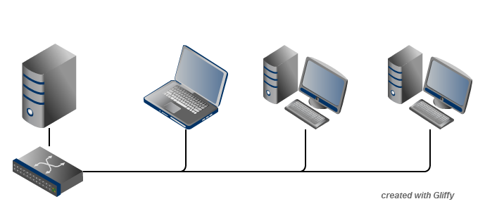

The Administrator/Installer tasks are hereby listed:

-   Server
    
    -   [Download](#download) the Open Hospital package for the selected Operating System (see [Prerequisites](#prereq))
        
    -   [Unpack](#unpack) the downloaded package on the server machine by uncompressing the archive in a folder of your choice
        
    -   [Install and configure MariaDB/MySQL](#database-server) on the server/computer that will act as the database server
        
    -   [Create the database](#ohdatabase-creation) through the execution of a script found in the _sql/_ folder
        
    -   [Test](#setup) and [run](#run) the application using the 'localhost' setting
        
    
-   Clients
    
    -   Unpack the downloaded package on a client machine in a folder of your choice
        
    -   [Configure](#setup) and [run](#run) the application to point to the database server using the hostname or the IP address
        
    -   Copy the newly configured package on every client
        
    

<a id="prereq"></a>

#### 2.1.1 Prerequisites - Software compatibility matrix

Before starting, check the following software compatibility matrix to verify the external software versions needed to run Open Hospital and the current available extended features for every version, architecture, and operating system. [./OH_software_compatibility_matrix.md](./OH_software_compatibility_matrix.md)

<a id="jre"></a>

#### 2.1.2 Java Runtime Environment (JRE)

Depending on the operating system, there are different ways to install the Java Runtime Environment (JRE). The **oh.sh / oh.bat** scripts can be used to download and install the latest JRE available; it is also possible to install it manually, following the specific instructions for the operating system being used.

> [!NOTE]
>
> See OH Software Compatibility Matrix to identify the correct Java version.

<a id="database-server"></a>

#### 2.1.3 Database Server

Depending on the operating system, there are several software tools to install and manage a MariaDB/MySQL database server. In most cases just a standard installation package of the software is needed, paying attention to configuration options during the installation process.

> [!NOTE]
>
> See OH Software Compatibility Matrix to identify the correct MariaDB / MySQL version.

> [!NOTE]
>
> MariaDB is the preferred alternative for the DBMS.

<a id="_2_1_3_1_mariadbmysql_server_installation"></a>

##### 2.1.3.1 MariaDB/MySQL - Server installation

Please refer to the latest MariaDB/MySQL Server online documentation for download<sup><a id="_footnoteref_4"></a>[4](#_footnotedef_4)</sup> and installation<sup><a id="_footnoteref_5"></a>[5](#_footnotedef_5)</sup> information while using this document.

**on a Linux machine**: during the installation, a “root” password must be defined; it is very important to choose it carefully and to keep it safe.

**on a Windows machine**: launch the installation and pay attention to the following steps:

-   Custom Setup
    
-   Install all components except Development Components
    
-   Select Modify password for database user 'root', choose the root password, and keep it safe
    
-   Select Enable access from remote machines for 'root' user
    
-   Select UTF8 as the default charset for Best Support For Multilingualism
    
-   Select Install as service
    
-   Select Enable networking and take note of the selected Port Number
    

> [!NOTE]
>
> MariaDB installer does not include the bin directory in the Windows PATH environment variable; it must be added manually to the Windows system variable PATH.

To check if the server is active and running, open a terminal window (command prompt) and type the following command:

`mysql –u root -p`

**Enter password:**

The terminal should reply with the MySQL client command line prompt:

**MariaDB>**

The prompt means that a successful connection to the database server instance has been established.

> [!NOTE]
>
> If the terminal does not reply as above most probably during installation the **Include Bin Directory in Windows PATH** option was not selected and therefore Windows can not find the mysql command. If this is the case add the path manually by searching "system variables" in the Control Panel or append the full path to the "mysql" command (e.g., "C:\\Program Files\\MySQL\\MySQL Server 5.0\\bin\\mysql" \[with the quotes\]). Another option is to uninstall and reinstall MySQL with the **Include** option selected.

<a id="_2_1_3_2_mariadbmysql_configuration"></a>

##### 2.1.3.2 MariaDB/MySQL - Configuration

Please use the following configuration values for MariaDB/MySQL server in _my.cnf_ config file. Values can be adjusted and adapted to the hardware resources available. Config file can be _my.ini_ or _my.cnf_; default for Windows MariaDB is _my.ini_ located at "C:\\Program Files\\MariaDB-\[VERSION\]\\data\\"

```
#
# Configuration to be inserted below last row of \[mysqld\] section
#
sql\_mode=STRICT\_TRANS\_TABLES,NO\_ZERO\_IN\_DATE,NO\_ZERO\_DATE,ERROR\_FOR\_DIVISION\_BY\_ZERO,NO\_AUTO\_CREATE\_USER,NO\_ENGINE\_SUBSTITUTION
max\_allowed\_packet = 4M # must match the value used on clients for DICOM\_SIZE
skip-external-locking
key\_buffer\_size = 16M
thread\_cache\_size = 64
lower\_case\_table\_names = 1
explicit\_defaults\_for\_timestamp = OFF
table\_open\_cache = 64
tmp\_table\_size = 16M
read\_buffer\_size = 256K
read\_rnd\_buffer\_size = 512K
join\_buffer\_size = 2M
sort\_buffer\_size = 2M
myisam\_sort\_buffer\_size = 8M

\[mysqldump\]
quick
max\_allowed\_packet = 16M

\[mysql\]
no-auto-rehash

\[isamchk\]
key\_buffer = 16M
sort\_buffer\_size = 16M
read\_buffer = 2M
write\_buffer = 2M

\[myisamchk\]
key\_buffer = 16M
sort\_buffer\_size = 16M
read\_buffer = 2M
write\_buffer = 2M
```

<a id="_2_1_3_3_mariadbmysql_networking"></a>

##### 2.1.3.3 MariaDB/MySQL - Networking

If deployed in a client-server, networked configuration, the database server must be configured to listen on the network interface connected to the local LAN; this can be achieved by editing the MariaDB/MySQL’s config file, _my.cnf_, and setting the "bind-address" parameter. For example, if you want the database server to listen on all the available network interfaces / IP addresses:

Change:

```properties
# Instead of skip-networking the default is now to listen only on
# localhost which is more compatible and is not less secure.
bind-address = 127.0.0.1
```

To:

```properties
# Instead of skip-networking the default is now to listen only on
# localhost which is more compatible and is not less secure.
bind-address = 0.0.0.0
```

In this way, the database server listens on any IP address (0.0.0.0) configured on the server and can serve the connecting clients.

It is also possible to specify a specific IP address, e.g:

bind-address = 192.168.1.100

<a id="ohdatabase-creation"></a>

#### 2.1.4 OH - Database creation

To create the Open Hospital database, a MySQL client and a set of SQL script files found under the _sql/_ folder are needed.

On a Microsoft Windows® system, MySQL Workbench® can be used as a client to connect to the database server and perform the needed tasks, while on Linux based systems the MySQL Administrator and MySQL Query Browser tools can be used.

The suggested approach is to use the command-line MariaDB/MySQL client which uses the same commands and syntax for every platform.

Open a terminal and navigate to the _sql/_ folder (e.g.):

```shell
C:\WINDOWS> cd C:\Users\OH\OpenHospital-v1.15.0\sql

C:\Users\OH\OpenHospital-v1.15.0\sql
```

and run the following command to connect to the database server (e.g.):

```shell
C:\Users\OH\OpenHospital-v1.15.0\sql> mysql -u root -p [-h hostname/ip address]
Enter password: *****
```

using the ‘root’ password chosen during the installation process. The terminal should reply with the MariaDB client command line prompt:

```shell
Welcome to the MariaDB monitor.  Commands end with ; or \g.
Your MariaDB connection id is 13
Server version: 10.6.11-MariaDB MariaDB Server

Copyright (c) 2000, 2018, Oracle, MariaDB Corporation Ab and others.

Type 'help;' or '\h' for help. Type '\c' to clear the current input statement.

MariaDB [(none)]>
```

we are now ready to create the database user (isf) with a password, the main OH database (oh) and grant the necessary permissions with the following SQL commands:

```sql
MariaDB> CREATE DATABASE oh CHARACTER SET utf8;
	 CREATE USER 'isf'@'localhost' IDENTIFIED BY 'isf123';
	 CREATE USER 'isf'@'%' IDENTIFIED BY 'isf123';
	 GRANT ALL PRIVILEGES ON oh.* TO 'isf'@'localhost';
	 GRANT ALL PRIVILEGES ON oh.* TO 'isf'@'%';
MariaDB> FLUSH PRIVILEGES;
```

> [!NOTE]
>
> "isf123" is used here as the default password. Change it for production setup!

To check if the database has been correctly created, enter the following command:

```shell
MariaDB> show databases;
+--------------------+
| Database           |
+--------------------+
| information_schema |
| mysql              |
| oh                 |
| performance_schema |
+--------------------+
```

The next step is to select the created database and execute the main SQL database creation script with the command:

```sql
MariaDB> use oh; source create_all_en.sql
```

> [!NOTE]
>
> The data can be installed in different languages by using the related "create\_all\_xx.sql" file or with demo data using the "create\_all\_demo.sql" file (English only).

> [!NOTE]
>
> If the error message "ERROR 1148 (42000): The used command is not allowed with this MySQL version" appears the "local infile" command must be enabled on the client by logging in again and specifying the "--local-infile=1" parameter after the "-p"; thus "mysql -u root -p --local-infile=1".

The SQL script creates the OH database structure and populates it with default data.

The ‘isf’ user, different from the ‘root’ one, is the user that the Open Hospital software uses to connect to the database and its password must be changed immediately with the command:

```sql
MariaDB> SET PASSWORD FOR 'isf'@'%' = PASSWORD('new-password-here');

Query OK, 1 row affected (0.00 sec)

Rows matched: 1 Changed: 1 Warnings: 0
```

And then:

```shell
MariaDB> FLUSH PRIVILEGES;

Query OK, 0 rows affected (0.00 sec)
```

```shell
MariaDB> quit;
```

> [!NOTE]
>
> Remember to set the updated database password also in the Open Hospital configuration files and startup scripts **oh.sh / oh.ps1**.

<a id="setup"></a>

#### 2.1.5 OH - CLIENT configuration

To set up the database connection for Open Hospital, edit and configure the database settings in the **oh.sh / oh.ps1** startup scripts.

Database settings are:

-   the **IP address** of the MariaDB/MySQL database server hosting the Open Hospital database. Replace “localhost” with the server IP address (e.g., 192.168.1.100)
    
-   the **TCP Port Number** of the database server - default is “3306"
    
-   the **Database name** of the OH installation - default is "oh"
    
-   the **Database user** of the OH database - default is "isf"
    
-   the **Database password** associated with the user
    

Please set them according to the values specified in the installation phase:

in **oh.sh / oh.ps1** scripts

```
$script:MYSQL_SERVER="127.0.0.1"
$script:MYSQL_PORT=3306
$script:MYSQL_ROOT_PW="tmp2021oh111"
$script:DATABASE_NAME="oh"
$script:DATABASE_USER="isf"
$script:DATABASE_PASSWORD="isf123"
```

> [!NOTE]
>
> "isf123" is used here as the default password. Change it for production setup!

After you can generate the config files: on Linux execute **oh.sh -g**, on Windows launch **oh.bat** and choose the option **g**.

**Alternative method**: you can first generate the config files with the **\-g** and after directly modify the _database.properties_ and _log4j2-spring.properties_ configuration files, located in the _oh/rsc/_ resource folder, without generating them every time.

Please set them according to the values specified in the installation phase:

in _database.properties_ config file

```
jdbc.url=jdbc:mysql://127.0.0.1:3306/oh
jdbc.username=isf
jdbc.password=isf123
```

in _log4j2-spring.properties_ config file

```
appender.jdbc.connectionSource.connectionString = mysql://127.0.0.1:3306/oh?autoReconnect=true
appender.jdbc.connectionSource.userName = isf
appender.jdbc.connectionSource.password = isf123
```

> [!NOTE]
>
> These settings are required for every Open Hospital installation/client.

More information on these files can be found in the [3\. Configuration](#configuration) section.

<a id="run"></a>

#### 2.1.6 OH - Startup and run

The Open Hospital software is now ready to be run by executing the proper launcher command:

-   on a Linux machine: **oh.sh -C** (CLIENT mode)
    
-   on a Windows machine: **oh.bat** (Select CLIENT mode from the interactive menu)
    

If everything is configured correctly, the Open Hospital main splash screen is presented:


And then the main Menu:

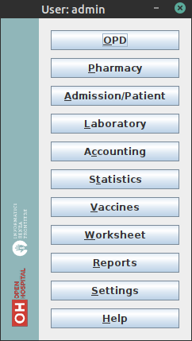

It is possible to create a shortcut (link) to the executable script on the desktop, in the Programs Menu or wherever is useful by using the provided icon “oh.ico” that is found in the package.


On Linux, it might be necessary to set the correct permissions to the **oh.sh** script:
```sh
chmod 755 ./oh.sh
```

> [!NOTE]
>
> Remember to review your setup in the Open Hospital configuration files and startup scripts **oh.sh / oh.ps1**.

<a id="portable"></a>

### 2.2 OH - PORTABLE mode

Open Hospital is a Java software program and it is portable by definition. The **PORTABLE** mode described in this chapter refers to the possibility of using OH as a self-contained package that includes Java, MariaDB/MySQL Server and all the data, without requiring any software installation. The package can be used on a single computer and used everywhere just by copying a folder - even onto an USB stick - carrying together all the saved data.

Pre-configured "Portable" packages are available for Windows and Linux; see the [Download](#download) section for more details.

Since the JRE and MariaDB/MySQL are not platform-independent and are provided in different versions and architectures, there exists:

-   **Open Hospital - portable for Linux** platforms (embedding Java JRE and MariaDB for Linux, 32 or 64bit)
    
-   **Open Hospital - portable for Windows** platforms (embedding Java JRE and MariaDB for Windows, 32 or 64bit)
    

Once the required version is downloaded, the application can be started by launching the script inside the package:

-   **oh.sh** in the Linux version
    
-   **oh.bat** in the Windows version
    

No other configuration is needed. Additional options can be shown by executing:

-   on Linux: **oh.sh -h**
    
-   on Windows: **oh.bat** and choose among the available options. See **oh.bat -h** for legacy mode help.
    

> [!NOTE]
>
> To use Open Hospital in PORTABLE mode for Linux from a USB key it is required that the file permissions in the archive remain unchanged once extracted, otherwise the launcher cannot launch or use the application in an appropriate manner.

> [!NOTE]
>
> Important: the PORTABLE mode is meant to try or test the software or to be used in a facility (like a dispensary) where only a single computer is available. If the facility is large and more clients/operators need to work on the same data, the full installation (client/server) in a networked architecture is recommended.

https://raw.githubusercontent.com/informatici/openhospital/master/oh-bundle/OH-README.md

<a id="server"></a>

### 2.3 OH - SERVER mode (portable)

Open Hospital can be launched in SERVER (portable) mode. SERVER mode launches a local instance of the database server and listens for connections from other clients. This mode is useful to test/simulate a client/server configuration or networked environment; it is not suggested for production setup. To setup a complete client / server configuration, refer to chapter [2.1.3 - Database Server](#database-server)

<a id="backup-restore"></a>

### 2.4 Backup & Restore

Backup of the Open Hospital database can be performed in several ways.

> [!NOTE]
>
> The easiest way is to use the provided scripts: on Linux execute **oh.sh -e**, on Windows launch **oh.bat** and choose the option **e**.

Restoring the Open Hospital database can also be performed in several ways.

> [!NOTE]
>
> The easiest way is to use the provided scripts: on Linux execute **oh.sh -e**, on Windows launch **oh.bat** and choose the option **e**.

<a id="backup-data"></a>

#### 2.4.1 Backup of database (alternative with MySQL Workbench®)

There are several ways to back up and restore **data** with MySQL. The recommended method is to use a common MySQL client such as MySQL Workbench®:

1.  Click on the **Administration** tab on the left side of the Navigator Panel
    
2.  Click on **Data Export** option
    
3.  Select the **oh** schema
    
4.  Select the required option from the dropdown below the tables list as required (the suggested option is **Dump Structure and Data**)
    
5.  Click on **Export to Self-Contained File**
    
6.  Adjust output file location as needed
    
7.  Select **Create Dump in a Single Transaction** checkbox
    
8.  Select **Include Create Schema** checkbox
    
9.  Click on the **Advanced Options** button and scroll down to the **Inserts** panel (see the second image below):
    
    1.  Select **complete-insert** checkbox
        
    2.  Uncheck **extended-insert** checkbox
        
    3.  Return to the main panel
        
    
10.  Select the **Start Export** button
     

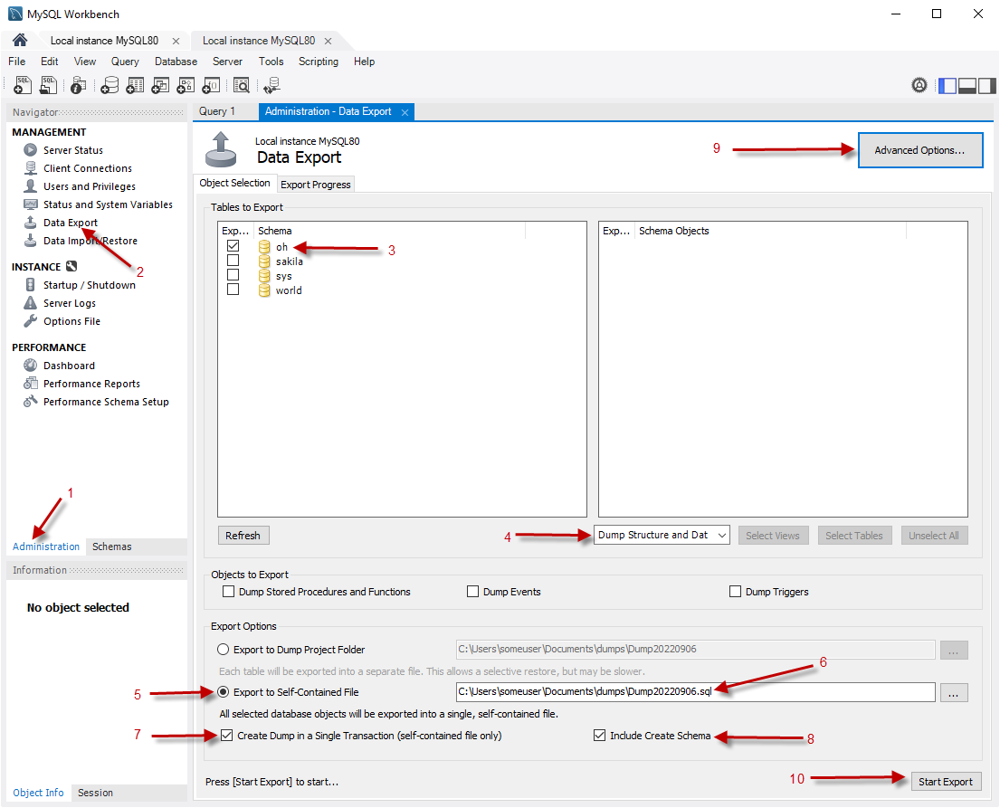

**Advanced Options** image:

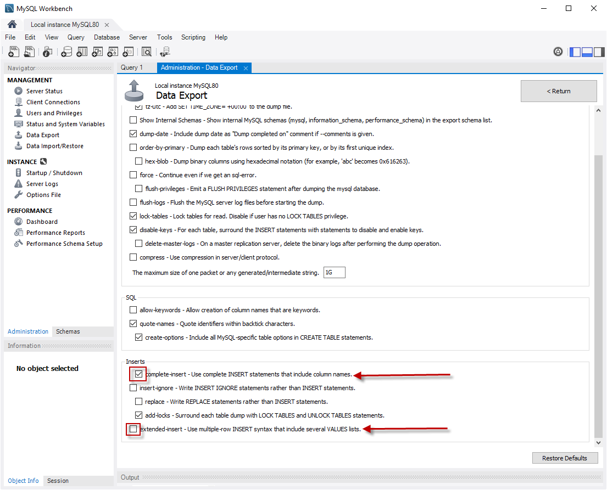

<a id="restore-data"></a>

#### 2.4.2 Restore of database (alternative with MySQL Workbench®)

To restore database data with MySQL Workbench®:

1.  Under **Server Administration** on the Home window select the server instance onto which the data will be restored (Create **New Server Instance** if doing it the first time).
    
2.  Click on **Manage Import/Export**
    
3.  Click on **Data Import/Restore** on the left side of the screen.
    
4.  Select **Import from Self-Contained File** radio button (right side of the screen)
    
5.  Select the path and the name of the restore sql file.
    
6.  Click the **Start Import** button at the right bottom corner of the window.
    

<a id="_2_4_3_backup_of_oh_code_and_settings"></a>

#### 2.4.3 Backup of OH code and settings

Backup of the Open Hospital **code and settings** can be performed by saving the **"oh"** folder (configuration files are found under the **"oh/rsc"** folder).

Backup of the client **data files**, useful for "PORTABLE" mode, can be performed by saving/copying the **"data"** folder (including all subfolders) found under the main OH installation path

<a id="folders"></a>

### 2.5 Folders and directory structure

Open Hospital has a folder tree hierarchy which is shown here, where **_<version>_** is replaced with the current Open Hospital version, **_<operating\_system>_** with windows or linux and **_<arch>_** with the OS architecture (32 or 64bit):

-   **OpenHospital-_<version>_\-<operating\_system>\_<arch>-<client|portable>**/
    
-   **bundle** – language files
    
-   **doc** – Open Hospital documentation
    
-   **lib** – Java libraries needed to run the software
    
-   **oh** – Open Hospital application
    
-   **oh/bin** – Open Hospital binaries (compiled software)
    
-   **oh/rpt\_base** – JasperReports® reports used by Open Hospital
    
-   **oh/rpt\_base/<lang>** – Language-specific translation files for reports in oh/rpt\_base
    
-   **oh/rpt\_base/PDF** – Reports defined in oh/rpt\_base generated by Open Hospital in PDF format
    
-   **oh/rpt\_stat** – JasperReports® reports used by Open Hospital in section Statistics
    
-   **oh/rpt\_stat/<lang>** – Language-specific translation files for reports in oh/rpt\_stat
    
-   **oh/rpt\_stat/PDF** – Reports defined in oh/rpt\_stat generated by Open Hospital in PDF format
    
-   **oh/rpt\_extra** – JasperReports® reports defined by the user
    
-   **oh/rpt\_extra/<lang>** – Language-specific translation files for reports in oh/rpt\_extra
    
-   **oh/rpt\_extra/PDF** – Reports defined in oh/rpt\_extra generated in PDF format
    
-   **oh/rsc** – **resources** of Open Hospital, as configuration files and other related files
    
-   **oh/rsc/icons** – icons used in Open Hospital for windows and buttons
    
-   **oh/rsc/images** – images used in Open Hospital
    
-   **data** – Open Hospital local data and configuration
    
-   **data/conf** – Database server configuration files
    
-   **data/db** – Database files (PORTABLE mode)
    
-   **data/logs** – Log files
    
-   **data/dicom** – Image files
    
-   **data/dump** – Database dumps/backups
    
-   **data/photo** – Patients photos
    
-   **sql** – Database creation scripts
    
-   **sql/extra** – SQL scripts for custom / experimental / temporary features
    
-   **tmp** – Temporary files
    

These folders may be organized differently depending on the version of the software or the architecture of the operating system.

Depending on the chosen operating system and architecture, the needed external applications and libraries (like MySQL/MariaDB and Java JRE) will be present also:

-   _zulu11.<version>-<operating\_system>_<arch>/ - Java Virtual Machine
    
-   _mariadb-<version>-<arch>/ or \_mysql-<version>-<arch>-<build>/_ - MySQL Server or MariaDB Server
    

<a id="_2_6_appearance"></a>

### 2.6 Appearance

Open Hospital’s main menu appearance can be customized by adding a logo of choice. To test the feature, rename the image file _logo\_hospital\_example.png_ found in the _oh/rsc/images_ folder to _logo\_hospital.png_:

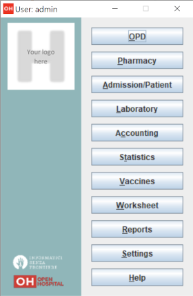

The custom logo has to be a 100x100 pixel png image file.

<a id="configuration"></a>

## 3 Configuration

Configuration of the local Open Hospital instance (CLIENT and PORTABLE mode) is set in the configuration files called “properties files”. The following properties files are found in the **oh/rsc** subfolder:

-   **database.properties** – Open Hospital database connection
    
-   **dicom.properties** – Imaging viewer module options
    
-   **examination.properties** – contains the settings for the ‘examination’ module
    
-   **log4j2-spring.properties** – Logging system and paths
    
-   **settings.properties** – Open Hospital options and settings
    
-   **sms.properties** – SMS Manager module
    
-   **telemetry.properties** – Telemetry module settings
    
-   **txtPrinter.properties** – Text printing system
    
-   **xmpp.properties** – Xmpp Server configuration
    
-   **default\_credentials.properties** – contains the default credentials
    

Furthermore, additional configurations files (not meant to be modified by the user) are:

-   **resolutions.xml** – stores locally the information about webcams
    
-   **version.properties** – contains the current Open Hospital version
    

The properties files are related only to the local instance of Open Hospital; different instances may use specific OH configurations with custom properties files. The properties files can be generated automatically from the packaged _.dist_ files by editing the configuration options available in the startup scripts **oh.sh / oh.ps1** and launching OH. The properties files can also be modified manually using a text editor.

> [!NOTE]
>
> Any change to these files requires an application restart to apply the modified settings.

> [!NOTE]
>
> The properties files can be automatically generated/overwritten at any Open Hospital startup, by setting the WRITE\_CONFIG\_FILES option to "on" in the **oh.sh / oh.ps1** scripts.

The following chapters will describe these properties files and their features in detail.

<a id="settings-properties"></a>

### 3.1 settings.properties

Open Hospital general configuration is set in the _settings.properties_ file. The default configuration is available in the _settings.properties.dist_ file:

```properties
###########################################
# This file contains Open Hospital settings
###########################################
# external settings
MODE=OH_MODE
DEMODATA=off

# experimental settings
APISERVER=off

# internal settings, modules, directories
LANGUAGE=OH_LANGUAGE
SINGLEUSER=YES_OR_NO
DEBUG=no
DOC_DIR=OH_DOC_DIR
PATIENTPHOTOSTORAGE=PHOTO_DIR
INTERNALVIEWER=yes
SMSENABLED=no
VIDEOMODULEENABLED=yes
XMPPMODULEENABLED=no
PARAMSURL=https://conf.open-hospital.org/oh-conf.json

# application settings
ENHANCEDSEARCH=no
INTERNALPHARMACIES=yes
LABEXTENDED=yes
LABMULTIPLEINSERT=yes
MATERNITYRESTARTINJUNE=no
MERGEFUNCTION=yes
OPDEXTENDED=yes
PATIENTEXTENDED=yes
PATIENTVACCINEEXTENDED=yes

# GUI settings
MAINMENUALWAYSONTOP=no

# accounting
ALLOWMULTIPLEOPENEDBILL=yes
ALLOWPRINTOPENEDBILL=yes
BILLSREPORT=BillsReport
BILLSREPORTMONTHLY=BillsReportMonthly
BILLSREPORTPENDING=BillsReportPending
PATIENTBILL=PatientBill
PATIENTBILLGROUPED=PatientBillGrouped
PATIENTBILLSTATEMENT=PatientBillStatement
RECEIPTPRINTER=yes

# pharmacy
AUTOMATICLOT_IN=no
AUTOMATICLOT_OUT=no
AUTOMATICLOTWARD_TOWARD=no
LOTWITHCOST=yes
PHARMACEUTICALORDER=PharmaceuticalOrder
PHARMACEUTICALSTOCK=PharmaceuticalStock_ver4
PHARMACEUTICALSTOCKLOT=PharmaceuticalStock_ver5
PHARMACEUTICALAMC=PharmaceuticalAMC

# dicom / imaging settings
DICOMMODULEENABLED=yes
DICOMTHUMBNAILS=yes

# reports
ADMCHART=patient_adm_chart
DISCHART=patient_dis_chart
EXAMINATIONCHART=patient_examination
OPDCHART=patient_opd_chart
PATIENTSHEET=patient_clinical_sheet_ver3
VISITSHEET=WardVisits

# security
SESSIONTIMEOUT=5
STRONGPASSWORD=yes
STRONGLENGTH=6
USERSLISTLOGIN=no
PASSWORDTRIES=5
PASSWORDLOCKTIME=60
PASSWORDIDLE=365
PASSWORDLEASE=0

# telemetry
TELEMETRYENABLED=yes
```

Every line is composed of a KEY and a value:

KEY=value

Values can be:

-   **Boolean**: yes | no or true | false
    
-   **String**: usually a filename or a country code (ISO 3166-1)
    

Use the provided startup scripts in order to automatically generate the _settings.properties_ file from the corresponding _.dist_ file; after generation, optionally adjust the KEY/value pair as explained in the following sections.

<a id="language"></a>

#### 3.1.1 LANGUAGE

The following table shows the allowed values for the OH\_LANGUAGE variable:

| Key | Default Value | Allowed Values |
| --- | --- | --- |
| LANGUAGE | en | ar, de, en, es, fr, it, pt, sw, zh\_CN |

Open Hospital is available in nine different languages, identified by the international country code:

-   ar – Arabic
    
-   de - German
    
-   en – English
    
-   es – Spanish
    
-   fr – French
    
-   it – Italian
    
-   pt – Portuguese
    
-   sw – Swahili
    
-   zh\_CN - simplified Chinese
    

To change the language used in the application edit _settings.properties_ and change the value of this key. If an unknown value is set, the local computer language is applied.

> [!NOTE]
>
> Report translation files are stored in language subfolders under `rpt_base`, `rpt_stat`, and `rpt_extra` (e.g. `rpt_base/es/`). Installations upgrading from a previous version should migrate their translation files from the legacy naming convention (e.g. `PatientBill_es.properties`) to the new subfolder structure. A temporary fallback for the legacy structure is available but will be removed in a future version.

> [!NOTE]
>
> An application restart is required to apply the modified setting.

> [!NOTE]
>
> The language (OH\_LANGUAGE) can be automatically set by using the provided **oh.sh / oh.ps1** scripts.

<a id="_3_1_2_singleuser"></a>

#### 3.1.2 SINGLEUSER

The following table shows the default value and the allowed ones:

| Key | Default Value | Allowed Values |
| --- | --- | --- |
| SINGLEUSER | yes | yes, no |

Open Hospital is designed to support multi-user usage. This means that it is possible to define different users, arrange them by group and set different rights in application usage; for instance, a user “receptionist” may be able to register a new patient but not to prescribe a therapy.

Open Hospital has a predefined user called “admin” that has access rights to all the features of the application. When SINGLEUSER is set to YES (default) the program starts with this user and all the features are available.

If SINGLEUSER is set to NO the following login window appears when the program is started:

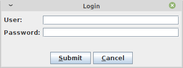

> [!NOTE]
>
> See [3.1.36 USERSLISTLOGIN](#users-list-login) in this document to change the login mode.

The default password for the “admin” user is “admin”. After typing this password in the white field and pressing **Submit**, the main **_Menu_** with the functions are enabled.

Once logged in as the “admin” user defining additional users and/or groups is possible (see the [Users & Groups](../doc_user/UserManual.md#users-groups) chapter in the User’s Guide), or just continue with a simple form of data protection.

> [!NOTE]
>
> The setting is client-side specific, this means that the login can be disabled on a specific client, but logons will still be required on other clients, with the same defined user and group.

> [!WARNING]
>
> Data security must never be left solely to the application but it must include proper network architecture and a rigid configuration of the clients.

<a id="_3_1_3_automaticlot"></a>

#### 3.1.3 AUTOMATICLOT

The following table shows the default value and the alternatives for lot management:

| Key | Default Value | Valid Values |
| --- | --- | --- |
| AUTOMATICLOT\_IN | no | yes, no |
| AUTOMATICLOT\_OUT | no | yes, no |
| AUTOMATICLOTWARD\_TOWARD | no | yes, no |

Open Hospital allows for automatic management of lots in the main pharmacy. This means that it is possible to work in the pharmacy without taking care of lot definitions in loading the store and just specify preparation and expiring date for each charging movement (see [4.2.2.2 Insert stock charging movement](../doc_user/UserManual.md#insert-stock-charging-movement) in the User’s Guide).

For discharging movement, the lot is automatically calculated according to the nearest expiring date of lots (FEFO - First Expiring First Out). If the quantity to discharge is larger than the quantity of the first selected lot, more than one discharging operation can be generated.

_AUTOMATIC LOTS MANAGEMENT_ is split into two different settings for charging and discharging the main pharmacy and managing lots also in the wards. In this way, more control is given to the user that may want to provide all the lots' details in _charging operations_ but ask the application to automatically _discharge_ the nearest expiring ones (FEFO). Similarly, in wards (see [4.3 Pharmaceuticals Stock Ward](../doc_user/UserManual.md#pharmaceutical-stock-ward) in the User’s Guide) the user may decide to manage lots manually or to ask the application to do it automatically.

With **AUTOMATICLOT\_IN = YES** the application generates a lot number automatically and only asks for an expiration date (mandatory). By default, AUTOMATICLOT\_IN is set to NO. It is possible to change the value at any time.

With **AUTOMATICLOT\_OUT = YES** the application discharges automatically the nearest expiring lot when required. By default, AUTOMATICLOT\_OUT is set to NO. It is possible to change the value at any time.

With **AUTOMATICLOTWARD\_TOWARD = YES**, the application discharges from a ward (to other wards) the nearest expiring lot automatically when required. By default, AUTOMATICLOTWARD\_TOWARD is set to NO. It is possible to change the value at any time. For discharges to patients (drug giving) the lot is **never** asked.

> [!NOTE]
>
> An application restart is required to apply the modified settings.

<a id="_3_1_4_lotwithcost"></a>

#### 3.1.4 LOTWITHCOST

The following table shows the default value and the allowed ones:

| Key | Default Value | Valid Values |
| --- | --- | --- |
| LOTWITHCOST | yes | yes, no |

Open Hospital allows for managing the cost of medicals in the main pharmacy (see [4.2.2.2 Insert stock charging movement](../doc_user/UserManual.md#insert-stock-charging-movement) in the User’s Guide).

> [!NOTE]
>
> An application restart is required to apply the modified setting.

<a id="_3_1_5_patientsheet"></a>

#### 3.1.5 PATIENTSHEET

The following table shows the default value and the allowed ones:

| Key | Default Value | Valid Values |
| --- | --- | --- |
| PATIENTSHEET | patient\_clinical\_sheet | any kind of .jasper file name |

Open Hospital can produce a report about the clinical history of a patient (see [8.9 Clinical Sheet](../doc_user/UserManual.md#_8_9_clinical_sheet_clinical_sheet) in the User’s Guide).

By default, PATIENTSHEET is set to patient\_clinical\_sheet, that is, the filename of the related report to use for the Clinical Sheet functionality. It is possible to use a different report by installing it in the report folder (see [Reports](#reports)) and by changing this parameter.

> [!NOTE]
>
> An application restart is required to apply the modified setting.

<a id="_3_1_6_opdchart"></a>

#### 3.1.6 OPDCHART

The following table shows the default value and the allowed ones:

| Key | Default Value | Valid Values |
| --- | --- | --- |
| OPDCHART | patient\_opd\_chart | any kind of .jasper file name |

Open Hospital can produce a report about the OPD chart of a patient (see [8.9 Clinical Sheet](../doc_user/UserManual.md#_8_9_clinical_sheet_clinical_sheet) in the User’s Guide).

By default, OPDCHART is set to patient\_opd\_chart which is the filename of the related report to use for the Clinical Sheet functionality **OPD Chart**. It is possible to use a different report by installing it in the report folder (see [Reports](#reports)) and by changing this parameter.

> [!NOTE]
>
> An application restart is required to apply the modified setting.

<a id="_3_1_7_admchart"></a>

#### 3.1.7 ADMCHART

The following table shows the default value and the allowed ones:

| Key | Default Value | Valid Values |
| --- | --- | --- |
| ADMCHART | patient\_adm\_chart | any kind of .jasper file name |

Open Hospital can produce a report about the Admission of a patient (see [8.9 Clinical Sheet](../doc_user/UserManual.md#_8_9_clinical_sheet_clinical_sheet) in the User’s Guide).

By default, ADMCHART is set to patient\_adm\_chart, that is, the filename of the related report to use for the Clinical Sheet functionality **Admission Chart**. It is possible to use a different report by installing it in the report folder (see [Reports](#reports)) and by changing this parameter.

> [!NOTE]
>
> An application restart is required to apply the modified setting.

<a id="_3_1_8_dischart"></a>

#### 3.1.8 DISCHART

The following table shows the default value and the allowed ones:

| Key | Default Value | Valid Values |
| --- | --- | --- |
| DISCHART | patient\_dis\_chart | any kind of .jasper file name |

Open Hospital can produce a report about the Discharge of a patient (see [8.9 Clinical Sheet](../doc_user/UserManual.md#_8_9_clinical_sheet_clinical_sheet) in the User’s Guide).

By default, DISCHART is set to patient\_dis\_chart which is the filename of the related report to use for the Clinical Sheet functionality **Discharge Chart**. It is possible to use a different report by installing it in the report folder (see [Reports](#reports)) and by changing this parameter.

> [!NOTE]
>
> An application restart is required to apply the modified setting.

<a id="_3_1_9_patientbill"></a>

#### 3.1.9 PATIENTBILL

The following table shows the default value and the allowed ones:

| Key | Default Value | Valid Values |
| --- | --- | --- |
| PATIENTBILL | PatientBill | any kind of .jasper file name |

Open Hospital can manage patient bills and produce an A4 format breakdown with his/her items and payments (see [6.2 Functions of Accounting](../doc_user/UserManual.md#_6_2_functions_of_accounting) in the User’s Guide).

By default, PATIENTBILL is set to PatientBill, that is, the filename of the related report to use for the bill printing functionality. It is possible to use a different report by installing it in the report folder (see [Reports](#reports)) and by changing this parameter.

> [!NOTE]
>
> An application restart is required to apply the modified setting.

<a id="_3_1_10_billsreport"></a>

#### 3.1.10 BILLSREPORT

The following table shows the default value and the allowed ones:

| Key | Default Value | Valid Values |
| --- | --- | --- |
| BILLSREPORT | BillsReport | any kind of .jasper file name |

Open Hospital can manage patient bills and produce a report about all bills paid (or not paid) within a span of time (see **8.2 Functions of Accounting** in the _User’s Guide_).

By default, BILLSREPORT is set to BillsReport, that is, the filename of the related report to use for the account printing functionality. It is possible to use a different report by installing it in the report folder (see [Reports](#reports)) and by changing this parameter.

> [!NOTE]
>
> An application restart is required to apply the modified setting.

<a id="_3_1_11_billsreportmonth"></a>

#### 3.1.11 BILLSREPORTMONTH

The following table shows the default value and the allowed ones:

| Key | Default Value | Valid Values |
| --- | --- | --- |
| BILLSREPORTMONTH | BillsReportMonth | any kind of .jasper file name |

Open Hospital can manage patient bills and produce a report about all bills paid (or not paid) monthly (see [6.2 Functions of Accounting](../doc_user/UserManual.md#_6_2_functions_of_accounting) in the User’s Guide).

By default, BILLSREPORTMONTH is set to BillsReportMonth, that is, the filename of the related report to use for the account printing functionality. It is possible to use a different report by installing it in the report folder (see [Reports](#reports)) and by changing this parameter.

> [!NOTE]
>
> An application restart is required to apply the modified setting.

<a id="_3_1_12_pharmaceuticalorder"></a>

#### 3.1.12 PHARMACEUTICALORDER

The following table shows the default value and the allowed ones:

| Key | Default Value | Valid Values |
| --- | --- | --- |
| PHARMACEUTICALORDER | PharmaceuticalOrder | any kind of .jasper file name |

Open Hospital can produce a report for the Pharmacy Stock critical levels which helps to identify which pharmaceuticals are running low and which ones need to be ordered (see [4.1 Pharmaceuticals](../doc_user/UserManual.md#pharmaceuticals) in the User’s Guide).

By default, PHARMACEUTICALORDER is set to PharmaceuticalOrder, which is the filename of the related report to use for the pharmacy printing functionality. It is possible to use a different report by installing it in the report folder (see [Reports](#reports)) and by changing this parameter.

> [!NOTE]
>
> An application restart is required to apply the modified setting.

<a id="_3_1_13_pharmaceuticalstock"></a>

#### 3.1.13 PHARMACEUTICALSTOCK

The following table shows the default value and the allowed ones:

| Key | Default Value | Valid Values |
| --- | --- | --- |
| PHARMACEUTICALSTOCK | PharmaceuticalStock | any kind of .jasper file name |

Open Hospital can produce a report for the Pharmacy Stock Status which identifies which pharmaceuticals are currently available (see **6.1 Pharmaceuticals** in the _User’s Guide_).

By default, PHARMACEUTICALSTOCK is set to PharmaceuticalStock which is the filename of the related report to use for the pharmacy printing functionality. It is possible to use a different report by installing it in the report folder (see [Reports](#reports)) and by changing this parameter.

> [!NOTE]
>
> An application restart is required to apply the modified setting.

<a id="_3_1_14_patientextended"></a>

#### 3.1.14 PATIENTEXTENDED

The following table shows the default value and the allowed ones:

| Key | Default Value | Valid Values |
| --- | --- | --- |
| PATIENTEXTENDED | yes | yes, no |

Open Hospital allows for the registration of a patient with extended or more detailed information (see [8.4 Insert a new Patient Extended](../doc_user/UserManual.md#insert-a-new-patient-extended) in the User’s Guide).

By default, PATIENTEXTENDED is set to yes. It is possible to set it to no to reduce the amount of data collected and so reduce the workload for the staff involved in data entry.

> [!NOTE]
>
> An application restart is required to apply the modified setting.

<a id="_3_1_15_opdextended"></a>

#### 3.1.15 OPDEXTENDED

The following table shows the default value and the allowed ones:

| Key | Default Value | Valid Values |
| --- | --- | --- |
| OPDEXTENDED | yes | yes, no |

Open Hospital can link every OPD visit to a registered patient to generate a comprehensive clinical history. For each visit, the user will be asked to select a registered patient or to register a new one, so each visit is attached to the patient’s history (see **5.3 OPD Extended** and **10.9 Clinical Sheet** in the _User’s Guide_).

By default, OPDEXTENDED is set to yes. It is possible to set it to no to reduce the amount of data to be collected (only age and sex, no patient registration) and so reduce the workload for the staff involved in data entry.

> [!NOTE]
>
> An application restart is required to apply the modified setting.

<a id="_3_1_16_maternityrestartinjune"></a>

#### 3.1.16 MATERNITYRESTARTINJUNE

The following table shows the default value and the allowed ones:

| Key | Default Value | Valid Values |
| --- | --- | --- |
| MATERNITYRESTARTINJUNE | no | yes, no |

Open Hospital allows changing the way the admissions in the Maternity ward are counted within the year; in Open Hospital the first admission of the year for every ward has progressive number 1 (one) and it increments itself automatically up to the end of the year; in some facilities, this is partially true and the progressive numbering starts from June only for the Maternity ward. This option controls which behavior is followed.

By default, MATERNITYRESTARTINJUNE is set to no.

> [!NOTE]
>
> An application restart is required to apply the modified setting.

<a id="_3_1_17_labextended"></a>

#### 3.1.17 LABEXTENDED

The following table shows the default value and the allowed ones:

| Key | Default Value | Valid Values |
| --- | --- | --- |
| LABEXTENDED | yes | yes, no |

Open Hospital can force every laboratory exam to be linked to a registered patient, to have a comprehensive clinical history. For each exam, the user will be asked to select a registered patient so from that moment the exam will be attached to the patient’s history (see [5.3.2 New Laboratory Exam](../doc_user/UserManual.md#_5_3_2_new_laboratory_exam_new) in the User’s Guide).

By default, LABEXTENDED is set to yes. Anyway, is possible to set it to no to reduce the amount of data to be collected (only name, age, sex, no patient registration) and so reduce the workload for the staff involved in data entry.

> [!NOTE]
>
> An application restart is required to apply the modified setting.

<a id="_3_1_18_labmultipleinsert"></a>

#### 3.1.18 LABMULTIPLEINSERT

The following table shows the default value and the allowed ones:

| Key | Default Value | Valid Values |
| --- | --- | --- |
| LABMULTIPLEINSERT | yes | yes, no |

Open Hospital can insert multiple laboratory tests per patient at one time to avoid the repetitive operation of selecting a patient or writing his/her name; note that the LABEXTENDED option must also be set to yes (see [5.3.3 Laboratory Multiple Insert](../doc_user/UserManual.md#laboratory-multiple-insert) in the User’s Guide).

By default, LABMULTIPLEINSERT is set to yes, but if LABEXTENDED is set to no it will be just ignored.

> [!NOTE]
>
> An application restart is required to apply the modified setting.

<a id="_3_1_19_internalpharmacies"></a>

#### 3.1.19 INTERNALPHARMACIES

The following table shows the default value and the allowed ones:

| Key | Default Value | Valid Values |
| --- | --- | --- |
| INTERNALPHARMACIES | yes | yes, no |

Open Hospital can register all dispensing to patients within a ward. Activating this option, the Pharmaceutical Stock Ward functionality will be available in the application.

By default, INTERNALPHARMACIES is set to yes.

> [!NOTE]
>
> An application restart is required to apply the modified setting.

<a id="_3_1_20_mergefunction"></a>

#### 3.1.20 MERGEFUNCTION

The following table shows the default value and the allowed ones:

| Key | Default Value | Valid Values |
| --- | --- | --- |
| MERGEFUNCTION | no | yes, no |

Open Hospital can merge two patients’ histories into one. This is particularly useful in the case of double registration where different information was collected over time. Activating this option, the Merge functionality will be available in the Admission/Patient module (see [Merge function](../doc_user/UserManual.md#_8_11_merge_function_merge) in the User’s Guide).

By default, MERGEFUNCTION is set to no.

> [!NOTE]
>
> An application restart is required to apply the modified setting.

<a id="_3_1_21_internalviewer"></a>

#### 3.1.21 INTERNALVIEWER

The following table shows the default value and the allowed ones:

| Key | Default Value | Valid Values |
| --- | --- | --- |
| INTERNALVIEWER | yes | yes, any executable filename in the path or with an absolute path |

Open Hospital can use a different PDF reader for generated reports. If this parameter is set to yes, the Jasper PDF Viewer is used (see [Report Launcher](../doc_user/UserManual.md#_9_2_report_launcher_launch_report) in the User’s Guide). If another PDF viewer is required, specify the executable’s filename; the executable must be available in the desktop environment.

**Example in Windows**:

```properties
INTERNALVIEWER=AcroRd32.exe

INTERNALVIEWER=C:\\Program Files (x86)\\Adobe\\Reader 10.0\\Reader\\AcroRd32.exe
```

> [!NOTE]
>
> Please note the double file and folder separator “\\\”.

**Example in Linux**:

```properties
INTERNALVIEWER=evince
```

By default, INTERNALVIEWER is set to yes.

> [!NOTE]
>
> An application restart is required to apply the modified setting.

<a id="_3_1_22_doc_dir"></a>

#### 3.1.22 DOC\_DIR

The following table shows the allowed value for the DOC\_DIR variable:

| Key | Default Value | Valid Values |
| --- | --- | --- |
| DOC\_DIR | doc | any path |

Open Hospital documentation is available [online](https://github.com/informatici/openhospital-doc); PDF versions of the manuals are packaged with every OH release in a folder that must be accessible by the application; this folder might change depending on the application version, or eventually be customized by the administrator (e.g., subfolder on the Desktop)

**Example in Windows**:

```properties
DOC_DIR=doc
DOC_DIR=C:\\Users\\user\\OneDrive\\Desktop\\doc
```

> [!NOTE]
>
> Please note the double file and folder separator “_\\\\_”.

**Example in Linux**:

```properties
DOC_DIR=doc
DOC_DIR=../doc
```

By default, DOC\_DIR is set to 'doc'.

> [!NOTE]
>
> An application restart is required to apply the modified setting.

> [!NOTE]
>
> The DOC\_DIR setting can be automatically generated/overwritten at any Open Hospital startup, by setting the WRITE\_CONFIG\_FILES option to "on" in the **oh.sh / oh.ps1** scripts.

<a id="_3_1_23_smsenabled"></a>

#### 3.1.23 SMSENABLED

The following table shows the default value and the allowed ones:

| Key | Default Value | Valid Values |
| --- | --- | --- |
| SMSENABLED | no | yes, no |

Open Hospital can indicate whether information can be sent to patients via SMS notifications. Enabling or disabling this option only affects the possibility to set, or not set, a therapy as notifiable (see [8.10.7 Notify & SMS](../doc_user/UserManual.md#_8_10_7_notify_sms) in the User’s Guide).

By default, SMSENABLED is set to no.

<a id="_3_1_23_1_gsm_configuration"></a>

##### 3.1.23.1 GSM Configuration

To set up a GSM device, the GSM mode has to be defined in the _sms.properties_ file (see [sms.properties](#sms-properties)).

The default settings for a GSM modem should work with the majority of GSM devices (like phones, smartphones, USB modems, etc…). The exception is the PORT parameter which must be changed to match the SERIAL port address used by the device plugged into the system.

If the PORT param is correct but Open Hospital is not able to communicate with the device (try switching to DEBUG log level – or lower - during this setup – see [log4j2-spring.properties](#log4j2-spring-properties)) and try to use the SetupGSM utility as explained in the next chapter.

<a id="_3_1_23_2_setupgsm_utility"></a>

##### 3.1.23.2 SetupGSM utility

To setup GSM communication it is possible to use the included SetupGSM utility and follow these instructions:

1.  Plug the device into the system and make sure the system recognizes it, loads a proper driver for it and assigns a serial port (COM)
    
2.  Launch the OH startup script and select the G option:
    
    -   On Windows launch **oh.bat** → select **G** option
        
    -   On Linux launch **oh.sh -G**
        
    
3.  Once the utility has started, it will scan all plugged devices and will try to recognize the modem (or phone) within them
    
4.  If the device is recognized as a modem, a confirmation message prompt is shown:
    

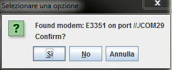

4.  If the identified device is the correct one, just click “yes”, otherwise click “no”, and the scan will continue
    
5.  Once “yes” is selected the _sms.properties_ file is automatically modified by the utility by inserting the proper port address.
    

<a id="_3_1_24_mainmenualwaysontop"></a>

#### 3.1.24 MAINMENUALWAYSONTOP

The following table shows the default value and the allowed ones:

| Key | Default Value | Valid Values |
| --- | --- | --- |
| MAINMENUALWAYSONTOP | no | yes, no |

Open Hospital can keep the main menu always on top so it cannot be overlapped or hidden by other windows.

By default, MAINMENUALWAYSONTOP is set to no.

> [!NOTE]
>
> An application restart is required to apply the modified setting.

<a id="receiptprinter"></a>

#### 3.1.25 RECEIPTPRINTER

The following table shows the default value and the allowed ones:

| Key | Default Value | Valid Values |
| --- | --- | --- |
| RECEIPTPRINTER | no | yes, no |

Open Hospital can manage text or ZPL printers with aim of printing simple receipts in the Accounting module (see [6.2.1.11 Print receipt](../doc_user/UserManual.md#_6_2_1_11_print_receipt_function) function in User’s Guide). Once this option is activated, additional parameters are needed in the **txtPrinter.properties file** to adjust the output with the printer connected to the system (see [txtPrinter.properties](#txtprinter-properties) in this document).

By default, RECEIPTPRINTER is set to no.

> [!NOTE]
>
> The text printer must be set as the default printer.

> [!NOTE]
>
> An application restart is required to apply the modified setting.

<a id="_3_1_26_videomoduleenabled"></a>

#### 3.1.26 VIDEOMODULEENABLED

The following table shows the default value and the allowed ones:

| Key | Default Value | Valid Values |
| --- | --- | --- |
| VIDEOMODULEENABLED | no | yes, no |

Open Hospital can drive any webcam with the aim of capturing patient images in the Admission/Patient module (see [8.4.3 Patient Photo](../doc_user/UserManual.md#_8_4_3_patient_photo_new_photo) function in User’s Guide). Once this option is activated the related button, **New Photo** in the **New Patient** window is available to start and use the webcam.

By default, VIDEOMODULEENABLED is set to no.

> [!NOTE]
>
> An application restart is required to apply the modified setting.

<a id="_3_1_27_patientvaccineextended"></a>

#### 3.1.27 PATIENTVACCINEEXTENDED

The following table shows the default value and the allowed ones:

| Key | Default Value | Valid Values |
| --- | --- | --- |
| PATIENTVACCINEEXTENDED | yes | yes, no |

Open Hospital can register vaccines given to patients (see [7 Vaccines](../doc_user/UserManual.md#vaccines) in the User’s Guide). This option allows toggling the patient’s full name in the **_Patient Vaccine Browser_** window.

By default, PATIENTVACCINEEXTENDED is set to yes.

> [!NOTE]
>
> An application restart is required to apply the modified setting.

<a id="_3_1_28_enhancedsearch"></a>

#### 3.1.28 ENHANCEDSEARCH

The following table shows the default value and the allowed ones:

| Key | Default Value | Valid Values |
| --- | --- | --- |
| ENHANCEDSEARCH | no | yes, no |

Open Hospital can optimize memory usage when the number of registered patients becomes large (see [8.2.2 Search patient Enhanced](../doc_user/UserManual.md#_8_2_2_search_patient_enhanced) in the User’s Guide). With the enhanced search only, the patient matching a search criterion will be loaded in the memory, otherwise, all patients registered in the system will be loaded in the **_Patient Browser_** window.

By default, ENHANCEDSEARCH is set to no. It is possible to toggle this option anytime to reduce the amount of memory needed by the computer or the server.

> [!NOTE]
>
> An application restart is required to apply the modified setting.

<a id="xmppmoduleenabled"></a>

#### 3.1.29 XMPPMODULEENABLED

The following table shows the default value and the allowed ones:

| Key | Default Value | Valid Values |
| --- | --- | --- |
| XMPPMODULEENABLED | no | yes, no |

Open Hospital embeds a technology that allows users logged into the application to chat and share information related to the hospital activities (see [11 Communication](../doc_user/UserManual.md#_11_communication_communication) in the User’s Guide); the SINGLEUSER option must be set to "no". If this option is active, Open Hospital will look for an XMPP Server at startup time.

See the [xmpp.properties](#xmpp-properties) chapter for instructions on how to setup and configure the XMPP Server communication.

By default, XMPPMODULEENABLED is set to no, but if SINGLEUSER is set to yes XMPPMODULEENABLED is ignored.

> [!NOTE]
>
> An application restart is required to apply the modified setting.

<a id="_3_1_30_dicommoduleenabled"></a>

#### 3.1.30 DICOMMODULEENABLED

The following table shows the default value and the allowed ones:

| Key | Default Value | Valid Values |
| --- | --- | --- |
| DICOMMODULEENABLED | no | yes, no |

Open Hospital includes a feature that allows attaching image files to a patient’s clinical sheet. When this option is enabled, an **Imaging** button is shown in the patient Clinical sheet module.

By default, DICOMMODULEENABLED is set to no.

> [!NOTE]
>
> An application restart is required to apply the modified setting.

<a id="_3_1_31_dicomthumbnails"></a>

#### 3.1.31 DICOMTHUMBNAILS

The following table shows the default value and the allowed ones:

| Key | Default Value | Valid Values |
| --- | --- | --- |
| DICOMTHUMBNAILS | yes | yes, no |

Open Hospital can enable or disable thumbnails in the Imaging Viewer.

By default, DICOMTHUMBNAILS is set to yes.

> [!NOTE]
>
> An application restart is required to apply the modified setting.

<a id="_3_1_32_debug"></a>

#### 3.1.32 DEBUG

The following table shows the default value and the allowed ones:

| Key | Default Value | Valid Values |
| --- | --- | --- |
| DEBUG | no | yes, no |

Open Hospital can run in debug mode which is useful to understand what is happening behind the user graphical interface. Currently, this option affects only the video module, which means that in place of the normal **New Patient** window (see [8.4.3 Patient Photo](../doc_user/UserManual.md#_8_4_3_patient_photo_new_photo) function in User’s Guide), the program opens the new special window shown below:

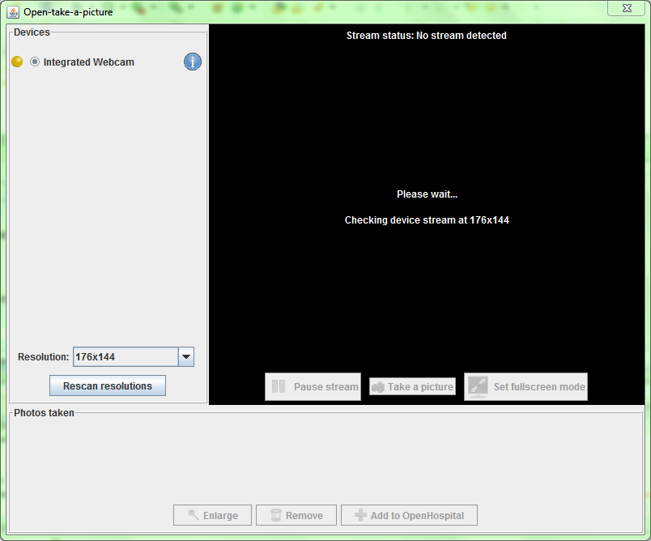

From this window it is possible to have more information about webcams connected to the system. It is possible to apply different resolutions in order to find the best setting or get information about a problem.

Once a photo is produced, Open Hospital remembers the settings and uses them in the future.

By default, DEBUG is set to no.

> [!NOTE]
>
> An application restart is required to apply the modified setting.

<a id="_3_1_33_allowmultipleopenedbill"></a>

#### 3.1.33 ALLOWMULTIPLEOPENEDBILL

The following table shows the default value and the allowed ones:

| Key | Default Value | Valid Values |
| --- | --- | --- |
| ALLOWMULTIPLEOPENEDBILL | no | yes, no |

Open Hospital allows a patient to have multiple open bills (invoices). If this option is enabled, when creating a new bill for a patient if that patient already has an open bill the user is asked to confirm the creation of another one.

By default, ALLOWMULTIPLEOPENEDBILL is set to no.

> [!NOTE]
>
> An application restart is required to apply the modified setting.

<a id="_3_1_34_openedbillsreport"></a>

#### 3.1.34 OPENEDBILLSREPORT

The following table shows the default value and the allowed ones:

| Key | Default Value | Valid Values |
| --- | --- | --- |
| OPENEDBILLSREPORT | OH023\_BillsReportMonth | OH023\_BillsReportMonth |

Open Hospital can print the list of open bills. The parameter contains the Jasper report file name to print the list of open bills.

By default, OPENEDBILLSREPORT is set to OH023\_BillsReportMonth.

> [!NOTE]
>
> An application restart is required to apply the modified setting.

<a id="_3_1_35_allowprintopenedbill"></a>

#### 3.1.35 ALLOWPRINTOPENEDBILL

The following table shows the default value and the allowed ones:

| Key | Default Value | Valid Values |
| --- | --- | --- |
| ALLOWPRINTOPENEDBILL | no | yes, no |

Open Hospital can print the receipt of a single open invoice. When the parameter is enabled, in the Accounting module under the pending tab one can select an open bill and get the receipt by clicking the Receipt button in the buttons panel.

By default, ALLOWPRINTOPENEDBILL is set to no.

> [!NOTE]
>
> An application restart is required to apply the modified setting.

<a id="users-list-login"></a>

#### 3.1.36 USERSLISTLOGIN

The following table shows the default value and the allowed ones:

| Key | Default Value | Allowed Values |
| --- | --- | --- |
| USERSLISTLOGIN | no | yes, no |

When Open Hospital is used in multi-user mode, i.e. SINGLEUSER = no, it is possible to choose between two different login modes:

(1) by typing the username directly in a textbox, if USERSLISTLOGIN is set to NO (default):


(2) by selecting the username from a list of users, if USERSLISTLOGIN is set to YES:

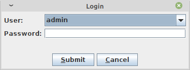

By default, USERSLISTLOGIN is set to no.

> [!NOTE]
>
> An application restart is required to apply the modified setting.

<a id="strongpassword"></a>

#### 3.1.37 STRONGPASSWORD

The following table shows the default value and the allowed ones:

| Key | Default Value | Allowed Values |
| --- | --- | --- |
| STRONGPASSWORD | yes | yes, no |

By default, the value of STRONGPASSWORD is set to yes indicating that the password must contain at least one alphabetic, numeric, and special character. The list of recognized special characters is: **\_$&+,:;=\\?@#|/'<>.^**()%!-\*

> [!NOTE]
>
> An application restart is required to apply the modified setting.

<a id="stronglength"></a>

#### 3.1.38 STRONGLENGTH

The following table shows the default value and the allowed ones:

| Key | Default Value | Allowed Values |
| --- | --- | --- |
| STRONGLENGTH | 6 | 0 or a positive integer value |

The value of STRONGLENGTH is the minimum length of a user’s password. To disable the checking of the password’s length set STRONGLENGTH to 0.

> [!NOTE]
>
> If STRONGPASSWORD is set to **yes**, then STRONGLENGTH should be set to a value greater than or equal to 3 as that is the minimum number of unique characters required.

> [!NOTE]
>
> An application restart is required to apply the modified setting.

<a id="passwordtries"></a>

#### 3.1.39 PASSWORDTRIES

The following table shows the default value and the allowed ones:

| Key | Default Value | Allowed Values |
| --- | --- | --- |
| PASSWORDTRIES | 5 | 0 or a positive integer value greater than or equal to 5 |

The value of PASSWORDTRIES is the maximum number of consecutive failed passwords when attempting to log in before the account is locked. To disable the checking of the consecutive failed attempts set PASSWORDTRIES to 0.

> [!NOTE]
>
> An application restart is required to apply the modified setting.

<a id="passwordlocktime"></a>

#### 3.1.40 PASSWORDLOCKTIME

The following table shows the default value and the allowed ones:

| Key | Default Value | Allowed Values |
| --- | --- | --- |
| PASSWORDLOCKTIME | 60 | a positive integer value greater than or equal to 60; the unit of time is minutes |

The value of PASSWORDLOCKTIME is the number of minutes that an account is locked after failing to specify the correct password for the number of times specified by the PASSWORDTRIES variable described above.

> [!NOTE]
>
> An application restart is required to apply the modified setting.

<a id="passwordidle"></a>

#### 3.1.41 PASSWORDIDLE

The following table shows the default value and the allowed ones:

| Key | Default Value | Allowed Values |
| --- | --- | --- |
| PASSWORDIDLE | 365 | a positive integer value greater than or equal to 0; the unit of time is days |

The value of PASSWORDIDLE specifies the maximum number of days that an account can be unused before being locked and requiring intervention by the administrator. To disable this check set PASSWORDIDLE to 0.

> [!NOTE]
>
> An application restart is required to apply the modified setting.

<a id="_3_1_42_patientphotostorage"></a>

#### 3.1.42 PATIENTPHOTOSTORAGE

The following table shows the default value and the allowed ones:

| Key | Default Value | Valid Values |
| --- | --- | --- |
| PATIENTPHOTOSTORAGE | DB | DB, _<path\_to\_folder>_ |

Open Hospital can save the patient’s profile picture in the database or on the file system.

> [!NOTE]
>
> The maximum size for a patient’s profile picture is limited to 32,768 bytes. If a bigger image is provided, it will automatically be resized.

If the PATIENTPHOTOSTORAGE parameter is set to a path (that is, not "DB"), then Open Hospital looks for or saves the patient’s profile picture in the specified path.

If the PATIENTPHOTOSTORAGE parameter is set to "DB", then Open Hospital looks for or saves the patient’s profile picture in the Open Hospital database.

By default, PATIENTPHOTOSTORAGE is set to "DB".

> [!NOTE]
>
> An application restart is required to apply the modified setting.

<a id="_3_1_43_sessiontimeout"></a>

#### 3.1.43 SESSIONTIMEOUT

The following table shows the default value and the allowed ones:

| Key | Default Value | Allowed Values |
| --- | --- | --- |
| SESSIONTIMEOUT | 5 | positive integer value |

The value SESSIONTIMEOUT represents the time in minutes of user inactivity beyond which the software application performs the automatic logout.

> [!NOTE]
>
> An application restart is required to apply the modified setting.

<a id="_3_1_44_examinationchart"></a>

#### 3.1.44 EXAMINATIONCHART

The following table shows the default value and the allowed ones:

| Key | Default Value | Allowed Values |
| --- | --- | --- |
| EXAMINATIONCHART | patient\_examination | any kind of .jasper file name |

Open Hospital can produce a report about patient\_examinations. (see [8.5.2 Patient Examination](../doc_user/UserManual.md#patient-examination) in the User’s Guide).

By default, EXAMINATIONCHART is set to patient\_examination which is the filename of the related report to use for the **Patient Examination** functionality. It is possible to use a different report by installing it in the report folder (see [Reports](#reports)) and by changing this parameter.

> [!NOTE]
>
> An application restart is required to apply the modified setting.

<a id="_3_1_45_visitsheet"></a>

#### 3.1.45 VISITSHEET

The following table shows the default value and the allowed ones:

| Key | Default Value | Allowed Values |
| --- | --- | --- |
| VISITSHEET | WardVisits | any kind of .jasper file name |

By default, VISITSHEET is set to WardVisits which is the filename of the related report to use for the **Visit Sheet** functionality. It is possible to use a different report by installing it in the report folder (see [Reports](#reports)) and by changing this parameter.

> [!NOTE]
>
> An application restart is required to apply the modified setting.

<a id="telemetryenabled"></a>

#### 3.1.46 TELEMETRYENABLED

The following table shows the default value and the allowed ones:

| Key | Default Value | Allowed Values |
| --- | --- | --- |
| TELEMETRYENABLED | yes | yes, no |

By default, the value of TELEMETRYENABLED is the set to `yes` indicating that the Telemetry module is enabled.

When the Telemetry module is enabled, users are presented with the option to participate in anonymous data collection on the software’s usage during the initial application launch. This process is designed to gather information that contributes to the ongoing improvement of software quality.

On the first telemetry configuration, all data categories are selected by default. The mandatory identification category cannot be deselected; users can deselect any optional category before opting in. Preselected categories do not enable telemetry or send data: users must accept the telemetry agreement and explicitly confirm the data before it is sent. When the configuration is reopened, the saved category choices are restored, including categories previously deselected. Disabling telemetry preserves these choices for later review.

The collected data is transmitted to a server managed by ISF, solely for the purpose of optimizing the application and generating usage statistics. ISF ensures that this data is treated anonymously and with utmost respect for user privacy.

The Telemetry module can be disabled at any time through the Settings menu or via [settings.properties](#settings-properties).

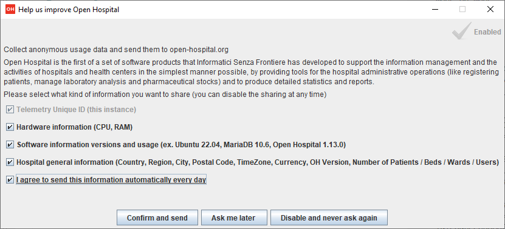

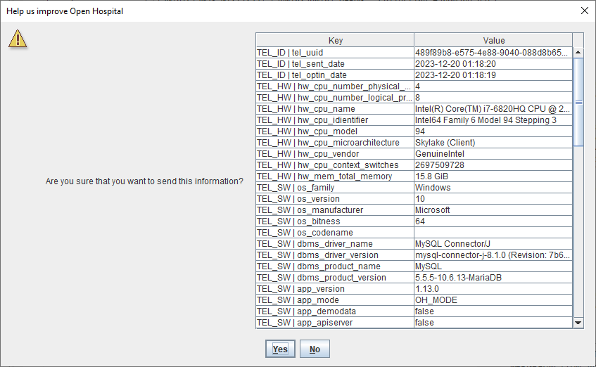

<a id="paramsurl"></a>

#### 3.1.47 PARAMSURL

This is the URL of the online configuration/parameters file.

> [!NOTE]
>
> This setting is not meant to be modified by the user.

<a id="passwordlease"></a>

#### 3.1.48 PASSWORDLEASE

The following table shows the default value and the allowed ones:

| Key | Default Value | Allowed Values |
| --- | --- | --- |
| PASSWORDLEASE | 0 | a positive integer value greater than or equal to 0; the unit of time is days |

The value of PASSWORDLEASE specifies the maximum number of days a password remains valid (the password lease). When the lease expires, the user is required to change the password at the next login, before being granted access to the application, both in the desktop GUI and in the web UI. To disable the password lease set PASSWORDLEASE to 0 (the default).

In addition, a password assigned by an administrator (when creating a user or resetting another user’s password) must be changed by the user at the first login, regardless of the PASSWORDLEASE value.

> [!NOTE]
>
> For production environments a value of 90 days is recommended.

> [!NOTE]
>
> An application restart is required to apply the modified setting.

<a id="database-properties"></a>

### 3.2 database.properties

Database configuration is set in the _database.properties_ file. Default database configuration is available in the _database.properties.dist_ file:

```properties
jdbc.url=jdbc:mysql://DBSERVER:DBPORT/DBNAME
jdbc.username=DBUSER
jdbc.password=DBPASS
```

Use the provided startup scripts in order to automatically generate the _database.properties_ file from the corresponding _.dist_ file; after generation, optionally adjust the following parameters:

-   **DBSERVER**: the IP address of the OH database server. IP address can be set to:  
    _127.0.0.1_ – localhost / loopback network interface (local computer)  
    _192.168.0.100_ – an example of a private IP address (LAN)  
    _217.147.110.117_ – an example of a public IP address (WAN)
    
-   **DBPORT**: the TCP port of the OH database server - default is "3306"
    
-   **DBNAME**: the database name - default is "oh"
    
-   **DBUSER**: the database user - default is "isf"
    
-   **DBPASS**: the database user password
    

> [!NOTE]
>
> An application restart is required to apply the modified setting.

> [!NOTE]
>
> The same settings must be applied in _log4.properties_, see [log4j2-spring.properties](#log4j2-spring-properties) in this manual.

> [!NOTE]
>
> The _database.properties_ file can be automatically generated/overwritten at any Open Hospital startup, by setting the WRITE\_CONFIG\_FILES option to "on" in the **oh.sh / oh.ps1** scripts.

<a id="_3_3_dicom_properties"></a>

### 3.3 dicom.properties

Imaging configuration is set in the _dicom.properties_ file. A default imaging configuration is available in the _dicom.properties.dist_ file:

```properties
#dicom.manager.impl=org.isf.dicom.manager.FileSystemDicomManager        # filesystem storage
#dicom.manager.impl=org.isf.dicom.manager.SqlDicomManager               # database storage
#dicom.max.size=1024B, 2048B, 1M, 16M, 256M, 512M, 1024M, 1G            # image size examples
dicom.manager.impl=org.isf.dicom.manager.DICOM_STORAGE
dicom.storage.filesystem=OH_PATH_SUBSTITUTE/DICOM_DIR
dicom.max.size=DICOM_SIZE
```

Use the provided startup scripts in order to automatically generate the _dicom.properties_ file from the corresponding _.dist_ file; after generation, optionally adjust the following parameters:

-   **DICOM\_STORAGE**: This property accepts one of the following:
    
    -   SqlDicomManager: Image files are stored in the database
        
    -   FileSystemDicomManager: Image files are stored in the file system
        
    
-   **OH\_PATH\_SUBSTITUTE/DICOM\_DIR**: if the value of the first parameter is set to "FileSystemDicomManager", this property specifies the path where the image files are stored. It is possible to specify a local folder (_data/dicom\_storage_ is the default path under the OH installation folder) or to set a shared network folder, useful for LAN - client/server environment. The suggested configuration is to map the network/NFS folder under the _data/dicom\_storage_ path with a symbolic link. The shared folder needs read/write permissions for uploading images. Always use slash "/" in the path variable and not backslash "\\".
    
-   **DICOM\_SIZE**: maximum allowed size for a dicom/jpg image (the MariaDB/MySQL server setting max\_allowed\_packet should be set with the same or a larger value). If not specified the default value of "4M" is used.
    

Example _dicom.properties_ file:

```properties
dicom.manager.impl=org.isf.dicom.manager.FileSystemDicomManager
dicom.storage.filesystem=Z:/OH/Shared/Dicom_images
dicom.max.size=4M
```

> [!NOTE]
>
> The _dicom.properties_ file can be automatically generated/overwritten at any **oh.sh / oh.ps1** startup, by setting the WRITE\_CONFIG\_FILES option to "on" in the **oh.sh / oh.ps1** scripts.

<a id="_3_4_examination_properties"></a>

### 3.4 examination.properties

The examination module configuration is set in the _examination.properties_ file. A default configuration file for this module is available in the _examination.properties.dist_ file:

```properties
# This file contains PatientExamination module settings
LIST_SIZE = 10
HEIGHT_MIN = 0
HEIGHT_MAX = 250
HEIGHT_INIT = 0
#HEIGHT_STEP = 1
#WEIGHT_UNIT = kg
WEIGHT_MIN = 0
WEIGHT_MAX = 200
WEIGHT_INIT = 0
WEIGHT_STEP = 0.1
#AP_UNIT = mmHg
AP_MIN_INIT = 80
AP_MAX_INIT = 120
#HR_UNIT = bpm
HR_MIN = 0
HR_MAX = 240
HR_INIT = 60
#TEMP_UNIT = *C
TEMP_INIT = 36
TEMP_MIN = 30
TEMP_MAX = 50
TEMP_STEP = 0.1
#SAT_UNIT = %
SAT_INIT = 98
SAT_MIN = 50
#SAT_MAX = 100
SAT_STEP = 0.1
HGT_MIN = 30
HGT_MAX = 600
HGT_INIT = 80
DIURESIS_MIN = 0
DIURESIS_MAX = 2500
DIURESIS_INIT = 100
RR_INIT = 20
RR_MIN = 0
RR_MAX = 100
```

-   **LIST\_SIZE**: the maximum number of examinations that can be viewed in the history. Must be less than or equal to 10
    
-   **HEIGHT\_MIN**: the height minimum value (in cm), used to initialize the height slider in the **_Patient Examination_** window
    
-   **HEIGHT\_MAX**: the height maximum value (in cm), used to initialize the height slider in the **_Patient Examination_** window
    
-   **HEIGHT\_INIT**: the height default value (in cm)
    
-   **WEIGHT _MIN_**_: the weight minimum value (in Kg), used to initialize the Weight slider in the **\_Patient Examination**_ window
    
-   **WEIGHT _MAX_**_: the weight maximum value (in Kg), used to initialize the Weight slider in the **\_Patient Examination**_ window
    
-   **WEIGHT \_INIT**: the weight default value (in Kg)
    
-   **WEIGHT \_STEP**: the step (in Kg) used when moving the weight slider
    
-   **AP \_MIN**: the Arterial pressure minimum value (in mmHg)
    
-   **AP \_MAX**: the Arterial pressure maximum value (in mmHg)
    
-   **HR \_MIN**: the Heart rate minimum value (in bmp)
    
-   **HR \_MAX**: the Heart rate maximum value (in bmp)
    
-   **HR \_INIT**: the Heart rate default value (in bmp)
    
-   **TEMP \_INIT**: the temperature default value (in °C)
    
-   **TEMP \_MIN**: the temperature minimum value (in °C)
    
-   **TEMP \_MAX**: the temperature maximum value (in °C)
    
-   **TEMP \_STEP**: the temperature step (in °C) used when moving the slider
    
-   **SAT \_INIT**: the saturation default value (%)
    
-   **SAT \_MIN**: the saturation minimum value (%)
    
-   **SAT \_STEP**: the saturation step (%) used when moving the slider
    
-   **HGT\_INIT**: = the Hemo Glucose Test default value (in mg/dl)
    
-   **DIURESIS\_INIT**: = the Daily Urine Volume default value (in ml)
    

<a id="log4j2-spring-properties"></a>

### 3.5 log4j2-spring.properties

The logging configuration is set in the _log4j2-spring.properties_ file. Default logging configuration is available in the _log4j2-spring.properties.dist_ file:

```properties
status = INFO
rootLogger.level = INFO
rootLogger.appenderRef.console.ref = STDOUT
rootLogger.appenderRef.rolling.ref = RollingFile

# Direct log messages to STDOUT
appender.console.type = Console
appender.console.name = STDOUT
appender.console.layout.type = PatternLayout
appender.console.layout.pattern = [%d{dd/MMM/yyyy HH:mm:ss}] [%X{OHUserGroup}:%X{OHUser}] %-p - %m%n

# File Appender (with classes), daily rotation
appender.rolling.type = RollingFile
appender.rolling.name = RollingFile
appender.rolling.fileName= LOG_DEST/openhospital.log
appender.rolling.filePattern= LOG_DEST/openhospital.log.%d{yyyy-MM-dd}
appender.rolling.layout.type = PatternLayout
appender.rolling.layout.pattern = [%d{dd/MMM/yyyy HH:mm:ss}] [%X{OHUserGroup}:%X{OHUser}] %-p - %m (%l)%n
appender.rolling.policies.type = Policies
# To change log file every day
appender.rolling.policies.time.type = TimeBasedTriggeringPolicy
appender.rolling.policies.time.interval = 1
appender.rolling.policies.time.modulate = true


# DB Appender (table columns)
appender.jdbc.type = JDBC
appender.jdbc.name = jdbc
appender.jdbc.connectionSource.driverClassName = com.mysql.cj.jdbc.Driver
appender.jdbc.connectionSource.type = DriverManager
appender.jdbc.connectionSource.connectionString = dbc:mysql://DBSERVER:DBPORT/DBNAME?autoReconnect=true
appender.jdbc.connectionSource.userName = DBUSER
appender.jdbc.connectionSource.password = DBPASS
appender.jdbc.tableName = logs
appender.jdbc.ignoreExceptions = false
appender.jdbc.columnConfigs[0].type = COLUMN
appender.jdbc.columnConfigs[0].name = LOG_TIME
appender.jdbc.columnConfigs[0].pattern = %d
appender.jdbc.columnConfigs[0].isUnicode = false
appender.jdbc.columnConfigs[1].type = COLUMN
appender.jdbc.columnConfigs[1].name = LOG_LEVEL
appender.jdbc.columnConfigs[1].pattern = %5p
appender.jdbc.columnConfigs[1].isUnicode = false
appender.jdbc.columnConfigs[2].type = COLUMN
appender.jdbc.columnConfigs[2].name = MESSAGE
appender.jdbc.columnConfigs[2].pattern = %mm%ex%n
appender.jdbc.columnConfigs[2].isUnicode = false


# Assigning appenders to Hibernate packages (DB loggers)
# - hibernate.SQL to DEBUG for SQL queries to be logged
# - hibernate.type to TRACE for queries parameters to be logged with "binding parameter [?]"
##logger.hibernate-SQL.name=org.hibernate.SQL
##logger.hibernate-SQL.level=DEBUG
##
##logger.hibernate-type.name=org.hibernate.type
##logger.hibernate-type.level=TRACE
```

Use the provided OH startup scripts in order to automatically generate the _log4j2-spring.properties_ file from the corresponding _.dist_ file; after generation, optionally adjust the following parameters:

-   **DBSERVER**: the IP address of the OH database server. IP address can be set to:  
    _127.0.0.1_ – localhost / loopback network  
    _192.168.0.100_ – an example of a private IP address (LAN)  
    _217.147.110.117_ – an example of a public IP address (WAN)
    
-   **DBPORT**: the TCP port of the OH database server - default is "3306"
    
-   **DBNAME**: the database name - default is "oh"
    
-   **DBUSER**: the database user - default is "isf"
    
-   **DBPASS**: the database user password
    
-   **LOG\_LEVEL**: the OH application log level - can be set to INFO|DEBUG|TRACE
    

> [!NOTE]
>
> The same settings must be applied in the _database.properties_ configuration file, see [database.properties](#database-properties) in this manual.

```properties
status = INFO
rootLogger.level = INFO
rootLogger.appenderRef.rolling.ref = RollingFile
```

To investigate bugs or issues, the log level can be increased to "TRACE" in order to log more detailed information:

```properties
status = TRACE
rootLogger.level = TRACE
rootLogger.appenderRef.rolling.ref = RollingFile
```

Logging can be routed to the database (DB) by adding the respective **appender**:

```properties
status = INFO
rootLogger.level = INFO
rootLogger.appenderRef.console.ref = STDOUT
rootLogger.appenderRef.rolling.ref = RollingFile
rootLogger.appenderRef.db = JDBC
```

Logging can also be routed to standard output (the console window) with:

```properties
status = INFO
rootLogger.level = INFO
rootLogger.appenderRef.console.ref = STDOUT
rootLogger.appenderRef.rolling.ref = RollingFile
```

If the DB appender is specified, the configuration must be set to match the settings in the _database.properties_ file (see [database.properties](#database-properties)).

> [!NOTE]
>
> The _log4j2-spring.properties_ file can be automatically generated/overwritten at any Open Hospital startup, by setting the WRITE\_CONFIG\_FILES option to "on" in the **oh.sh / oh.ps1** scripts.

> [!NOTE]
>
> DEBUG mode can generate large log files and should be avoided in a production environment.

> [!NOTE]
>
> An application restart is required to apply the modified setting.

<a id="sms-properties"></a>

### 3.6 sms.properties

The SMS communication module configuration is set in the _sms.properties_ file. A default configuration file for this module is available in the _sms.properties.dist_ file:

```properties
##################################################################
# Global configuration
##################################################################
# use: gsm-gateway-service || skebby-gateway-service || textbelt-gateway-service
sms.gateway=textbelt-gateway-service
sms.gateway.thread.timeout=3000
sms.gateway.thread.loop=15
sms.gateway.thread.icc=+39

... other sections
```

-   **sms.gateway**: the SMS sender mode. Can take three values:
    
    -   **gsm-gateway-service**: requires a GSM modem connected to a COM port. The administrator should configure the SMSGateway/GSM.properties file to set the suitable PORT.
        
    -   **skebby-gateway-service**: requires a Skebby provider account.
        
    -   **textbelt-gateway-service**: requires a Textbelt provider account.
        
    
-   **TIMEOUT**: the timeout for the HTTP request. Required when sms.gateway is set to skebby-gateway-service or textbelt-gateway-service.
    
-   **LOOP**: the delay used by the sender to fetch new SMS operations. The value is in seconds.
    
-   **ICC**: the International Country Code that needs to be added to the phone numbers (if missing).
    

<a id="_3_6_1_skebby_gateway_service"></a>

#### 3.6.1 skebby-gateway-service

The default skebby-gateway-service section is:

```properties
##################################################################
# Skebby configuration
##################################################################
skebby-gateway-service.username=
skebby-gateway-service.password=
skebby-gateway-service.ribbon.base-url=https://api.skebby.it:443
# USER_KEY and ACCESS_TOKEN avoids the login call every time we need to send sms
skebby-gateway-service.accessToken=
skebby-gateway-service.userKey=
```

This file defines the parameters for sending SMS using the Skebby HTTP API.

-   **username**: the username for authenticating to the Skebby server.
    
-   **password**: the password for authenticating to the Skebby server.
    
-   **ribbon.base-url**: the URL of the Skebby HTTP API.
    
-   **accessToken**: the token generated by the Skebby provider upon user request (it replaces username)
    
-   **userKey**: the key generated by the Skebby provider upon user request (it replaces password)
    

<a id="_3_6_2_textbelt_gateway_service"></a>

#### 3.6.2 textbelt-gateway-service

The default textbelt-gateway-service section is:

```properties
##################################################################
# Textbelt configuration
##################################################################
# enables/disables server testing mode (so that textbelt will do fake actions)
textbelt-gateway-service.enable-testing-mode=false
# use: textbelt (in order to send 1 free sms per day) or your api key (if you purchased sms)
textbelt-gateway-service.key=textbelt
textbelt-gateway-service.ribbon.base-url=https://textbelt.com:443
```

This file defines the parameters for sending SMS using the Skebby HTTP API.

-   **enable-testing-mode**: if set to "true", textbelt will do fake actions upon user/application requests.
    
-   **key**: the API key (if using a purchased sms) from Textbelt provider (one can use "textbelt" to send 1 free sms per day)
    
-   **ribbon.base-url**: The URL of the Textbelt HTTP API.
    

<a id="telemetry-properties"></a>

### 3.7 telemetry.properties

The telemetry configuration is set in the _telemetry.properties_ file. A default configuration file for this module is available in the _telemetry.properties.dist_ file:

```properties
# number of seconds to check if it should send a message
telemetry.daemon.thread.loop.seconds=14400

# enabled remote geo ip lookup service
# allowed values:
# - geoiplookup-remote-service
# - ipapi-remote-service
telemetry.enabled.geo.ip.lookup.service=geoiplookup-remote-service
# endpoints remote services
geoiplookup-remote-service.ribbon.base-url=https://json.geoiplookup.io
ipapi-remote-service.ribbon.base-url=http://ip-api.com/json
```

This file is used only if the TELEMETRYENABLED flag is true (see [TELEMETRYENABLED](#telemetryenabled) in this document).

The file has the following configurable parameters:

-   **telemetry.daemon.thread.loop.seconds**: number of seconds the Telemetry module should try again to send the telemetry data; if the telemetry data have been sent in the same day it will not send again.
    
-   **telemetry.enabled.geo.ip.lookup.service**: the GeoIP service to use among the ones available in the comment: geoiplookup-remote-service or ipapi-remote-service; more services may be added in the future.
    
-   **<service>.ribbon.base-url**: the URL for each available GeoIP service
    

> [!NOTE]
>
> An application restart is required to apply the modified setting.

<a id="txtprinter-properties"></a>

### 3.8 txtPrinter.properties

The text printer configuration is set in the _txtPrinter.properties_ file. A default configuration file for this module is available in the _txtPrinter.properties.dist_ file:

```properties
# This file contains text printing information
# MODE = TXT, PDF or ZPL

# TXT_CHAR_HEIGHT: height of a text row used by JRTextExporter to convert the
# JRXML layout into a text grid. It should match (or be proportional to)
# the height of the fields in the jrxml report (e.g. 18 in our templates).

# TXT_CHAR_WIDTH: width of a text column used by JRTextExporter. It depends on
# the printable width of the report and determines how many characters fit
# on one line (typically around 42–48 columns for 80mm receipts).

# TXT_FEED_LINES: number of blank lines sent before finishing the print
# TXT_CUTTER: enable/disable the ESC/POS cut command

USE_DEFAULT_PRINTER=yes
PRINT_AS_PAID=no
PRINT_WITHOUT_ASK=no
MODE=PDF
TXT_CHAR_HEIGHT=18
TXT_CHAR_WIDTH=12
TXT_FEED_LINES=3
TXT_CUTTER=yes
ZPL_FONT_TYPE=0
ZPL_ROW_HEIGHT=25
```

This file is used only if the RECEIPTPRINTER flag is enabled (see [RECEIPTPRINTER](#receiptprinter) in this document).

The file has the following configurable parameters:

-   **USE\_DEFAULT\_PRINTER**: If it is set to _yes_, Open Hospital will use the default printer, otherwise it will show the system printing dialog allowing a change to the printer at every print attempt:
    

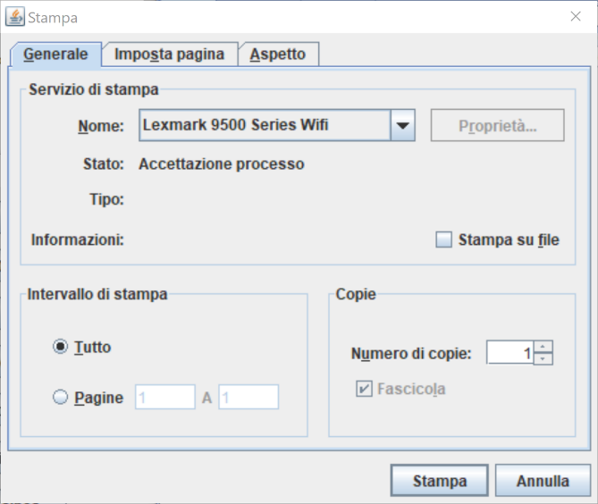

-   **PRINT\_AS\_PAID**: This changes the behavior when a Bill is set to PAID in the Accounting module (see [6.2.1.11 Print receipt](../doc_user/UserManual.md#_6_2_1_11_print_receipt_function) function in User’s Guide).  
    
    -   If it is set to _yes_, Open Hospital will try to print a receipt just after a Bill is set to PAID  
        
        -   A confirmation window will appear (see below), otherwise, it must be done after, by pressing the **Edit Bill** button on the already closed (“C”) bill
            
        
    

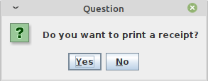

-   **PRINT\_WITHOUT\_ASK**: if set to yes Open Hospital will try to print the receipt without the confirmation window
    
-   **MODE**: the MODE can take three values:
    
    -   **TXT**: the bill is printed as pure text using a monospaced text layout suitable for thermal POS printers
        
    -   **PDF**: the bill will be printed as a PDF
        
    -   **ZPL**: the text printer connected to the system works with ZPL language (an EPL evolution for Zebra Label Printer)
        
    
-   **TXT\_CHAR\_HEIGHT**: controls the text row height used by the JasperReports TXT exporter.  
    This value must be consistent with the JRXML layout to obtain proper line spacing and alignment.
    
-   **TXT\_CHAR\_WIDTH**: controls the text column width used by the JasperReports TXT exporter.  
    This value affects the number of printable characters per line and should be adjusted according to the paper width and font size.
    
-   **TXT\_FEED\_LINES**: number of empty lines appended at the end of the receipt before closing the print job.  
    Useful to improve paper feeding on thermal POS printers.
    
-   **TXT\_CUTTER**: if set to _yes_, Open Hospital sends the ESC/POS cutting command after printing.  
    If set to _no_, the printer will not attempt automatic cutting.  
    Useful for printers without an automatic cutter.
    
-   **ZPL\_FONT\_TYPE**: a 0 (zero) value stands for a standard character; the value can be changed to “A”, “B”, “C”, etc. according to the device datasheet, to obtain a better look
    
-   **ZPL\_FONT\_SIZE**: an integer value to adjust the character size to obtain a better look
    

> [!NOTE]
>
> The best way to configure TXT and ZPL parameters is to adjust them incrementally and print test receipts until the best alignment and readability are achieved for the target printer.

> [!NOTE]
>
> An application restart is required to apply the modified setting.

<a id="xmpp-properties"></a>

### 3.9 xmpp.properties

The XMPP module configuration is set in the _xmpp.properties_ file. A default configuration file for this module is available in the _xmpp.properties.dist_ file:

```properties
# This file contains Xmpp Server information
DOMAIN=127.0.0.1
PORT=5222
```

This file is used only if the XMPPMODULEENABLED flag is enabled (see [XMPPMODULEENABLED](#xmppmoduleenabled) in this document).

To use the Communication module (see [11 Communication](../doc_user/UserManual.md#_11_communication_communication) in the User’s Guide), an XMPP Server must be installed and configured separately on a server/computer in the local network. The XMPP server can also be installed on the same machine as the OH database server.

The most common XMPP Server is the free and open-source project Ignite Openfire® ([https://www.igniterealtime.org/projects/openfire/](https://www.igniterealtime.org/projects/openfire/)) available for Linux, Windows, and Mac.

Once the XMPP Server is installed, active and running set the two parameters in the _xmpp.properties_ file as follows:

-   **DOMAIN** – the IP address of the XMPP server (it could be the same as the database server)
    
-   **PORT** – 5222 or another if set differently
    

> [!NOTE]
>
> An application restart is required to apply the modified setting.

<a id="_3_9_1_openfire_settings"></a>

#### 3.9.1 OpenFire Settings

The XMPP module needs some knowledge about the XMPP protocol and how an XMPP server works.

Every new user login into Open Hospital creates an OpenFire user with the same username and password (even if passwords are saved differently in OH and OpenFire DB). For this reason, the OH "admin" user may conflict with the OpenFire user, not allowing the log in as admin and to chat.

> [!NOTE]
>
> If the admin user needs to chat with other users consider creating another "superuser" in OH under the "admin" group.

To allow users to see each other and communicate via XMPP protocol, they must belong to the same OpenFire "group" and have the other users in their own "_roster_" (find more comprehensive information about "group" and "roster" in the online documentation).

Please follow these settings:

1.  Install the OpenFire server (it is better if from the zip file) on a writable path
    
2.  Set in both OpenFire and in the _xmpp.properties_ file an IP address rather than the FQDN (e.g., 127.0.0.1)
    
3.  Set OpenFire to use Embedded DB
    
4.  Create a group "OH" in the OpenFire server and enable the "Contact List (Roster) Sharing"
    
5.  Add new users automatically created from OH to the "OH" group
    
6.  Consideration should be given to using the OpenFire plugin to automatically add new users to a group (e.g., registration plugin [https://www.igniterealtime.org/projects/openfire/plugins/registration.jar](https://www.igniterealtime.org/projects/openfire/plugins/registration.jar))
    

<a id="default-credentials-properties"></a>

### 3.10 default\_credentials.properties

Open Hospital is packaged with a login "hint" visible only if the _default\_credentials.properties_ file is found.

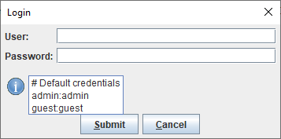

> [!NOTE]
>
> Mouse over the "i" icon to see the hint.

To not show the hint just delete _default\_credentials.properties_ file.

The original values are found in _default\_credentials.properties.dist_ and _default\_demo\_credentials.properties.dist_ files.

```properties
# Default credentials
admin:admin
guest:guest
```

```properties
# Default demo credentials
admin:admin
guest:guest
laboratorist:laboratorist
doctor:doctor
```

> [!NOTE]
>
> It is always recommended to change the **admin** user password in a production environment.

<a id="_3_11_bundles"></a>

### 3.11 Bundles

Bundles are the language (or translation) files provided with Open Hospital. As described in the [LANGUAGE](#language) chapter, Open Hospital comes with different available languages in the folder **bundles/** within the package file:

**language\_XY.properties**

where XY is an international country code.

These property files (text format) contain multiple **key = value** pairs containing localized text for the language specified.

All files must be encoded in **UTF-8** to accept any language-specific characters (e.g. è ì ò à ñ ú ù ¡ ¿ …​).

<a id="_3_11_1_new_translations"></a>

#### 3.11.1 New Translations

To create a new translation, simply copy the English file, rename it with the new country code in place of the “XY” in the filename, and start translating with a simple text editor. A text editor can also be used to modify existing translations that are incorrect.

For instance, if to create an Arabic translation, copy a new bundle from the English one by copying _language\_en.properties_ to a **new file** _language\_ar.properties_.

Then edit the Arabic bundle file and set the LANGUAGE parameter to **ar** to start testing the translation.

<a id="_3_12_application_properties_rest_api_security_hardening"></a>

### 3.12 application.properties (REST API) - security hardening

The REST API server (_rsc/application.properties_) ships with settings that prevent technical and version information from being disclosed in HTTP responses (STRIDE I03 - Information Disclosure):

```properties
# Do not leak messages, stack traces or exception class names in error responses
server.error.include-message=never
server.error.include-stacktrace=never
server.error.include-exception=false
server.error.include-binding-errors=never
# Return a clean 404 for unknown paths
spring.mvc.throw-exception-if-no-handler-found=true
# Suppress the server identification (version) header
server.server-header=
```

Keep these settings enabled in production. The Spring Boot Actuator is not bundled, so management endpoints (e.g. _/actuator_) already returns _404_, while the Swagger UI stays available. When the API is published behind a reverse proxy (nginx/Apache), strip the proxy’s own `Server` and `X-Powered-By` headers there as well (e.g. `server_tokens off;` in nginx).

<a id="reports"></a>

## 4 Reports

Reports in Open Hospital are produced with JasperReports® technology. JasperReports gives the possibility to design a report in an visual / WYSIWYG editor, connect it to a datasource (DB), test it, modify it, and then compile it to use it directly from the OpenHospital application.

Open Hospital reports are placed into three different folders (see [Folders](#folders)):

-   **rpt\_base/** → contains all the hardcoded reports used by the application;
    
-   **rpt\_stat/** → contains the _OHxxx_ basic reports available in the Statistics menu;
    
-   **rpt\_extra/** → contains additional reports defined by the user.
    

Each report consists of two files:

-   a .**jrxml** file: JasperReport XML file, that can be modified with Jaspersoft® Studio (see below)
    
-   a .**jasper** file: Jasper file, which is the compiled version of the jrxml report, suitable to be run in Open Hospital
    

Reports that support translation also include:

-   a .**properties** file: default translation file, placed alongside the `.jasper` file. This file must be written in **English**, as it serves as the fallback for all languages that do not have a specific translation. It must contain the **jTitle** property that defines the name of the report visualized in the Open Hospital application, otherwise the application will not show it (this can be useful for subreports).
    
-   language-specific .**properties** files: placed in a `<lang>/` subfolder (e.g., `it/Laboratory.properties` for Italian), with the same filename as the default. If no language-specific file is found for the current language, Open Hospital falls back to the JRXML default automatically.
    

> [!NOTE]
>
> Translations in languages other than English are managed via [Transifex](https://app.transifex.com/informatici-senza-frontiere-onlus/openhospital/dashboard/), which will automatically attempt to provide translations for new files and changes.

In order to create / modify a report, it is possibile to use a free application, [TIBCO Jaspersoft® Studio](https://community.jaspersoft.com/download-jaspersoft/community-edition/) version 6.14.0 or later. To define a new report it is possible to start from scratch or modify an existing Open Hospital report:

-   open Jaspersoft® Studio
    
-   open the original jrxml file
    
-   modify the report as desired
    
-   save the .jrxml file with a new name
    
-   re-compile the .jrxml file in jasper format (generate the .jasper file)
    
-   place the .jasper file in the report folder used by the Open Hospital application (rpt\_extra/)
    
-   Open Hospital will show the custom reports in the Statistics menu.
    

<a id="_5_installing_open_hospital_1_15_0_in_eclipse_ee"></a>

## 5 Installing Open Hospital 1.15.0 in Eclipse EE

The OH source code is available on GitHub at the following links:

-   [openhospital-core](https://github.com/informatici/openhospital-core/tree/v1.15.0)
    
-   [openhospital-gui](https://github.com/informatici/openhospital-gui/tree/v1.15.0)
    
-   [openhospital-doc](https://github.com/informatici/openhospital-doc/tree/v1.15.0)
    

_Please use EGit (Eclipse Plugin for Git) to clone the code into the Eclipse instance._

Assuming Eclipse EE, MariaDB/MySQL and the Java Virtual Machine 11 or higher (Java8 or greater) are already installed on the computer, this chapter will focus on cloning version 1.15.0 into the Eclipse J2EE (or Eclipse EE) environment.

Please follow these [EGit User Guide - Working with remote Repositories](https://wiki.eclipse.org/EGit/User_Guide#Working_with_remote_Repositories).

<a id="_5_1_run_the_project"></a>

### 5.1 Run the Project

> [!NOTE]
>
> Before running the project, the database must be created as explained in the chapter [MySQL Server and Open Hospital Database](#database-server).

To run the application, look for class _openhospital-gui/src/main/java/org/isf/menu/gui/Menu.java_, then right-click on it and choose _Run As → Java Application_. If everything is OK, the splash screen will appear. If not, look in the Eclipse console for any error or warning messages.


Open Hospital’s advanced features require “native” libraries generated to match the computer’s operating system. Right-click on the project’s name, then select _Run As → Run Configurations_:

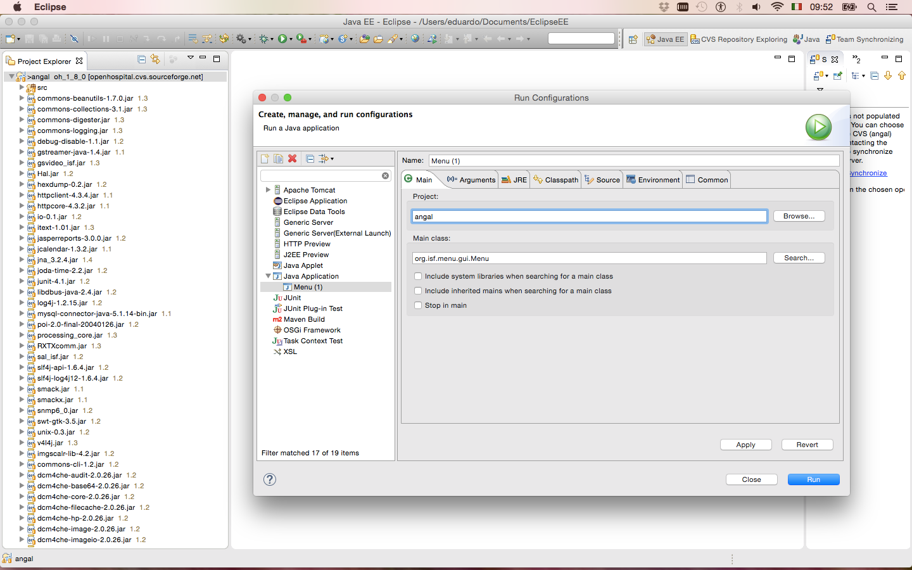

A “Run Configurations” window opens. Choose Java Application → <application’s name> - Menu (1) on this example. Select the “Main” tab, write “angal” on the “Project” field and check if the “Main class” is org.isf.menu.gui.Menu.

Select the “Arguments” tab and fill in the “VM arguments” path typing (on a single line):

```
-Dsun.java2d.dpiaware=false -Djava.library.path=lib\native\<OS name>
```

<OS name> can be “Mac\_OS\_X”, “Solaris”, “Linux”, “Win64” (for 64bit Windows) or “Windows” (for 32bit Windows) according to the folder’s schema found in the related folder “native”. Click on “Run” to close the window and run the application.

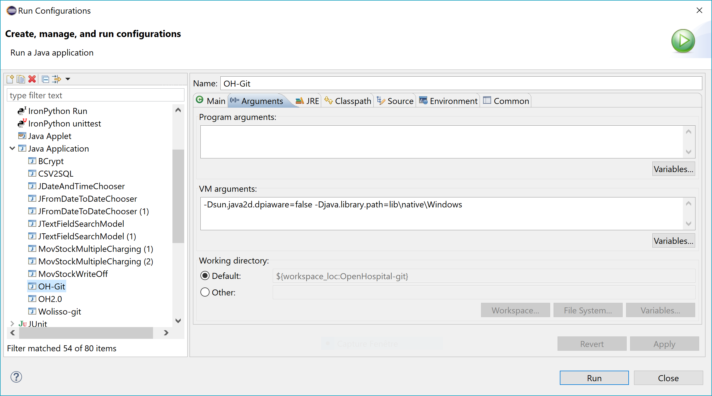

Now that the run configuration settings have been selected, OH can be launched by just clicking on the “Run” button (shown below by an arrow).

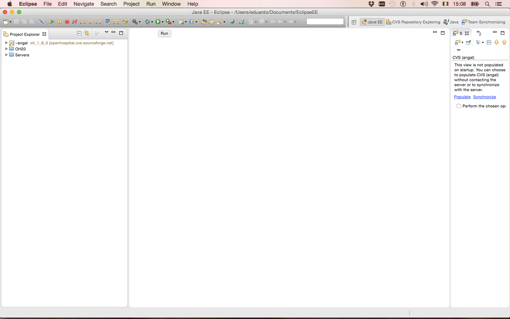  
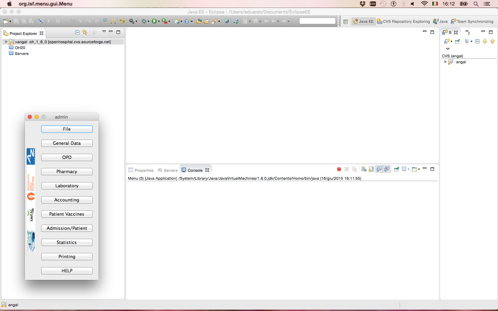

Because of the default settings, Open Hospital’s first run does not show the login window. The system defaults to “single-user” mode by default. This can be verified by the “SINGLEUSER=yes” string on the third row of the [settings.properties](#settings-properties) file. In production use this is unacceptable as Open Hospital must be accessible only to the administrator and logged users. Click on the triangle near the project’s name, do the same on the “rsc” subfolder and then double-click on the [settings.properties](#settings-properties) file.

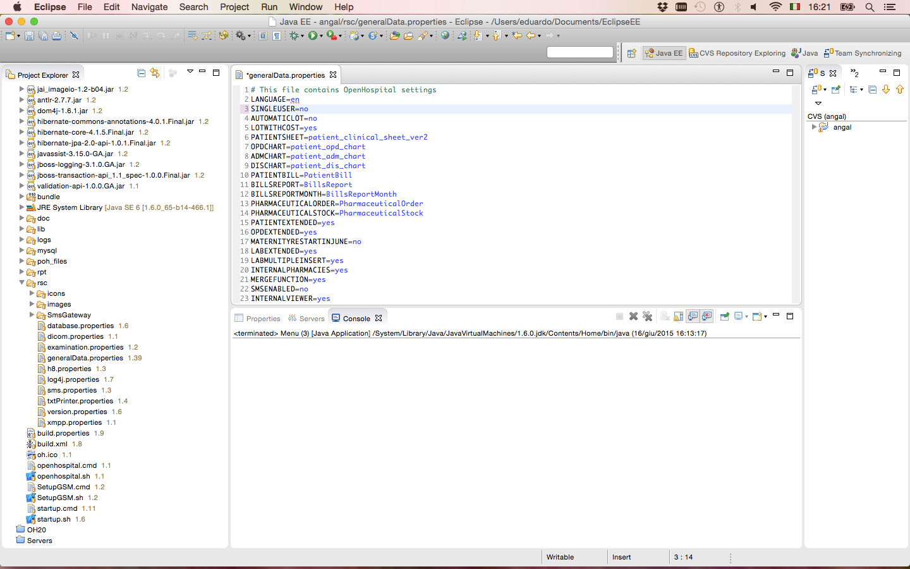

Replace “yes” with “no” on the “SINGLEUSER” row. Press CTRL+S (or Command+S on Mac) to save the change. Now rerun the application and after the splash window, a “login” window opens. Click on the drop-down menu to choose the role. To access as the administrator, select “admin” and type the password. The default is “admin”. The administrator has the right to register users as guests. Guests have to choose “guest” from the drop-down menu and then type their password.

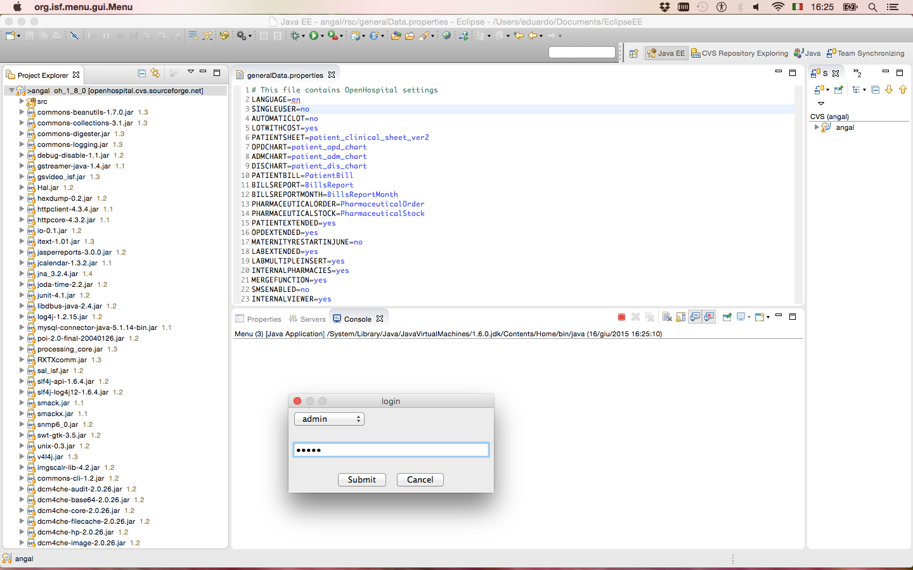  

If the password is not correct, an error message is shown, asking the user to try again.

To better understand the processes built in the software, also enable the “Standard Output” in _log4j2-spring.properties_ as explained in the chapter [log4j2-spring.properties](#log4j2-spring-properties).

<a id="update-open-hospital"></a>

## 6 Update Open Hospital

New releases, as well as this Admin Manual and the User Manual, are regularly released on GitHub/SourceForge. See the [Download](#download) section for more details. NOTE: Following instructions only apply between “official releases”.

Minor releases (if not otherwise specified) do not need changes to the database structure, so the working copy can be replaced on each client with the new one and then connect to the same DB (see [database.properties](#database-properties) and [log4j2-spring.properties](#log4j2-spring-properties)).

It is important to keep/preserve files that have been created or modified, especially configuration/settings and data files (see [Configuration](#configuration)). The easiest way is to backup the working copy and re-apply those settings in the new installation (see the [Backup & Restore](#backup-restore) chapter).

**Major Releases**: Changes are documented in the RELEASE\_NOTES file.

<a id="_6_1_update_database"></a>

### 6.1 Update Database

Major OH releases usually require changes to the database structure, and these changes are implemented via different SQL scripts included in the _sql/update_ folder (e.g.):

| **Previous OH version** | **New OH version** | **Database update script** |
| --- | --- | --- |
| 1.8.4 | 1.9 | _update\_1\_8\_4-1\_9.sql_ |
| 1.9 | 1.10 | _update\_1\_9-1\_10.sql_ |
| 1.10 | 1.10 | _update\_1\_10-1\_11.sql_ |
| 1.11 | 1.12 | _update\_1\_11-1\_12.sql_ |
| 1.12 | 1.13 | _update\_1\_12-1\_13.sql_ |
| 1.13 | 1.14 | _update\_1\_13-1\_14.sql_ |
| 1.14 | 1.15 | _update\_1\_14-1\_15.sql_ |

> [!NOTE]
>
> The user-related tables enforce uniqueness at the database level: a permission name (`OH_PERMISSIONS.P_NAME`) and each (user group, permission) pair (`OH_GROUPPERMISSION`) must be unique. When running the database update, duplicate (user group, permission) rows are removed automatically by the update script, but duplicate permission names are NOT (a permission may be referenced elsewhere): if any exist the update fails fast without changing data, so resolve the duplicates reported by the pre-flight queries and then re-run.

To perform the database update process follow these steps:

1.  Close the program if it is still running
    
2.  Backup the current database for safety (see [Backup & Restore](#backup-restore))
    
3.  Open a terminal in the folder sql/update (e.g.):
    

```shell
C:\WINDOWS\system32> cd C:\Users\OH\OpenHospital-v1.15.0\sql\update

C:\Users\OH\OpenHospital-v1.15.0\sql\update>
```

4.  Run the following commands (e.g.):
    

```shell
C:\Users\OH\OpenHospital-1.15.0\sql\update> mysql –u root -p [-h hostname/ip address]

Enter password: ****
```

5.  Use the ‘root’ password chosen during the installation process. The terminal should reply with the MySQL client command line prompt:
    

```shell
MariaDB>
```

6.  Select the open hospital database;
    

```shell
MariaDB>USE oh;
```

7.  Execute all the SQL scripts from your current OH version up to the new one:
    

Example: updating version from 1.10.X to 1.13.X

```shell
MariaDB> source update_1_10-1_11.sql

MariaDB> source update_1_11-1_12.sql

MariaDB> source update_1_12-1_13.sql

...
```

8.  If any error message occurs you can report an issue here: [https://openhospital.atlassian.net/](https://openhospital.atlassian.net/)
    

<a id="_6_2_update_client"></a>

### 6.2 Update Client

If the database upgrade procedure is successful, it is possible to update the OH software by replacing the OH working copy on each client with the new one. (see [database.properties](#database-properties) and [log4j2-spring.properties](#log4j2-spring-properties)). Remember to maintain the configuration files that have been changed, to preserve the custom settings. (see [Configuration](#configuration)). The most common way is to backup the working copy and re-apply those settings in the new one (see [Backup & Restore](#backup-restore)). Start the program and check the log files (data/logs) to ensure that the new version is running and has no error messages.

<a id="_6_3_update_portable"></a>

### 6.3 Update Portable

> [!NOTE]
>
> Open Hospital, used in PORTABLE mode, is not meant to be used in a production environment. To migrate a portable installation to a full client/server configuration, keeping the existing data, the following steps must be performed:

1.  Close Open Hospital;
    
2.  use oh.sh / oh.ps1 **e** option to export the database
    
3.  overwrite local working copy with the new version files
    
4.  use oh.sh / oh.ps1 **r** option to restore exported database
    

If needed, start the PORTABLE instance in SERVER mode, connect to the local running database and apply the required SQL scripts.

<a id="_7_support"></a>

## 7 Support

For support, or questions about updating, migrating, or maintaining an Open Hospital installation, please check our website at [https://www.open-hospital.org](https://www.open-hospital.org). You can contact us at: [https://www.open-hospital.org/contact](https://www.open-hospital.org/contact) and specify:

-   A brief history of the organization;
    
-   The country where the installation is and the language used;
    
-   Technical details of the OH installation;
    
-   The application logs (see [Help](../doc_user/UserManual.md#help) chapter in the User’s Guide)
    
-   The current Open Hospital version;
    
-   Complete the [Open Hospital Assessment online-form](https://goo.gl/forms/rXgcYTWpAyp9Eyqw1) form
    

<a id="_8_license"></a>

## 8 License

<a href="https://creativecommons.org/licenses/by-sa/4.0/">
  
</a> Informatici Senza Frontiere Onlus, 2026 
 
Administrator’s Guide, © 2026 by [Informatici Senza Frontiere Onlus](https://www.informaticisenzafrontiere.org/)  
Policies is made available under a [Creative Commons Attribution-ShareAlike 4.0](https://creativecommons.org/licenses/by-sa/4.0//) International License: [https://creativecommons.org/licenses/by-sa/4.0//](https://creativecommons.org/licenses/by-sa/4.0//).

---

<a id="_footnotedef_1"></a>[1](#_footnoteref_1). Informatici Senza Frontiere - [https://www.informaticisenzafrontiere.org](https://www.informaticisenzafrontiere.org)

<a id="_footnotedef_2"></a>[2](#_footnoteref_2). DataBase Management System

<a id="_footnotedef_3"></a>[3](#_footnoteref_3). See [https://www.mariadb.org](https://www.mariadb.org)

<a id="_footnotedef_4"></a>[4](#_footnoteref_4). [https://mariadb.org/download/](https://mariadb.org/download/)

<a id="_footnotedef_5"></a>[5](#_footnoteref_5). [https://mariadb.org/documentation/](https://mariadb.org/documentation/)
