# Open Hospital 1.15.2 - User’s Guide

Table of Contents

- [Open Hospital 1.15.2 - User’s Guide](#open-hospital-1152---users-guide)
  - [Open Hospital](#open-hospital)
  - [1 Introduction](#1-introduction)
    - [1.1 Main Features](#11-main-features)
      - [1.1.2 Soft Deletion and Disabling Features](#112-soft-deletion-and-disabling-features)
    - [1.2 About this User Manual](#12-about-this-user-manual)
      - [1.2.1 Help](#121-help)
      - [1.2.2 Legend](#122-legend)
  - [2 Start the OH Application](#2-start-the-oh-application)
    - [2.1 Main menu](#21-main-menu)
    - [2.2 Functions](#22-functions)
  - [3 Outpatient Department Management (OPD)](#3-outpatient-department-management-opd)
    - [3.1 Main Characteristics](#31-main-characteristics)
    - [3.2 Functions of Out Patient Department](#32-functions-of-out-patient-department)
      - [3.2.1 Search Patient Visits (Search)](#321-search-patient-visits-search)
      - [3.2.2 Create a New Patient Visit (New)](#322-create-a-new-patient-visit-new)
      - [3.2.3 Modify a Recorded Patient Visit (Edit)](#323-modify-a-recorded-patient-visit-edit)
      - [3.2.4 Delete a Recorded Patient Visit (Delete)](#324-delete-a-recorded-patient-visit-delete)
    - [3.3 OPD Extended](#33-opd-extended)
      - [3.3.1 Additional Features](#331-additional-features)
  - [4 Pharmacy (Pharmacy)](#4-pharmacy-pharmacy)
    - [4.1 Pharmaceuticals (Pharmaceuticals)](#41-pharmaceuticals-pharmaceuticals)
      - [4.1.1 Main Characteristics](#411-main-characteristics)
      - [4.1.2 Functions of Pharmaceuticals](#412-functions-of-pharmaceuticals)
        - [4.1.2.1 Insert a New Pharmaceutical (New)](#4121-insert-a-new-pharmaceutical-new)
        - [4.1.2.2 Modify an Existing Pharmaceutical (Edit)](#4122-modify-an-existing-pharmaceutical-edit)
        - [4.1.2.3 Delete a Pharmaceutical (Delete)](#4123-delete-a-pharmaceutical-delete)
        - [4.1.2.4 Export the List of Pharmaceuticals (Export)](#4124-export-the-list-of-pharmaceuticals-export)
        - [4.1.2.5 Stock Report (Stock)](#4125-stock-report-stock)
        - [4.1.2.6 StockCard (StockCard)](#4126-stockcard-stockcard)
        - [4.1.2.7 Order of Pharmaceuticals (Order)](#4127-order-of-pharmaceuticals-order)
        - [4.1.2.8 Expiring Pharmaceuticals (Expiring)](#4128-expiring-pharmaceuticals-expiring)
        - [4.1.2.9 Average Monthly Consumption (AMC)](#4129-average-monthly-consumption-amc)
    - [4.2 Pharmaceutical Stock (Pharmaceutical Stock)](#42-pharmaceutical-stock-pharmaceutical-stock)
      - [4.2.1 Main Characteristics](#421-main-characteristics)
      - [4.2.2 Functions of Pharmaceuticals Stock](#422-functions-of-pharmaceuticals-stock)
        - [4.2.2.1 Search Pharmaceuticals Stock Movements (Filter)](#4221-search-pharmaceuticals-stock-movements-filter)
        - [4.2.2.2 Insert Stock Charging Movement (Charge)](#4222-insert-stock-charging-movement-charge)
        - [4.2.2.3 Insert Stock Discharging Movement (Discharge)](#4223-insert-stock-discharging-movement-discharge)
        - [4.2.2.4 Delete Last Stock Movement (**Delete**)](#4224-delete-last-stock-movement-delete)
    - [4.3 Pharmaceuticals Stock Ward (Pharmaceuticals Stock Ward)](#43-pharmaceuticals-stock-ward-pharmaceuticals-stock-ward)
      - [4.3.1 Main Characteristics](#431-main-characteristics)
      - [4.3.2 Functions of Pharmaceuticals Stock Ward](#432-functions-of-pharmaceuticals-stock-ward)
        - [4.3.2.1 Rectify (Rectify)](#4321-rectify-rectify)
        - [4.3.2.2 Search Ward Pharmacy Movements (Filter)](#4322-search-ward-pharmacy-movements-filter)
        - [4.3.2.3 The Movements Panel](#4323-the-movements-panel)
        - [4.3.2.4 Inserting a New Ward Pharmacy Movement (New)](#4324-inserting-a-new-ward-pharmacy-movement-new)
        - [4.3.2.5 Delete the Last Stock Movement in a Ward (Delete)](#4325-delete-the-last-stock-movement-in-a-ward-delete)
    - [4.4 Inventory (Inventory)](#44-inventory-inventory)
      - [4.4.1 Main Characteristics](#441-main-characteristics)
      - [4.4.2 Functions of Inventory](#442-functions-of-inventory)
        - [4.4.2.1 Create a New Inventory (New Inventory)](#4421-create-a-new-inventory-new-inventory)
          - [4.4.2.1.1 Insert Inventory Row By Using The Code Or Description](#44211-insert-inventory-row-by-using-the-code-or-description)
          - [4.4.2.1.2 Insert Inventory Rows By Type And Usage](#44212-insert-inventory-rows-by-type-and-usage)
          - [4.4.2.1.3 Insert Inventory Row With New Lot](#44213-insert-inventory-row-with-new-lot)
        - [4.4.2.2 Edit Inventory (Edit Inventory)](#4422-edit-inventory-edit-inventory)
        - [4.4.2.3 Validate Inventory (Validate)](#4423-validate-inventory-validate)
        - [4.4.2.4 Confirm Inventory (Confirm](#4424-confirm-inventory-confirm)
        - [4.4.2.5 View Inventory (View)](#4425-view-inventory-view)
        - [4.4.2.6 Print Inventory (Print)](#4426-print-inventory-print)
        - [4.4.2.7 Delete Inventory (Delete)](#4427-delete-inventory-delete)
    - [4.5 Ward Inventory (Ward Inventory)](#45-ward-inventory-ward-inventory)
      - [4.5.1 Main Characteristics](#451-main-characteristics)
      - [4.5.2 Functions of Ward Inventory](#452-functions-of-ward-inventory)
        - [4.5.2.1 Create a New ward Inventory (New)](#4521-create-a-new-ward-inventory-new)
          - [4.5.2.1.1 Insert Inventory Row By Using The Code Or Description](#45211-insert-inventory-row-by-using-the-code-or-description)
          - [4.5.2.1.2 Insert Inventory Rows By Type And Usage](#45212-insert-inventory-rows-by-type-and-usage)
          - [4.5.2.1.3 Insert Inventory Row With New Lot](#45213-insert-inventory-row-with-new-lot)
        - [4.5.2.2 Edit Ward Inventory (Edit)](#4522-edit-ward-inventory-edit)
        - [4.4.2.3 Validate Inventory (Validate)](#4423-validate-inventory-validate-1)
        - [4.4.2.4 Confirm Inventory (Confirm)](#4424-confirm-inventory-confirm-1)
        - [4.5.2.5 View Ward Inventory (View)](#4525-view-ward-inventory-view)
        - [4.5.2.6 Print Ward Inventory (Print)](#4526-print-ward-inventory-print)
        - [4.5.2.7 Delete Ward Inventory (Delete)](#4527-delete-ward-inventory-delete)
    - [4.6 Lot Management (Lot Management)](#46-lot-management-lot-management)
      - [4.6.1 Main Characteristics](#461-main-characteristics)
      - [4.6.2 Functions of Lot Management](#462-functions-of-lot-management)
        - [4.6.2.1 Edit Lot (Edit)](#4621-edit-lot-edit)
        - [4.6.2.2 Lot Distribution (Distribution)](#4622-lot-distribution-distribution)
  - [5 Laboratory (Laboratory)](#5-laboratory-laboratory)
    - [5.1 Main Characteristics](#51-main-characteristics)
    - [5.2 Functions of Laboratory](#52-functions-of-laboratory)
      - [5.2.1 Search Laboratory Exams (Search)](#521-search-laboratory-exams-search)
      - [5.2.2 Create a New Laboratory Exam (New)](#522-create-a-new-laboratory-exam-new)
        - [5.2.2.1 Results](#5221-results)
      - [5.2.3 Modify a Laboratory Exam (Edit)](#523-modify-a-laboratory-exam-edit)
      - [5.2.4 Delete Laboratory Exam (Delete)](#524-delete-laboratory-exam-delete)
    - [5.3 Laboratory Extended](#53-laboratory-extended)
      - [5.3.1 Extended Laboratory Browsing](#531-extended-laboratory-browsing)
      - [5.3.2 New Laboratory Exam (New)](#532-new-laboratory-exam-new)
      - [5.3.3 Laboratory Multiple Insert](#533-laboratory-multiple-insert)
        - [5.3.3.1 New Patient Exams (New)](#5331-new-patient-exams-new)
  - [6 Accounting (Accounting)](#6-accounting-accounting)
    - [6.1 Main Characteristics](#61-main-characteristics)
    - [6.2 Functions of Accounting](#62-functions-of-accounting)
      - [6.2.1 Insert a New Bill (New Bill)](#621-insert-a-new-bill-new-bill)
        - [6.2.1.1 Insert a Bill Entry Related to Medicals, Operations or Exams (Medical, Operation, Exam)](#6211-insert-a-bill-entry-related-to-medicals-operations-or-exams-medical-operation-exam)
        - [6.2.1.2 Insert a Bill Entry Related to Various Custom Reasons (Custom)](#6212-insert-a-bill-entry-related-to-various-custom-reasons-custom)
        - [6.2.1.3 Remove a Bill Entry of a Bill (Remove Item)](#6213-remove-a-bill-entry-of-a-bill-remove-item)
        - [6.2.1.4 Insert a Payment (Payment)](#6214-insert-a-payment-payment)
        - [6.2.1.5 Insert a Refund (Refund)](#6215-insert-a-refund-refund)
        - [6.2.1.6 Payment Receipt (Payment Receipt)](#6216-payment-receipt-payment-receipt)
        - [6.2.1.7 Remove a Payment (Remove Payment)](#6217-remove-a-payment-remove-payment)
        - [6.2.1.8 Give Change (Give Change)](#6218-give-change-give-change)
        - [6.2.1.9 Save Function (Save)](#6219-save-function-save)
        - [6.2.1.10 Paid Function (Paid)](#62110-paid-function-paid)
        - [6.2.1.11 Print Receipt Function](#62111-print-receipt-function)
        - [6.2.1.12 Close Function (Close)](#62112-close-function-close)
      - [6.2.2 Edit an Existing Bill (Edit Bill)](#622-edit-an-existing-bill-edit-bill)
      - [6.2.3 Delete a Bill (Delete Bill)](#623-delete-a-bill-delete-bill)
      - [6.2.4 Receipt (Receipt)](#624-receipt-receipt)
      - [6.2.5 Reports (Report)](#625-reports-report)
    - [6.3 Functions of Accounting in Multi-user Mode](#63-functions-of-accounting-in-multi-user-mode)
  - [7 Vaccines (Vaccines)](#7-vaccines-vaccines)
    - [7.1 Main Characteristics](#71-main-characteristics)
    - [7.2 Functions of Vaccines](#72-functions-of-vaccines)
      - [7.2.1 Search Vaccinations](#721-search-vaccinations)
      - [7.2.2 Insert a New Patient Vaccination (New)](#722-insert-a-new-patient-vaccination-new)
      - [7.2.3 Modify Data of a Recorded Patient Vaccination (Edit)](#723-modify-data-of-a-recorded-patient-vaccination-edit)
      - [7.2.4 Delete a Patient Vaccination (Delete)](#724-delete-a-patient-vaccination-delete)
    - [7.3 Vaccines Extended (Vaccines)](#73-vaccines-extended-vaccines)
      - [7.3.1 Extended Vaccine Browsing](#731-extended-vaccine-browsing)
  - [8 Admission/Patient (Admission/Patient)](#8-admissionpatient-admissionpatient)
    - [8.1 Main Characteristics](#81-main-characteristics)
    - [8.2 Functions of Admission/Patients](#82-functions-of-admissionpatients)
      - [8.2.1 Search Patient](#821-search-patient)
      - [8.2.2 Search Patient Enhanced](#822-search-patient-enhanced)
    - [8.3 Insert a New Patient (New)](#83-insert-a-new-patient-new)
      - [8.3.1 Modify Data of a Patient (Edit)](#831-modify-data-of-a-patient-edit)
      - [8.3.2 Delete a Patient (Delete)](#832-delete-a-patient-delete)
    - [8.4 Insert a New Patient Extended (New)](#84-insert-a-new-patient-extended-new)
      - [8.4.1 Additional Features](#841-additional-features)
      - [8.4.2 Height and Weight Functionality (Height and Weight)](#842-height-and-weight-functionality-height-and-weight)
      - [8.4.3 Patient Photo (New Photo)](#843-patient-photo-new-photo)
      - [8.4.4 Anamnesis](#844-anamnesis)
      - [8.4.5 Patient Consensus](#845-patient-consensus)
    - [8.5 Admission Functions (Admission)](#85-admission-functions-admission)
      - [8.5.1 Start the Admission of a Patient (Admission)](#851-start-the-admission-of-a-patient-admission)
      - [8.5.2 Patient Examination](#852-patient-examination)
      - [8.5.3 Insert or Modify Surgery Data](#853-insert-or-modify-surgery-data)
      - [8.5.4 Insert or Modify Delivery Data](#854-insert-or-modify-delivery-data)
      - [8.5.5 Discharge of a Patient (Admission)](#855-discharge-of-a-patient-admission)
    - [8.6 OPD (OPD)](#86-opd-opd)
    - [8.7 Bill (Bill)](#87-bill-bill)
    - [8.8 Manage Patient Historical Data (Data)](#88-manage-patient-historical-data-data)
      - [8.8.1 Modify Data of an Admission (Edit)](#881-modify-data-of-an-admission-edit)
      - [8.8.2 Modify Data of an Outpatient Visit (Edit)](#882-modify-data-of-an-outpatient-visit-edit)
      - [8.8.3 Delete an Admission (Delete)](#883-delete-an-admission-delete)
      - [8.8.4 Delete an Outpatient Visit (Delete)](#884-delete-an-outpatient-visit-delete)
      - [8.8.5 Manage Malnutrition Control of a Patient (Malnutrition Control)](#885-manage-malnutrition-control-of-a-patient-malnutrition-control)
        - [8.8.5.1 Insert a New Control (New)](#8851-insert-a-new-control-new)
    - [8.9 Clinical Sheet (Clinical Sheet)](#89-clinical-sheet-clinical-sheet)
      - [8.9.1 Imaging (Imaging)](#891-imaging-imaging)
    - [8.10 Therapy Management (Therapy)](#810-therapy-management-therapy)
      - [8.10.1 Add a Therapy (Add Therapy)](#8101-add-a-therapy-add-therapy)
      - [8.10.2 Modify a Therapy (Edit Therapy)](#8102-modify-a-therapy-edit-therapy)
      - [8.10.3 Remove a Therapy (Remove Therapy)](#8103-remove-a-therapy-remove-therapy)
      - [8.10.4 Check Availability of the Pharmaceuticals (Check Availability)](#8104-check-availability-of-the-pharmaceuticals-check-availability)
      - [8.10.5 Save Function (Save)](#8105-save-function-save)
      - [8.10.6 Close Function (Close)](#8106-close-function-close)
      - [8.10.7 Notify \& SMS](#8107-notify--sms)
      - [8.10.8 Visits](#8108-visits)
        - [8.10.8.1 Appointments rules](#81081-appointments-rules)
    - [8.11 Merge Function (Merge)](#811-merge-function-merge)
      - [8.11.1 Different Names](#8111-different-names)
      - [8.11.2 Different Sex](#8112-different-sex)
  - [9 Statistics (Statistics)](#9-statistics-statistics)
    - [9.1 Main Characteristics](#91-main-characteristics)
    - [9.2 Report Launcher (Launch Report)](#92-report-launcher-launch-report)
  - [10 Reports (Reports)](#10-reports-reports)
    - [10.1 Main Characteristics](#101-main-characteristics)
    - [10.2 Reports](#102-reports)
      - [10.2.1 Exams List (Exams List)](#1021-exams-list-exams-list)
      - [10.2.2 Disease List (Disease List)](#1022-disease-list-disease-list)
      - [10.2.3 Operation List (Operation List)](#1023-operation-list-operation-list)
  - [11 Communication (Communication)](#11-communication-communication)
    - [11.1 Main Characteristics](#111-main-characteristics)
    - [11.2 Chat](#112-chat)
    - [11.3 Admission/Discharge Notifications](#113-admissiondischarge-notifications)
      - [11.3.1 Admission Notifications](#1131-admission-notifications)
      - [11.3.2 Discharge Notifications](#1132-discharge-notifications)
    - [11.4 Pharmaceuticals Critical Level Notifications](#114-pharmaceuticals-critical-level-notifications)
    - [11.5 Report Sharing](#115-report-sharing)
  - [12 Settings (Settings)](#12-settings-settings)
    - [12.1 Main Characteristics](#121-main-characteristics)
    - [12.2 Types (Types)](#122-types-types)
      - [12.2.1 Admission Types (Admission Type)](#1221-admission-types-admission-type)
      - [12.2.2 Discharge Types (Discharge Type)](#1222-discharge-types-discharge-type)
      - [12.2.3 Delivery Result Types (Delivery Result Type)](#1223-delivery-result-types-delivery-result-type)
      - [12.2.4 Delivery Types (Delivery Type)](#1224-delivery-types-delivery-type)
      - [12.2.5 Disease Types (Disease Type)](#1225-disease-types-disease-type)
      - [12.2.6 Exam Types (Exam Type)](#1226-exam-types-exam-type)
      - [12.2.7 Medicals Stock Movement Types (Medicals Stock Mov Type)](#1227-medicals-stock-movement-types-medicals-stock-mov-type)
      - [12.2.8 Medicals Types (Medicals Type)](#1228-medicals-types-medicals-type)
      - [12.2.9 Operation Types (Operation Type)](#1229-operation-types-operation-type)
      - [12.2.10 Pregnant Treatment Types (Pregnant Treatment Type)](#12210-pregnant-treatment-types-pregnant-treatment-type)
      - [12.2.11 Other Prices (Other Prices)](#12211-other-prices-other-prices)
      - [12.2.12 Age Types (Age Type)](#12212-age-types-age-type)
      - [12.2.13 Vaccine Types (Vaccine Type)](#12213-vaccine-types-vaccine-type)
      - [12.2.14 Imaging Type (Imaging Type)](#12214-imaging-type-imaging-type)
    - [12.3 Hospital (Hospital)](#123-hospital-hospital)
    - [12.4 Ward (Ward)](#124-ward-ward)
    - [12.5 Disease (Disease)](#125-disease-disease)
    - [12.6 Exam (Exams)](#126-exam-exams)
      - [12.6.1 Results (Results)](#1261-results-results)
    - [12.7 Operations (Operation)](#127-operations-operation)
    - [12.8 Vaccine (Vaccine)](#128-vaccine-vaccine)
    - [12.9 Prices (Price Lists)](#129-prices-price-lists)
      - [12.9.1 Price Lists (Manage Lists)](#1291-price-lists-manage-lists)
    - [12.10 Supplier (Supplier)](#1210-supplier-supplier)
    - [12.11 SMS Manager (SMS Manager)](#1211-sms-manager-sms-manager)
    - [12.12 Users \& Groups (Users \& Groups)](#1212-users--groups-users--groups)
      - [12.12.1 Groups (Groups)](#12121-groups-groups)
      - [12.12.2 Users (Users)](#12122-users-users)
  - [13 Worksheet (Worksheet)](#13-worksheet-worksheet)
  - [14 License](#14-license)


<a href="https://creativecommons.org/licenses/by-sa/4.0/">
  
</a> Informatici Senza Frontiere Onlus, 2026  

User’s Guide, © 2026 by [Informatici Senza Frontiere Onlus](https://www.informaticisenzafrontiere.org/)  
Policies is made available under a [Creative Commons Attribution-ShareAlike 4.0](https://creativecommons.org/licenses/by-sa/4.0//) International License: [https://creativecommons.org/licenses/by-sa/4.0//](https://creativecommons.org/licenses/by-sa/4.0//).

<a id="_open_hospital"></a>

## Open Hospital

<a id="_1_introduction"></a>

## 1 Introduction

OH - Open Hospital ([https://www.open-hospital.org/](https://www.open-hospital.org/)) is a free and open-source Electronic Health Record (EHR) software application. Open Hospital is deployed as a desktop application that can be used in a stand alone, single user mode (PORTABLE mode) or in a client / server network configuration (CLIENT mode), where multiple clients and users connect to the same database server.

Open Hospital is developed in Java and it is based on open-source tools and libraries; it runs on any computer, requires low resources and is designed to work without an Internet connection.

Open Hospital is the first of a set of software applications that ISF<a id="_footnoteref_1"></a>[1](#_footnotedef_1) has developed to support the information management and the activities of hospitals and health centers in the simplest manner possible, by providing tools for administrative operations (like registering patients, and managing laboratory analysis and pharmaceutical stocks) and for the production of detailed statistics and reports. It was first deployed in 2006 at the St. Luke Hospital in Angal (Uganda) and it is now used in dozens of different locations around the world.

<a id="_1_1_main_features"></a>

### 1.1 Main Features

OH - Open Hospital features include:

-   Pharmacy management with Inventory
    
-   Laboratory management
    
-   OPD management
    
-   Patient admission and discharge management
    
-   Pregnancy management
    
-   Malnutrition control management
    
-   Vaccines database
    
-   Patient billing support
    
-   Therapy management
    
-   Appointment scheduling
    
-   Internal communication
    
-   Statistics and printing
    

<a id="soft-deletion-and-disabling-features"></a>

#### 1.1.2 Soft Deletion and Disabling Features

In general, records can be created, edited, or deleted from the database. Certain records, however, are not permanently deleted but allow their status to be modified, either by being "deleted," "disabled," or "marked as deleted," depending on the module.

-   **Soft Deletion (Mark as Deleted):** Soft deletion is the practice of marking a record as deleted without actually removing it from the database. The record remains stored but is typically hidden from standard operations and searches. The purpose of soft deletion is to:
    
    -   Retain historical or auditing data.
        
    -   Avoid irreversible data loss.
        
    -   Allow for potential recovery or un-deleting.
        
        These records are generally **hidden** from standard users and workflow to avoid cluttering the interface with irrelevant or obsolete data. A common use case is _deleting user accounts while retaining their activity logs_. Examples include:
        
    -   [12.2.8 Medicals Types](#medicals-types): _Medical Types that are marked as deleted will no longer appear in standard searches or operational workflow and cannot be referenced for new medicals._
        
    -   [12.12.1 Groups](#groups): _User Groups that are marked as deleted cannot be referenced for new users. A unique code is required for new groups._
        
    -   [12.12.2 Users](#users): _Users that are marked as deleted cannot be used anymore. A unique name is required for new users._
        
    
-   **Disabling Records:** Disabling a record makes it inactive or unavailable for use, but it is still visible and accessible in some contexts. Unlike soft deletion, disabled records are often still part of workflow, albeit restricted in functionality. The purpose of disabling is to:
    
    -   Temporarily suspend a record’s usage.
        
    -   Allow for reactivation if needed.
        
        Disabled records are often still **visible** to standard users but clearly marked as "inactive" or "disabled." This provides transparency and maintains awareness of the record’s existence. A common use case is _temporarily deactivating user accounts (e.g., suspending a subscription)_. Examples include:
        
    -   [4.1.2.1 Insert a New Pharmaceutical](#insert-a-new-pharmaceutical): _Medicals that are marked as disabled (or inactive) will no longer appear in standard searches or operational workflow._
        
    
-   **Statuses:** Statuses represent a record’s inclusion in a process workflow without necessarily removing or disabling it. For example:
    
    -   [6.2.3 Delete a Bill](#delete-a-bill): _Bills that have been moved to a deleted status will continue to appear in the list but will not be counted in the reports._
        
    

<a id="_1_2_about_this_user_manual"></a>

### 1.2 About this User Manual

In the following chapters, all the information needed to correctly and efficiently use the OH software is presented. More information can be found on the Open Hospital web site: [https://www.open-hospital.org](https://www.open-hospital.org).

> [!NOTE]
>
> The information needed to install, configure or administer Open Hospital is not included in this manual; please refer to the _Open Hospital Administrator’s Guide_ supplied with the software.

<a id="help"></a>

#### 1.2.1 Help

-   The **Help** function available at the bottom of the main MENU of Open Hospital provides access to this document offline.
    
-   It allows enabled user to easily access the application **Logs** folder
    

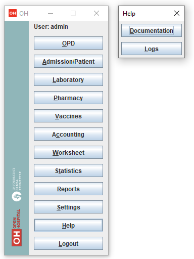

<a id="_1_2_2_legend"></a>

#### 1.2.2 Legend

In this document, the following conventions are used:

-   When a text is written in bold and highlighted in grey **–** like **Pharmacy** or **New –** it indicates a function of the application and it is also called a “button”. **Pharmacy** is a button.
    
-   When a text is written in bold italics (as an example, **_Laboratory Browser)_**, it indicates the screen with the name “Laboratory Browser” (see example below). Each screen of the application is called a window. **_Laboratory Browser_** is a window.
    
-   When a text is written in bold as **Search patient visits**, it indicates a function of the application, or an area of the window (for example, **Data table**).
    
-   Each button always has a single letter with an underscore. The functionality offered by the button is made available by simultaneously pressing the “Alt” key and the “underlined” key (in the example of **Pharmacy**, press “Alt” and “P”)**.** This behavior is common throughout the application and allows the user to operate (almost) without the use of the mouse. In this document, the “Alt” key and the “P” key will be indicated as “Alt + P”.
    

Click with the mouse on the button or press "Alt + P" to enter the **Pharmacy**

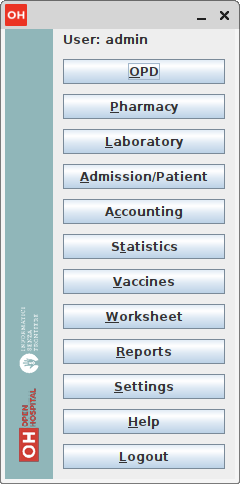

-   Each screen of the application is a called “window”. Most complex windows of the application are composed of more than one area. Areas can be a **Selection panel**, a **Data table**, or a **Buttons panel** (see **_Laboratory Browser_** window below).
    

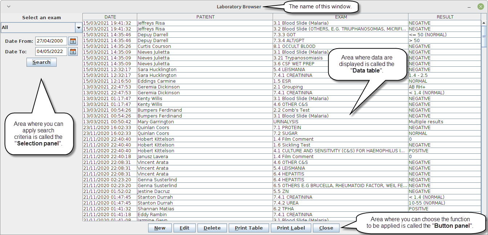

-   To highlight an entry (for example, a single line in a **Data table**), click the mouse on the entry. The entry (the entire line) is then highlighted in blue. This behavior is valid throughout the application (see the example below):
    

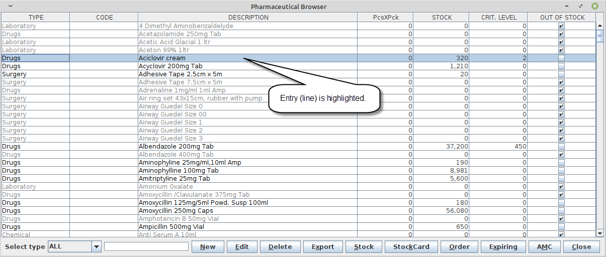

<a id="_2_start_the_oh_application"></a>

## 2 Start the OH Application

To run Open Hospital, double-click the program icon on the desktop; an information image (splash image) appears for a few seconds and then the main _menu_ of the OH application is shown.

If no desktop shortcut is present, open the folder where the software has been installed and double-click on the platform-specific startup script (**oh.bat** on Windows / **oh.sh** on Linux).

<a id="_2_1_main_menu"></a>

### 2.1 Main menu

The default Main Menu of the OH application shows the available functions.


<a id="_2_2_functions"></a>

### 2.2 Functions

From the main menu, it is possible to access functions and submenus. In the example below, selecting the **_Settings_** button leads to the OH settings submenu:

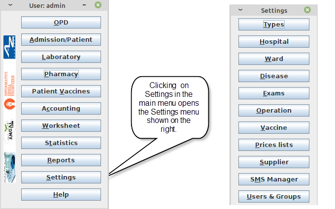

Some menu items lead directly to a specific function of the application (see the following example with the **_OPD Out Patient Department_** window):

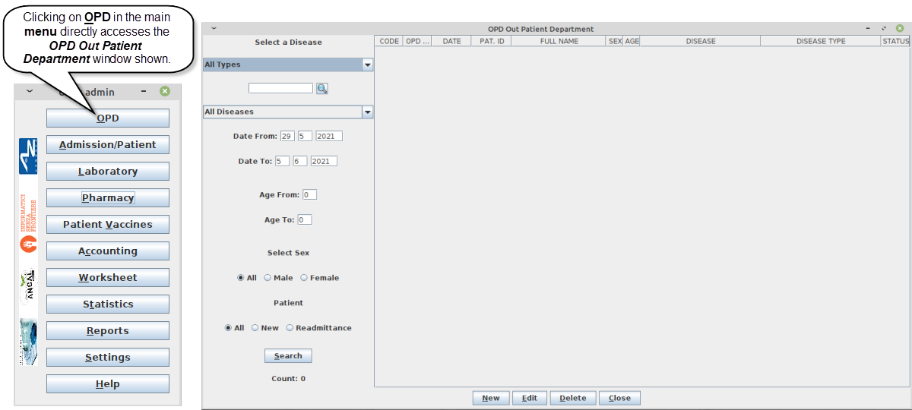

<a id="outpatient-department-management"></a>

## 3 Outpatient Department Management (OPD)

<a id="_3_1_main_characteristics"></a>

### 3.1 Main Characteristics

The function of the Out Patient Department (OPD) allows the recording of ambulatory patient visits, searching, reviewing, editing, and eventually deleting visits. In addition, queries necessary for statistical purposes are available.

Click on the **OPD** button or press “Alt + O” in the main **_menu_** to access the OPD function.

Press the **OPD** button or “Alt + O”.


<a id="_3_2_functions_of_out_patient_department"></a>

### 3.2 Functions of Out Patient Department

All functions available under **OPD** are accessible from the window **_OPD Out Patient Department_**, shown below:

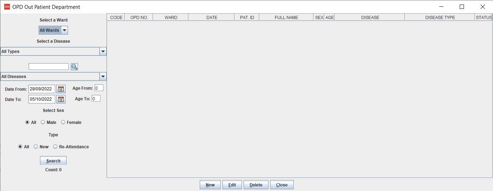

The following functions are available from the **Buttons panel** of the window **_OPD Out Patient Department_**:

-   **New**: create a new patient visit.
    
-   **Edit**: modify an existing patient visit.
    
-   **Delete**: delete a patient visit.
    
-   **Close**: exit from the **_OPD Out Patient Department_** function.
    

Furthermore, a search function (**Search**) is available using the **Selection panel** on the left side of the window.

<a id="_3_2_1_search_patient_visits_search"></a>

#### 3.2.1 Search Patient Visits (Search)

Queries about ambulatory patient visits can be done using the search criteria available on the **Selection panel** area of the window (on the left side of the window).

The following fields are available to select or narrow the resulting matches:

-   **Search by code** (only one can be used at a time)
    
    -   **Code**: Search an OPD visit by its code. Each code is unique, so only **ONE** result is expected
        
    -   **OPD No.**: Search OPD visits by their Progressive in Year. This starts every year from 1, so one or more results are expected
        
    -   **Pat. Id**: Search OPD visits by Patient ID. One or more results are expected
        
    

> [!NOTE]
>
> to apply the above **Exclusive Filters** one has to just type a _number_ and press _ENTER_.

-   **Other filters** (they are all applied when pressing Search)
    
    -   **Ward**: Select a specific OPD ward
        
    -   **Disease type**: Select a specific disease type or all disease types
        
    -   **Disease**: Select either a specific disease or all diseases, or search using partial matches by typing some letters in the search field
        
    -   **Sex**: Select patients by sex: All / Male / Female
        
    -   **Date**: “Date From” and “Date To” to select all visits occurring during the specified period
        
    -   **Age**: “Age From” and “Age To” to select patients by age
        
    -   **Type of patient**: Select visits by type of attendance: All / New / Re-Attendance
        
    -   **User**: Select visits by doctor (USER column): only visits inserted by the logged user (me) or All
        
    

After specifying the selection criteria, press the **Search** button. The counter at the bottom of the window indicates how many visits match the specified criteria, and the individual visit data is shown in the **Data table** area. The **Reset** button blanks all filters to default values.

The example below shows all the visits for patients with _asthma_ disease admitted in the period from 29-5-2020 until 5-6-2021; all ages, all sexes, and all patient types are included.

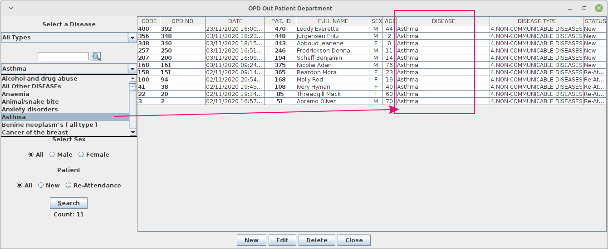

<a id="create-a-new-patient-visit"></a>

#### 3.2.2 Create a New Patient Visit (New)

Press the **New** button in the **_OPD Out Patient Department_** window to access the **_New OPD Registration_** window, shown below.

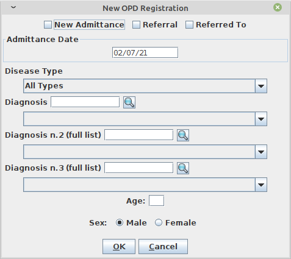

To record a visit, enter data into the following fields:

-   **Type of attendance**: This field is not meant to distinguish whether or not an individual is new in the ambulatory (that is, whether this is the absolute first time they have entered the ambulatory). The NEW ATTENDANCE selection indicates whether the patient comes to the ambulatory to report a new health issue or new disease for which no care has been previously addressed or recorded. This could be their initial visit or their n-th time in the ambulatory; it does not matter with regard to this field. If this visit is for an issue or disease previously addressed, the field is not selected and records are created for the patient with regard to the follow-up care and instructions for recovery.  
      
    _Example: A patient comes to the ambulatory because they report a cut; this event is recorded as NEW ATTENDANCE. The doctor sutures the wound and invites the patient to come back ten days later. When the same patient comes back after ten days to have his/her stitches removed, a new OPD record is created, without the NEW ATTENDANCE flag set._  
    
-   **Attendance Date**: The date on which the patient is seen for the recorded activity.
    
-   **Disease Type**: By selecting a _Disease Type_, the first diagnosis list will contain only related diseases. The second and third list continues to contain all diseases.  
    

> [!NOTE]
>
> Disease Types are defined by the Administrator. Ask the Administrator or check the [Settings](#settings) chapter.

-   **Diagnosis**: A maximum of three diseases can be diagnosed per attendance (“new attendance” or “re-attendance” does not matter in this context). Normally, the patient reports at least one visit reason, but it may happen that during the same visit, the doctor finds other concurrent pathologies. Thus it is possible to record up to a maximum of three (the first being the only one mandatory) diagnoses.  
    It is possible to use filters to find diseases more easily. To do so, enter a text fragment in the search field that is part of the disease name. The closer the search text comes to the name of the disease being searched, the more precise the search is.  
      
    _Example: In the **OPD Out Patient Department** window, only the first diagnosis and its type are shown, but all the corresponding data is stored and available in reports and for searching._  
    
-   **Age**: The patient’s age; the valid age range is 0-120.
    
-   **Sex**: The patient’s sex; either male or female.
    

When finished entering data, the **Buttons panel** has the following choices:

-   **OK**: confirm and record the patient’s visit.
    
-   **Cancel**: close the window and return to the **_OPD Out Patient Department_** window.
    

<a id="_3_2_3_modify_a_recorded_patient_visit_edit"></a>

#### 3.2.3 Modify a Recorded Patient Visit (Edit)

In order to modify a visit, first highlight it in the **_OPD Out Patient Department_** window. Once the visit has been highlighted, press the **Edit** button. When the **_Edit OPD Registration_** window is shown, all the data can be changed or modified.

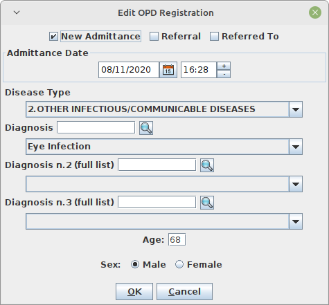

Once the data have been inserted, the **Buttons panel** shows the following choices:

-   **OK**: confirm new values (all the previous values will be lost).
    
-   **Cancel**: close the window and return to the **_OPD Out Patient Department_** window without applying any changes.
    

<a id="_3_2_4_delete_a_recorded_patient_visit_delete"></a>

#### 3.2.4 Delete a Recorded Patient Visit (Delete)

In order to delete a visit, first highlight it in the **_OPD Out Patient Department_** window. Once the visit has been highlighted, press the **Delete** button. The highlighted record is shown in a confirmation dialog: now the record can be deleted. Deleted records are no longer available.

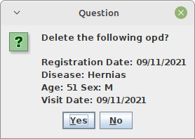

The **Buttons panel** shows the following choices:

-   **Yes**: confirm the deletion of the visit.
    
-   **No**: close the window and return to the **_OPD Out Patient Department_** window without deleting the visit.
    

<a id="opd-extended"></a>

### 3.3 OPD Extended

The OPD functionality can be extended by changing the _OPDEXTENDED_ flag in the configuration file. Ask the Administrator or refer to the _Administrator’s Guide_.

<a id="_3_3_1_additional_features"></a>

#### 3.3.1 Additional Features

Press the **New** button in the **_OPD Out Patient Department_** window to access the **_New OPD Registration_** window, shown below.

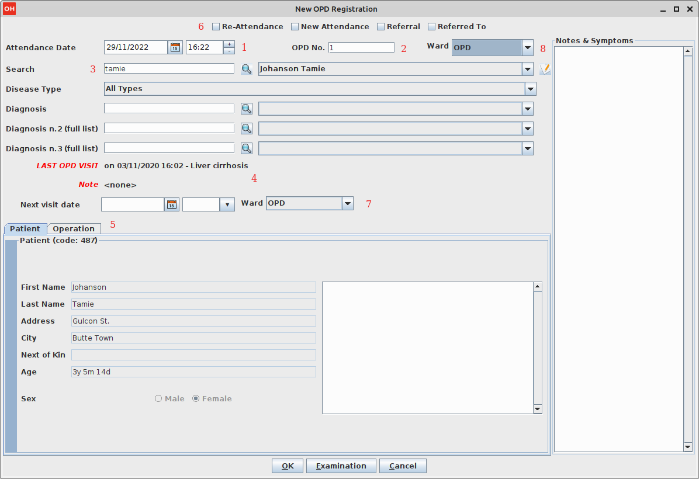

The OPD Extended module affords the following additional features:

-   Calendar (1): to choose the visit date
    
-   OPD number (2): the progressive number per year automatically set by the system; changes to the value can be made only at the first registration in a year, and then it will be increased automatically at each registration. The OPD number **MUST** be unique for each year.
    
-   Registered Patient (3): before choosing a disease, first select a patient from the drop-down list (this is **required**); to find a patient, use the nearby search field by typing part of the patient’s name or code. This improves the reliability of reports and statistics, and is a service to the patient as it accounts for the patient’s history.
    
-   Radio box (6): to distinguish whether an individual is new (**New Attendance**) or a (**Re-Attendance**) in the ambulatory. The **New Attendance** selection indicates that the patient came to the ambulatory to report a new health issue or new disease for which no care has been previously provided and/or addressed. This could be their initial visit or their n-th time in the ambulatory; it does not matter for this selection. The important criteria for selecting **New Attendance** is that the problem under consideration is a new issue; that is, one that has not been dealt with previously. For an issue or disease previously dealt with but not completely addressed (that is, completely cured or healed), **Re-Attendance** is selected and records are created for the patient in regard to the follow-up care and instructions for recovery. Any other follow-up visits for the same issue are also marked as **Re-Attendance**.
    
    ```   
    Example: A patient comes to the ambulatory because they report a cut; this
    event is recorded as a *New Attendance*. The doctor sutures the wound and
    invites the patient to come back in ten days. When the same patient comes
    back after ten days to have his/her stitches removed, a new OPD record is
    created with the *Re-Attendance* flag set, as this visit is a
    continuation of the previous visit and medical problem.
    ```

-   Once a patient is selected and if a previous OPD visit is found, special fields are populated with the most recent visit of the patient (4), his/her personal data (5), and the **Re-Attendance** radio box will be selected automatically upon selection of the main (first) disease (6);
    
-   It is now possible to set the next appointment date (7) and in what ward (OPD or IPD). This automatically schedules a visit visible in [Therapy Management](#therapy-management) and [Worksheet](#worksheet).
    
-   Selecting the trash can icon (7) clears the next visit information (date, time and ward) and deletes the appointment if previously specified.
    
-   The selection of the OPD ward (8) is required so as to specify where the visit is taking place. After the first selection in a session, the application remembers the selection to ease the data entry.
    
-   If a new attendance for this patient is required, click the "New Attendance" (6) radio box and proceed normally.
    
-   If editing an old OPD, it is possible to change everything except the patient to whom the OPD refers, and the "New Attendance" radio box.
    
-   In the event that the selected patient’s personal data need to be updated, it is possible to click on the Edit icon  near his/her name; a new window shows the patient’s personal information ready for modification.
    
-   In the event that the patient is not yet registered, the **_<new patient>_** entry can be selected to register a new patient; after registration, the program returns to the OPD window and the new patient is selected.
    
-   If the user is enabled by the Administrator (see [Users & Groups](#users-groups)), the following is shown:
    
    -   the **Examination** button function (see [Patient examination](#patient-examination))
        
    -   the **Operation** tab after the patient’s tab (5) to record small surgeries and other interventions (see [Operations](#operations)) as well as in Admission (see [Insert or Modify Surgery Data](#insert-or-modify-surgery-data)).
        
    

> [!NOTE]
>
> For OPD and IPD wards, see [Ward](#ward) settings.

<a id="_4_pharmacy_pharmacy"></a>

## 4 Pharmacy (Pharmacy)

Pressing **Pharmacy** from the main menu provides access to the Pharmacy menu. From the Pharmacy menu, the following functions are available: **Pharmaceuticals**, **Pharmaceuticals Stock**, and **Pharmaceuticals Stock Ward.**

<table class="tableblock frame-none grid-none stretch"><caption class="title">Submenu: Press the <strong><span class="underline">P</span>harmacy</strong> button or “Alt + P” to open the Pharmacy submenu</caption> 
<colgroup>
<col width="50%"> 
<col width="50%">
</colgroup>
<tbody>
<tr>
<td class="tableblock halign-left valign-top"><p class="tableblock"><span class="image"></span></p>
</td>
<td class="tableblock halign-left valign-top"><p class="tableblock"><span class="image">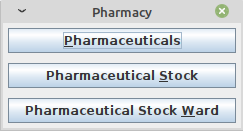</span></p>
</td>
</tr>
</tbody>
</table>

> [!NOTE]
>
> Pharmaceuticals Stock Ward functionality can be disabled by changing the INTERNALPHARMACIES flag in the configuration file. Ask the Administrator or refer to the _Administrator’s Guide_.

<a id="pharmaceuticals"></a>

### 4.1 Pharmaceuticals (Pharmaceuticals)

<a id="_4_1_1_main_characteristics"></a>

#### 4.1.1 Main Characteristics

Pharmaceutical functions allow for the insertion, modification, and deletion of pharmaceuticals. Moreover, it provides important information about pharmaceuticals:

-   the current quantity lying in the stock
    
-   the limit quantity that defines when a pharmaceutical is going out of stock
    
-   if the pharmaceutical is out of stock
    
-   the drugs expiring today or within a specified time period
    

> [!NOTE]
>
> In Open Hospital, to identify pharmaceuticals, sometimes the word, “pharmaceutical” is used and sometimes the synonym “medical” is used.

<a id="_4_1_2_functions_of_pharmaceuticals"></a>

#### 4.1.2 Functions of Pharmaceuticals

To access the functions of Pharmaceuticals, press **Pharmaceuticals** in the Pharmacy menu.

All functions available under Pharmaceuticals are accessible from the **_Pharmaceutical Browser_** window, shown below. It displays all the pharmaceuticals available in the hospital.

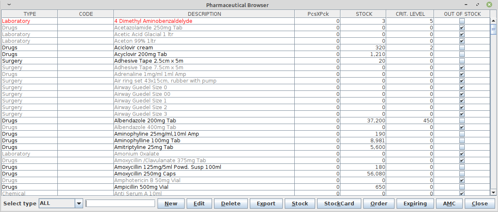

If the pharmaceutical quantity is under the critical level, it is shown in RED.

If the pharmaceutical quantity is zero, it is shown in GRAY and the square in the last column is checked.

The following functions are accessible from the **Buttons panel** of the **_Pharmaceutical Browser_** window:

-   **New**: register a new pharmaceutical.
    
-   **Edit**: modify a registered pharmaceutical.
    
-   **Delete**: delete a pharmaceutical.
    
-   **Export**: export the pharmaceuticals to a CSV file (Excel).
    
-   **Stock**: show the report of stock quantities.
    
-   **StockCard**: show the history of the movement of a certain pharmaceutical (must be selected in the list first).
    
-   **Order**: show the list of pharmaceuticals that have to be ordered.
    
-   **Expiring**: show the list of pharmaceuticals that are going to expire (today, next month, within two months, within three months, or within another month to be specified).
    
-   **AMC**: show the AMC (average monthly consumption) of pharmaceuticals.
    
-   **Close**: exit from the **Pharmaceuticals Browser**.
    

At the bottom left of the window, there are an "Active Only" and a "Select type" selectors. Based on the values selected, the table either displays a pharmaceutical of a specific type or all pharmaceuticals if the default value of "All" is used. Similarly, the "Active Only" shows only the active pharmaceuticals; other options are "Disabled Only" and "All".

Just to the right of the selectors is a field that is used to search for a specific pharmaceutical by description by typing a keyword into the field.

It is possible to sort the table by any of the column headers by double-clicking on the column name. Filtered type (combo box), searched keys (the search field) and sorting are all reflected in the STOCK report.

<a id="insert-a-new-pharmaceutical"></a>

##### 4.1.2.1 Insert a New Pharmaceutical (New)

Press the **New** button in the **_Pharmaceutical Browser_** window to access the **_New Medical_** window, shown below.

To insert a new pharmaceutical, enter the following fields:

-   **Type**: for example, Drugs or Chemical  
    
-   **Code**: code that uniquely identifies the pharmaceutical for fast searching.
    
-   **Description**: the description of the pharmaceutical.
    
-   **Pieces per Packet**: number of pieces per packet (if more than 1).
    
-   **Critical level**: the minimum quantity required in stock.
    
-   **Active**: if the pharmaceutical is active or not.
    

> [!NOTE]
>
> Types can be defined by the Administrator. Check the [Settings](#settings) chapter for more information.

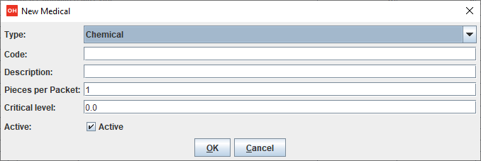

When all the data is entered, the **Buttons panel** has the following choices:

-   **OK**: confirm and save the data.
    
-   **Cancel**: close the window and return to the **_Pharmaceutical Browser_** window.
    

<a id="_4_1_2_2_modify_an_existing_pharmaceutical_edit"></a>

##### 4.1.2.2 Modify an Existing Pharmaceutical (Edit)

After selecting the pharmaceutical to modify, press the **Edit** button in the **_Pharmaceutical Browser_** window to access the **_Edit Medical_** window, shown below. All the data can be modified or changed.

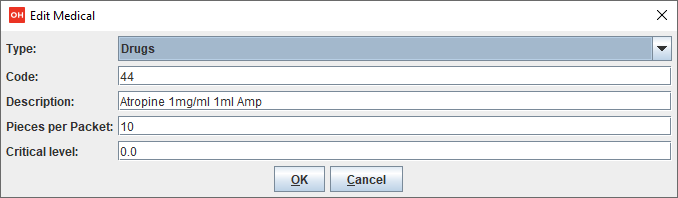

When all the data is entered, the **Buttons panel** has the following choices:

-   **OK**: confirm and save the data.
    
-   **Cancel**: close the window and return to the **_Pharmaceutical Browser_** window.
    

<a id="_4_1_2_3_delete_a_pharmaceutical_delete"></a>

##### 4.1.2.3 Delete a Pharmaceutical (Delete)

To delete a pharmaceutical, highlight it in the Browser window as before. Next, press the **Delete** button and a confirmation dialog is shown:

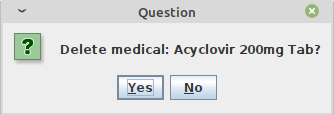

The **Buttons panel** has the following choices:

-   **Yes**: confirm the deletion of the pharmaceutical.
    
-   **No**: close the window and return to the **_Pharmaceutical Browser_** window.
    

> [!NOTE]
>
> If a pharmaceutical has been already used in the system, it will be "Disabled" (see [1.1.2 Soft Deletion and Disabling Features](#soft-deletion-and-disabling-features)).

<a id="_4_1_2_4_export_the_list_of_pharmaceuticals_export"></a>

##### 4.1.2.4 Export the List of Pharmaceuticals (Export)

Use this function to export the list of pharmaceuticals shown in the **_Pharmaceutical Browser_** window that then can be imported into Excel.

Press the **Export** button in the **_Pharmaceutical Browser_** window to access the **_Save_** window, shown below. The window uses the language of the computer, regardless of the language used in Open Hospital.

This begins the exporting of the list of pharmaceuticals.

In the **_Save_** window:

-   select the directory of the file system where the data is to be stored
    
-   input the name for the file (Filename)
    

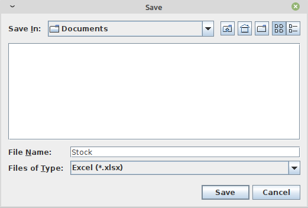

<a id="_4_1_2_5_stock_report_stock"></a>

##### 4.1.2.5 Stock Report (Stock)

Press the **Stock** button in the **_Pharmaceutical Browser_** window to produce the report of pharmaceuticals in the stock, grouped by _IN STOCK_ and _OUT OF STOCK_.

<a id="_4_1_2_6_stockcard_stockcard"></a>

##### 4.1.2.6 StockCard (StockCard)

Press the **StockCard** button in the **_Pharmaceutical Browser_** window to show the history of the movement for a selected pharmaceutical for a specific time range. The data can either be in report format or exported to a CSV file.

<a id="_4_1_2_7_order_of_pharmaceuticals_order"></a>

##### 4.1.2.7 Order of Pharmaceuticals (Order)

Press the **Order** button in the **_Pharmaceutical Browser_** window to produce the list of pharmaceuticals remaining in stock and the ones to be reordered according to their critical level.

<a id="_4_1_2_8_expiring_pharmaceuticals_expiring"></a>

##### 4.1.2.8 Expiring Pharmaceuticals (Expiring)

Press the **Expiring** button in the **_Pharmaceutical Browser_** window to produce the list of pharmaceuticals that are going to expire, grouped by type and lot.

<a id="_4_1_2_9_average_monthly_consumption_amc"></a>

##### 4.1.2.9 Average Monthly Consumption (AMC)

Press the **AMC** button in the **_Pharmaceutical Browser_** window to produce a report showing the average monthly consumption of pharmaceuticals.

<a id="pharmaceutical-stock"></a>

### 4.2 Pharmaceutical Stock (Pharmaceutical Stock)

<a id="_4_2_1_main_characteristics"></a>

#### 4.2.1 Main Characteristics

The Pharmaceutical Stock feature is used to store and trace every stock movement that has been made. Every movement is identified by the following data:

-   date of the movement
    
-   type of the movement, that is, if it is a charging or discharging type
    
-   the ward to which the movement refers. This feature is needed for discharging movements only. It is important to know in which ward pharmaceuticals have been used; otherwise, this field is empty
    
-   the quantity
    
-   the pharmaceutical (which in turn relates to different categories: Laboratory, Surgery, Drugs or Chemical)
    
-   the lot to which the movement is referred. Some pharmaceuticals may not have a lot related (for example, ‘Gloves’), so the field can be omitted. It is recommended to store even the lot (if it exists) because every lot has its own peculiarity:
    
    -   a name (that can be its code)
        
    -   a preparation date
        
    -   a due date
        
        In this way, which movement that refers to the pharmaceuticals expiring can be found, or pharmaceuticals prepared on a specific date, or how many movements have been registered about that lot, and so on.
        
    
-   the supplier of the pharmaceutical. This characteristic is needed for charging movements only. This field is empty in other cases.
    

<a id="_4_2_2_functions_of_pharmaceuticals_stock"></a>

#### 4.2.2 Functions of Pharmaceuticals Stock

To access the functions of Pharmaceuticals, press **Pharmaceutical Stock** in the Pharmacy menu, shown below.

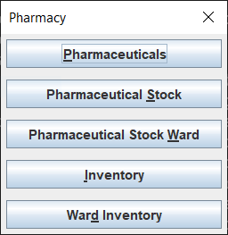

The **_Stock Movement Browser_** window, shown below, is opened.

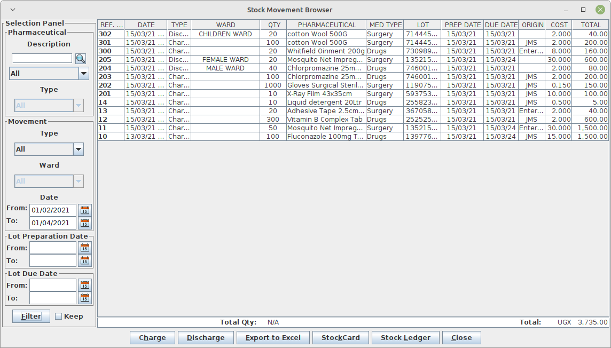

> [!NOTE]
>
> The User column can be enabled or disabled by changing the _SINGLEUSER_ flag in the configuration file. Ask the Administrator to enable/disable this function or refer to the _Administrator’s Guide_.

The following functions are available from the **Buttons panel** of the window **_Stock Movement Browser_**:

-   **Charge**: record a new charge movement.
    
-   **Discharge**: record a new discharge movement.
    
-   **Delete**: delete the last movement.
    
-   **Export to Excel**: export pharmaceuticals stock movements.
    
-   **StockCard**: show the history of the movement for a certain pharmaceutical (can be directly selected by the list otherwise will be requested).
    
-   **Stock Ledger**: show the history of the movement for all pharmaceuticals within a selected date range.
    
-   **Close**: exit the **_Stock Movement Browser_** window.
    

Furthermore, a search function (**Filter)** is available using the **Selection panel** on the left of the window.

<a id="_4_2_2_1_search_pharmaceuticals_stock_movements_filter"></a>

##### 4.2.2.1 Search Pharmaceuticals Stock Movements (Filter)

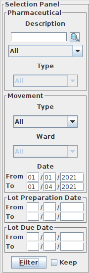

Using the **_Stock Movement Browser_** search function, the information in the window can be filtered to show:

-   how many boxes of pharmaceuticals remain in the stock
    
-   which movements have been made on a specific day
    
-   in which ward a specific pharmaceutical has been discharged
    
-   if there are any pharmaceuticals expired
    

Queries about the movements of pharmaceuticals can be done using the search criteria available on the **Selection panel** area of the **_Stock Movement Browser_** window (left side of the browser). The search results are shown in the **Data table** area.

The **Selection panel** is used to select a group of movements according to specific filters. The filter is set using the tools contained in the **Selection panel**.

Filters refer to three different objects: the **Pharmaceutical**, the **Movement**, and the **Lot Preparation and Lot Due Date**.

For a **Pharmaceutical**, choose either its:

-   **_Description_**, the pharmaceutical’s name
    
-   **_Type_**: Laboratory, Surgery, Chemical, or Drug, etc.
    

To avoid conflicting filters, only one of the options is available at any one time. So, when the description combo box is active, the other one is not, and vice versa.

To quickly find a medical, simply type a keyword that is a part of the medical’s name into the text field at the top of the pharmaceuticals products combo box and press the search button () that follows this text field.

For a **Movement**, choose either its:

-   **_Type_**: specifies if it is a charge or a discharge type. If the discharge option is selected, then the ward combo box is enabled. The ward combo box allows finding any discharging movements that refer to a specific ward.
    
-   **_Date_**: specifies the data range for the search, between the ‘Date From’ and ‘Date To’ values. The date tools consist of three blank areas, which (from left to right) refer to day, month and year. As a value is inserted into a blank area, moving to the next area is accomplished by using the “Tab” key on the keyboard. When the window is shown, the date range is set to the previous week by default.
    

Finally, for **Lot Preparation Date** and **Lot Due Date**, movements that refer to specific lots can be found by inserting:

-   the _lot preparation date_: a valid time span (between ‘Preparation Date From’ and ‘Preparation Date To’)
    
-   the _due date_; behaves similarly to the lot preparation tool and the movement date tool
    

Each filter can be combined with another, allowing for many possibilities.

After the filtering criteria are chosen, press the **Filter** button and the matching data is shown in the **Data table** area.

By pressing the **Reset** button, all criteria reset to default values.

<a id="insert-stock-charging-movement"></a>

##### 4.2.2.2 Insert Stock Charging Movement (Charge)

To insert charging movements, press **Charge** in the **_Stock Movement Browser_** window. The **_Stock Movement_** window is shown:

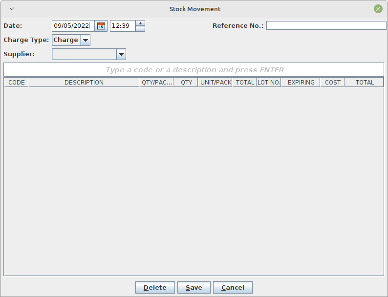

It is possible to perform more than one charging movement at a time. The window is composed of two areas: a **Panel** and a **Grid**.

The **Panel** contains the following fields:

-   **Date**: the date of the movement
    
-   **Charge Type**: the charge type
    
-   **Supplier**: the origin of the pharmaceutical
    
-   **Reference No.**: the reference of the operation
    

The **Grid** is filled with the pharmaceuticals involved in the charging movement. To fill the grid, use the field above the grid to select a pharmaceutical. Enter into the field the code or the description of the pharmaceutical to move, and press **ENTER.** This will open the **_Choose a Medical_** window.

> [!NOTE]
>
> Only **Active** pharmaceuticals will be displayed (see [4.1 Pharmaceuticals](#pharmaceuticals))

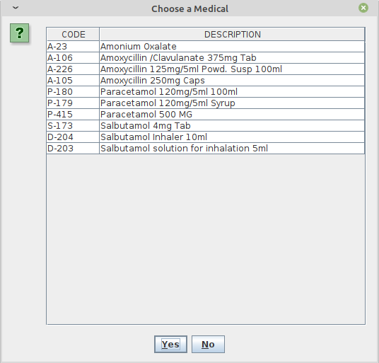

Select the desired medical and click **Yes**. This will open a new window where the quantity of the medical is specified:

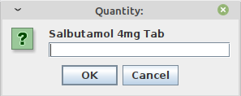

Then press **OK**. If there is an existing lot in the system, the **_Existing Lot_** window is shown:

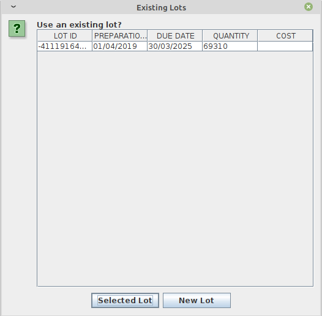

If stock movement is related to this existing lot, select it and click **Selected Lot**. Otherwise, click **New Lot**; then the **_Lot Information_** window is shown with the following fields:

-   **Lot No.**: the lot code
    
-   **Lot preparation**: the lot preparation date
    
-   **Expiring**: the lot expiring date
    

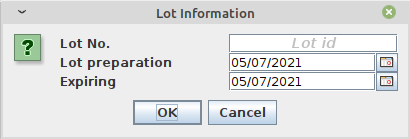

Enter the appropriate values and then press the **OK** button. The **_Input_** window is shown, where the unit cost is specified:

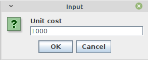

Then click **OK** to insert the medical information as a line in the grid.

Finally, click the **Save** button to save the charge movement.

> [!NOTE]
>
> The Lot definition can be set as automatic by changing the AUTOMATICLOT\_IN flag in the configuration file, so every new charging movement automatically creates a new lot. Regardless of the setting, the Expiring Date must always be provided. Ask the Administrator or refer to the _Administrator’s Guide_.

> [!NOTE]
>
> In order to avoid managing the cost of medicals, set the LOTWITHCOST flag to _no_ in the configuration file. Ask the Administrator or refer to the _Administrator’s Guide_.

<a id="insert-stock-discharging-movement"></a>

##### 4.2.2.3 Insert Stock Discharging Movement (Discharge)

To insert discharging movements, press the **Discharge** button in the **_Stock Movement Browser_** window. The **_Stock Movement_** window is shown:

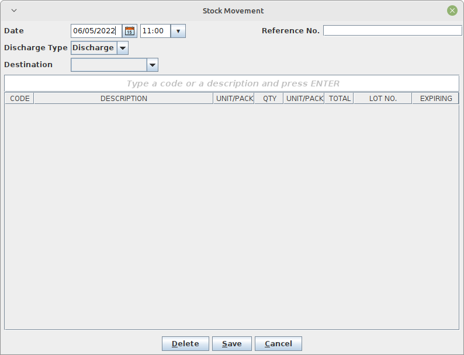

It is possible to perform more than one discharging movement at a time. The window is composed of two areas: a **Panel** and a **Grid.**

The **Panel** contains the following fields:

-   **Date**: the date of the movement
    
-   **Discharge Type**: the discharge type
    
-   **Destination**: the ward where the discharged medical will be affected
    
-   **Reference No.**: the reference number of the operation
    

The **Grid** is filled in with pharmaceuticals involved in the discharging movement. To fill the grid, enter into the field above the grid the description of the pharmaceutical to discharge, and press **ENTER.** This opens the **_Choose a Medical_** window.

> [!NOTE]
>
> Only **Active** pharmaceuticals will be displayed (see [4.1 Pharmaceuticals](#pharmaceuticals)


Select the desired medical and click **Yes**. This opens the **_Quantity_** window, showing the existing stock for the medical. In the input field, enter the quantity of the medical to discharge.

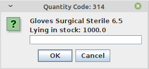

Then press **OK**. The **_Lot Information_** window is shown:

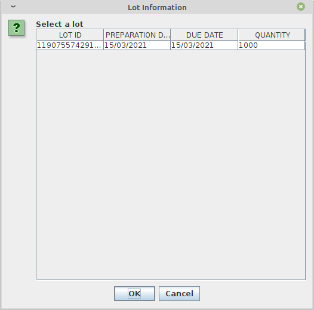

Select the existing lot and click **OK** to insert the medical discharge into the grid.

Click the **Save** button to save the discharge movement.

> [!NOTE]
>
> The Lot definition can be set as automatic by changing the flag AUTOMATICLOT\_OUT in the configuration file, so every new discharging movement will automatically select a suitable lot for the operation according to the expiring date. If the first selected lot does not contain a high enough quantity to serve the discharging movement, several discharging movements may be generated. Ask the Administrator or check the _Administrator’s Guide_ for more information.

<a id="delete-last-stock-movement"></a>

##### 4.2.2.4 Delete Last Stock Movement (**Delete**)

In Pharmaceutical Stock it is not possible to change the past and all operations need to be done in consecutive order. If a mistake concerns a movement in the past (for example, the wrong quantity of a pharmaceutical is inserted in charge), then use a new opposite movement to correct the mistake (in the example, use a discharge movement to undo the unwanted change).

Nevertheless, the admin can enable/disable the **Delete** button that allows the enabled user do delete only the last movement, and helps quickly undoing mistakes.

To delete the last movement, select first the row that you want to delete and press the **Delete** button in the **_Stock Movement Browser_** window. Only one row is allowed to delete at a time.

If it is not the last movement the following **_Error_** message is shown:


But if the row selected is the last movement, the following dialog is presented, where a **reason** for the deletion must be entered (it is kept in the audit log of deleted movements):

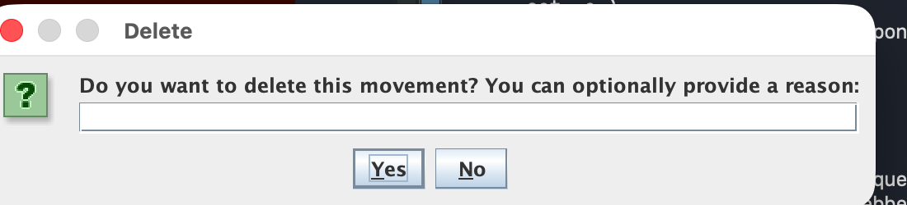

Type a reason (it is required and cannot be left empty) and click **Yes** to confirm the deletion of the last movement, otherwise click **No** to cancel the operation. After confirming, the system checks if the product involved in the selected movement has not been used itself in the **_Pharmaceuticals Stock Ward_** (see [Pharmaceuticals Stock Ward](#pharmaceutical-stock-ward) in this document).

If the product has been already used in a Ward, then the **_Error_** message is shown.

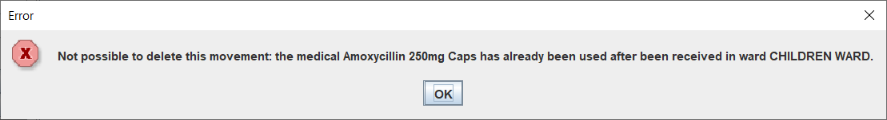

Otherwise the selected movement is deleted and the **_Success_** window is shown:

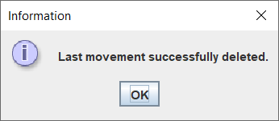

> [!NOTE]
>
> This button can be enabled/disabled to allow/not allow movements deletion. Ask the Administrator or check the Administrator’s Guide for more information.

<a id="pharmaceutical-stock-ward"></a>

### 4.3 Pharmaceuticals Stock Ward (Pharmaceuticals Stock Ward)

<a id="_4_3_1_main_characteristics"></a>

#### 4.3.1 Main Characteristics

The Pharmaceutical Stock Ward feature allows the management of the pharmacy at the ward level.

**Pharmaceuticals Stock Ward** functionality can be enabled or disabled by changing the _INTERNALPHARMACIES_ flag in the configuration file**.** Ask the Administrator or refer to the _Administrator’s Guide_.

<a id="_4_3_2_functions_of_pharmaceuticals_stock_ward"></a>

#### 4.3.2 Functions of Pharmaceuticals Stock Ward

To access the functions of Pharmaceuticals, press **Pharmaceutical Stock Ward** on the Pharmacy menu shown below.


The window **_Ward Pharmacy_**, shown below, will be opened. All functions available under Pharmaceutical Stock are accessible from the **_Ward Pharmacy_** window by selecting one **WARD** on the top left of the window.

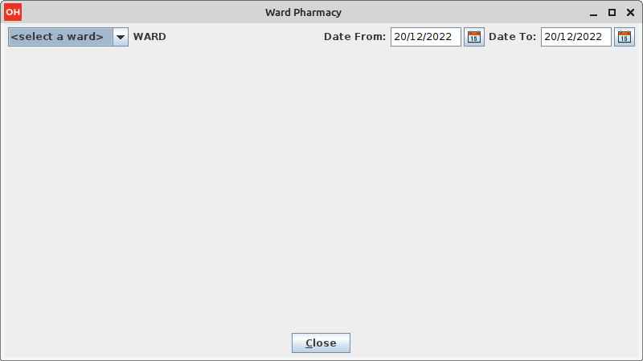

After the selection of the ward (FEMALE WARD in this example), the **_Ward Pharmacy_** window is shown, allowing for the management of the ward pharmacy of the FEMALE WARD:

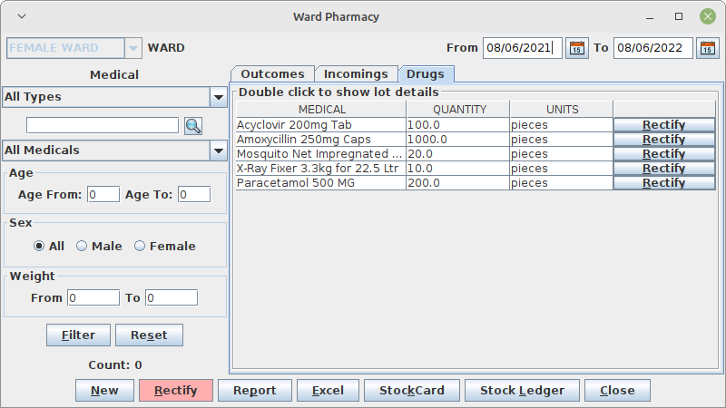

The available functions are:

-   **New**: create a new discharging movement for the patient.
    
-   **Rectify**: rectify the quantity lying in stock (see 4.3.2.1 Rectify).
    
-   **Report**: print the ward medical inventory report.
    
-   **Excel**: export the data in a format to import into Excel.
    
-   **Delete**: delete the last movement.
    
-   **StockCard**: show the history of the movement for a certain pharmaceutical (can be directly selected by the list otherwise will be requested).
    
-   **Stock Ledger**: show the history of the movement for all pharmaceuticals within a selected date range.
    
-   **Close**: exit from the **_Ward Pharmacy_** window.
    

Differently from the **Pharmaceuticals Stock** functionality, the **Pharmaceutical Stock Ward** allows only discharging movement to patients since it is an internal management of pharmaceuticals held in the ward after they have been “charged” by the main pharmacy. It is also possible that the discharging movement from ward to ward can be accomplished.

The **_Ward Pharmacy_** window shows a **Filter panel** on the left, a **Movements panel** in the right-center, and a **Button panel** at the bottom.

<a id="_4_3_2_1_rectify_rectify"></a>

##### 4.3.2.1 Rectify (Rectify)

It is possible to rectify the quantity held in stock in the Ward Pharmacy. This may be necessary when a drug is damaged or stolen. To do this, click the **Rectify** button to open the **_Rectify_** window.

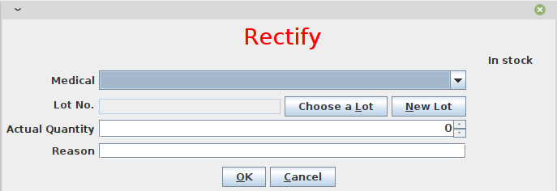

-   Select the medical. Once the medical has been selected, the quantity currently in stock is displayed.
    
-   If lots exist for the drug, click **Choose a Lot**; otherwise, click on **New Lot** (new lot creation).
    
-   Modify the **Actual Quantity**.
    
-   Enter the reason for the rectification.
    

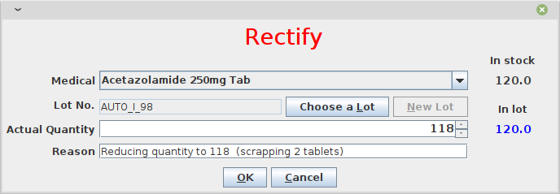

Click **OK** to save the rectification or **Cancel** to abort the change.

<a id="search-ward-pharmacy-movements"></a>

##### 4.3.2.2 Search Ward Pharmacy Movements (Filter)

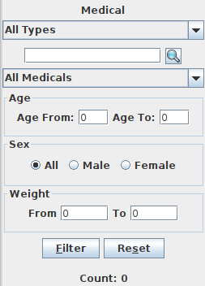

The **Filter panel** allows the filtering of registered movements by:

-   Medical
    
-   Age
    
-   Sex
    
-   Weight
    

The counter at the bottom automatically displays the number of movements that match the filtering criteria after clicking the **Filter** button.

The **Reset** button resets all the values in the **Filter panel** back to their default values as shown in the figure above.

<a id="_4_3_2_3_the_movements_panel"></a>

##### 4.3.2.3 The Movements Panel

The **Movements panel** is made up of three tabs:

-   **Outcomes**: shows all the movements registered between the dates in the **From** and **To** fields at the top of the window. By default, **From** and **To** dates are set to the current date. Every movement is identified by the following fields:
    
    -   **Date**: the date of the movement.
        
    -   **Patient**: the patient the movement is related to, their age, sex, and weight (ND if the weight has not been defined at the moment of registration).
        
    -   **Medical**: the drug subject of the movement.
        
    -   **Quantity**: the quantity subject of the movement.
        
    
-   **Incomings**: shows all incomings from the main pharmacy; it is to say, all discharging movements registered in the **_Pharmaceutical Stock_** window related to the selected ward.
    
-   **Drugs**: the number of drugs remaining in the selected ward as a result of all incoming minus all the outgoings.
    

<a id="_4_3_2_4_inserting_a_new_ward_pharmacy_movement_new"></a>

##### 4.3.2.4 Inserting a New Ward Pharmacy Movement (New)

To insert ward pharmacy movements, press the New button in the **_Ward Pharmacy_** window. The **_New / Edit_** window is shown:

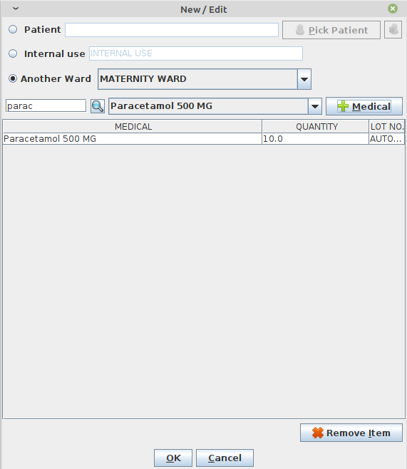

As mentioned previously, only discharging movements are allowed in this functionality. So, the information required is the following:

-   **Patient** or **Internal use** or **Another Ward**: a registered patient can be selected by clicking on the **Pick Patient** button so the movement is associated with his/her ID or select **Internal use** and type a description to specify that the movement is not related to a patient. Selecting **Another Ward** allows for choosing the destination ward from the list provided.
    
-   **Medical**: first select the drug to give to that patient (the only ones that are in the ward as a result of a previous discharging movement in the **_Pharmaceutical Stock Browser_**) from the dropdown list and then press the **Medical** button. It is possible to specify the quantity (multiple and half-piece are allowed) in the window shown:
    

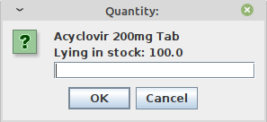

If _AUTOMATICLOTWARD\_TOWARD_ has been enabled, the user will be requested to select a lot (similar to [Insert Stock Discharging Movement](#insert-stock-discharging-movement)).

> [!NOTE]
>
> The lot selection can be enabled or disabled (set as automatic) by changing the flag AUTOMATICLOTWARD\_TOWARD in the configuration file, so every new discharging movement will automatically select a suitable lot for the operation according to the expiring date (FEFO). If the first selected lot does not contain enough quantity to serve the discharging movement, several discharging movements may be generated if the quantity laying in other lots can satisfy the request. Ask the Administrator or check the _Administrator’s Guide_ for more information.

Before pressing the **OK** button, insert as many Medicals as needed; it will show a corresponding number of movements in the **Outcomes** tab of the **Movement panel** in the **_Ward Pharmacy_** window. These movements are also visible in the **Incomings** tab of the **Movement panel** in the **_Ward Pharmacy_** window of the receiving ward, in case of discharging to another ward.

<a id="_4_3_2_5_delete_the_last_stock_movement_in_a_ward_delete"></a>

##### 4.3.2.5 Delete the Last Stock Movement in a Ward (Delete)

In a pharmaceutical stock ward, it is possible to discharge medicals to **patient**, **internal use** or **another ward**. If a mistake is made during the discharge, it is possible to delete it in order to correct the stock of the ward and resume the action.

The Administrator can enable or disable the **Delete** button that allows the deletion of the last movement. This aids in quickly undoing mistakes.

To delete the last movement, select first the row that you want to delete and press the Delete button in the Stock Movement Browser window. Only one row is allowed to delete at a time.

If the selection is not the last movement the following error message dialog is shown:


If the row selected is the last movement then this **_Question_** message is presented:


Click **Yes** to confirm the deletion of the last movement, otherwise click **No** to cancel the operation. After clicking the **Yes** button, if the movement discharges to another ward, the system checks if the product involved in the selected movement has not been used in the destination ward. If not, then the movement is deleted, otherwise the deletion is denied.

If the product has been used in the destination ward, then the **_Error_** message is shown:


Otherwise the selected movement is deleted and the **_Success_** window is shown:


> [!NOTE]
>
> This button can be enabled or disabled to control movements deletions. Ask the Administrator or check the Administrator’s Guide for more information.

<a id="inventory-main"></a>

### 4.4 Inventory (Inventory)

The Inventory feature enables users to manage stock levels within the hospital’s Main Store and wards. This functionality allows for the accurate tracking and adjustment of inventory, ensuring that stock levels are correctly maintained and recorded.

The application supports two types of inventory management:

-   **Main Store Inventory**: this is the primary inventory management system for the hospital’s central storage area. The details of this system are covered in this chapter.
    
-   **Ward Inventory**: this feature is used to manage stock levels within individual wards of the hospital. The specifics of Ward Inventory management are explained in the chapter [4.5 Ward Inventory](#inventory-ward).
    

<a id="inventory-main-characteristics"></a>

#### 4.4.1 Main Characteristics

The Inventory feature is used to manage stock levels in the **_Main Store_** as the hospital’s central storage area. These are the main features:

-   Theoretical and real quantity evidence
    
-   Print working paper to hand write real quantities
    
-   Rotational (partial) inventories
    
-   In line lots creation and editing
    
-   Status workflow: (Save) DRAFT $\rightarrow$ (Validate) VALIDATED $\rightarrow$ (Confirm) DONE
    
-   Full control on charge/discharge types and supplier/destination selection (to be defined by the Administrator)
    

<a id="_4_4_2_functions_of_inventory"></a>

#### 4.4.2 Functions of Inventory

To access the functions of inventory, click on **Inventory** on the Pharmacy menu.


The **_Inventory Browser_** window, shown below, will be opened. By default, the system shows all the inventories recorded in the period. If the "All" filter for Status is selected, the window will show "open" (draft, validated) inventories regardless the date range:

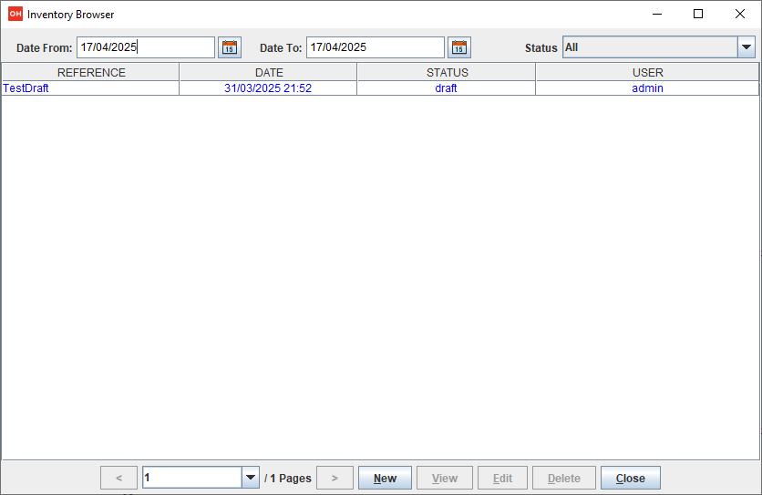

The **_Inventory Browser_** window is composed of three areas: the **Search panel** at the top, the **Inventory table** in the center and the **Buttons panel** on the bottom. See the image above.

The **Search panel** at the top allows for narrowing or sub-setting the inventory list by:

-   **Date From** and **Date To**: dates selectors used to select a period.
    
-   **Status** selector (e.g., 'All'): inventory status filter.
    

The **Inventory table** in the center identifies the inventory by:

-   **REFERENCE**: indicates the reference of the inventory.
    
-   **DATE**: indicates the date the inventory was entered into the system.
    
-   **STATUS**: indicates the status of the inventory.
    
-   **USER**: indicates the user who entered the inventory.
    

The **Buttons panel** has the following inventory operations available:

-   **New**: create a new inventory.
    
-   **Edit**: modify an existing inventory.
    
-   **View**: show an existing inventory.
    
-   **Delete**: cancel an existing inventory.
    
-   **Close**: close the window and return to the main menu.
    

<a id="create-a-new-inventory"></a>

##### 4.4.2.1 Create a New Inventory (New Inventory)

The **New Inventory** function is used to create a new inventory on the main store. Click on **New** button in the **_Inventory Browser_** window to access the **_New Inventory_** window.

The **_New Inventory_** window is composed of three areas: the **Inventory panel** at the top, the **Inventory row table** in the center and the **Buttons panel** on the bottom. See the image below.

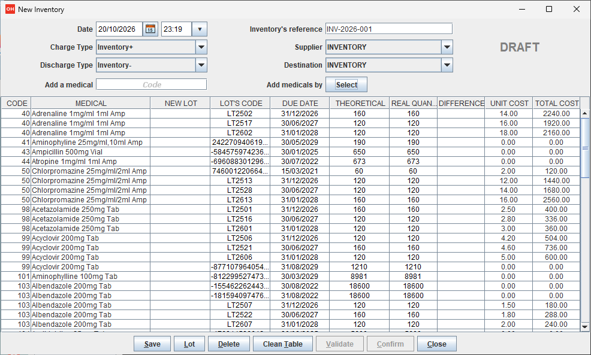

The data shown in the **Inventory panel** area are:

-   **Date**: the date and time when the physical check for this inventory was completed in the main store.
    
    > [!NOTE]
    >
    > This affects the _validation_ step, when the system will check all further charges and/or discharges recorded after this date and so potentially affecting the theoretical and real quantities in the current inventory.
    
-   **Inventory’s reference**: the reference associated to the inventory.
    
-   **Charge Type**: (e.g. Inventory+) the charge movement type used for the charge movement (when theoretical quantity < real quantity).
    
-   **Supplier**: (e.g. INVENTORY) the supplier used for the charge movement.
    
-   **Discharge Type**: (e.g. Inventory-) the discharge movement type used for discharge movement (when theoretical quantity > real quantity).
    
-   **Destination**: (e.g. INVENTORY) the ward used for the discharge movement.
    
    > [!NOTE]
    >
    > The **Charge Type**, **Supplier**, **Discharge Type** and **Destination** can be defined by the Administrator. For instance, it is advisable to use dedicated charge and discharge types for inventories, as well as a virtual supplier and a virtual ward that will be used as origin and destination of the inventory rectifications. Ask the Administrator or check the [Settings](#settings) chapter.
    
-   **Status** (e.g., 'DRAFT'): the status of the inventory. This value is set automatically by the system.
    
-   **Add a medical**: this field is used to add a single product by typing its code or name.
    
-   **Add medicals by**: This button is used to add a set of medicals, by type, quantities or actual usage.
    

The data shown in the **Inventory row table** area are:

-   **CODE**: the code of the pharmaceutical.
    
-   **MEDICAL**: the description of the pharmaceutical.
    
-   **NEW LOT**: indicates if the inventory row introduces a new lot (never recorded before) for the system.
    
-   **LOT’s CODE**: the lot code of the pharmaceutical.
    
-   **DUE DATE**: the due date of the lot.
    
-   **THEORETICAL**: the theoretical (according to the records) quantity of the lot of the pharmaceutical.
    
-   **REAL QUANTITY**: the real (physical count) quantity of the lot of the pharmaceutical.
    
-   **DIFFERENCE**: the difference between real and theoretical quantities, if any.
    
-   **UNIT COST**: the unit cost of the pharmaceutical
    
-   **TOTAL COST**: the total cost that represents the real value of the lot.
    

The **Buttons panel** is used to perform some action:

-   **Save**: this button is used to save the inventory.
    
-   **Lot**: this button is used to link a new lot to a new specific product (the inventory row that column **New Lot** has the value **N**). To perform the operation, first select the product/lot in the list and then click on this button.
    
    > [!NOTE]
    >
    > This button is enabled only for products/lots where the column **New Lot** has the value **N**.
    
-   **Delete**: this button is used to remove one or more products/lots from the list.
    
-   **Clean Table**: this button is used to remove all the inventory rows.
    
-   **Validate**: this button is used to validate the inventory.
    
-   **Confirm**: this button is used to confirm the inventory.
    
    > [!NOTE]
    >
    > The **Confirm** button is enabled only after the inventory is validated. See [Main Characteristics](#inventory-main-characteristics) chapter.
    
-   **Close**: this button is used to return to the **_Inventory Browser_** window.
    

<a id="insert-inventory-row"></a>

###### 4.4.2.1.1 Insert Inventory Row By Using The Code Or Description

To insert an inventory row for a medical, type into the **Add medical** field the code or the description of the pharmaceutical and press ENTER. This opens the _Choose a Medical_ window:

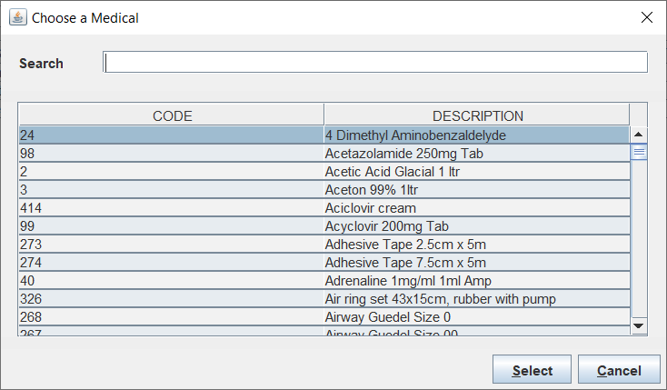

Select the desired pharmaceutical or search for the pharmaceutical by code or description using the search field and then select the pharmaceutical by highlighting it. Next click the **Select** button to add the pharmaceutical as inventory row or click the **Cancel** to return to the **_Inventory Browser_** window.

<a id="_4_4_2_1_2_insert_inventory_rows_by_type_and_usage"></a>

###### 4.4.2.1.2 Insert Inventory Rows By Type And Usage

To insert an inventory row for a set of medicals; which is useful for rotational inventories; click the **Add medicals by** button. This opens the **_Lot Information_** window.

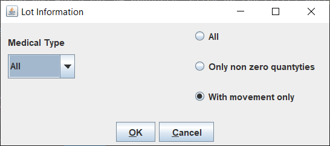

Specify the Medical Type in the combo box (All = all medical types) and choose:

-   **All**: if all the pharmaceuticals for the selected Medical Type are needed.
    
-   **Only non-zero quantity**: if only the pharmaceuticals for the selected Medical Type with non-zero theoretical quantity are needed.
    
-   **With movement only**: if only the pharmaceuticals for the selected Medical Type which have been used at least once are needed.
    

Then click on **Ok** button to insert all the pharmaceuticals that match the choice as the inventory(ies) row(s) in the **Inventory row table**.

<a id="_4_4_2_1_3_insert_inventory_row_with_new_lot"></a>

###### 4.4.2.1.3 Insert Inventory Row With New Lot

If the pharmaceutical is already in the Inventory with all of its possible lots, the system asks if to add it anyway:

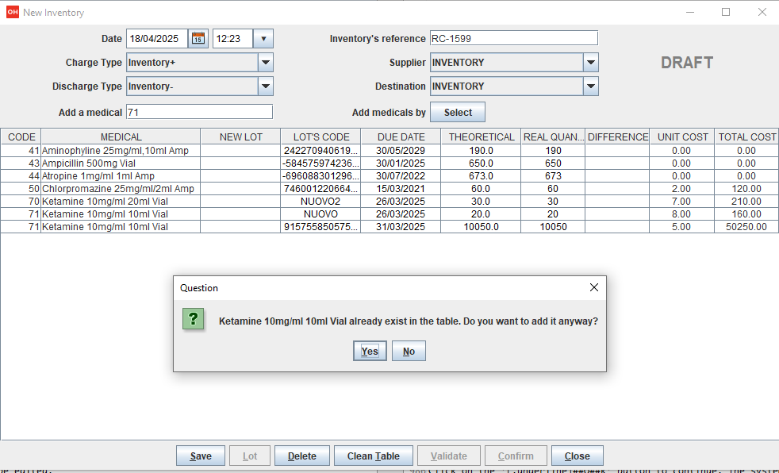

By clicking the **Yes** button, the pharmaceutical is added to the list with a **N** flag:

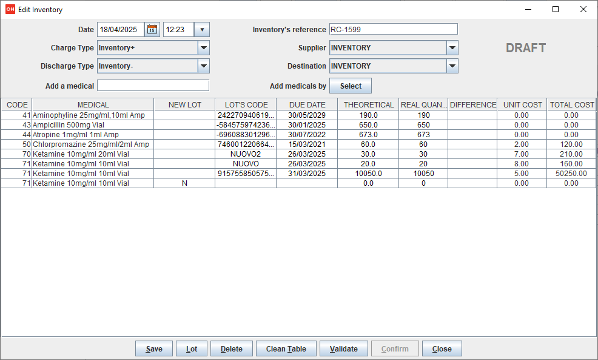

This means that the lot must be defined within the inventory. This can be achieved by selecting the inventory row and then clicking the **Lot** button:

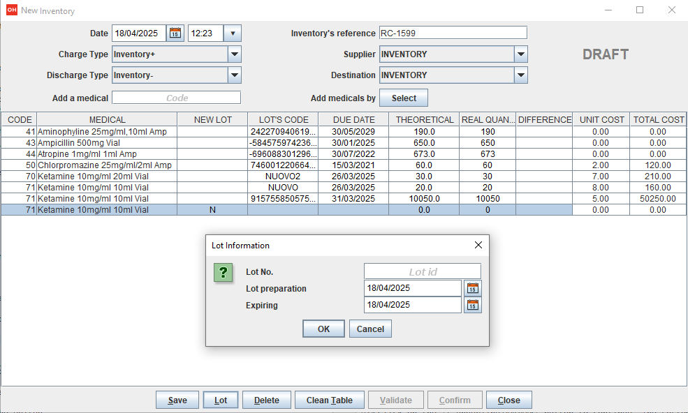

The procedure is similar as that defined in the chapter [4.2.2.2 Insert Stock Charging Movement](#insert-stock-charging-movement).

Once the lot is defined, a real quantity greater than zero must be specified, otherwise validation fails:

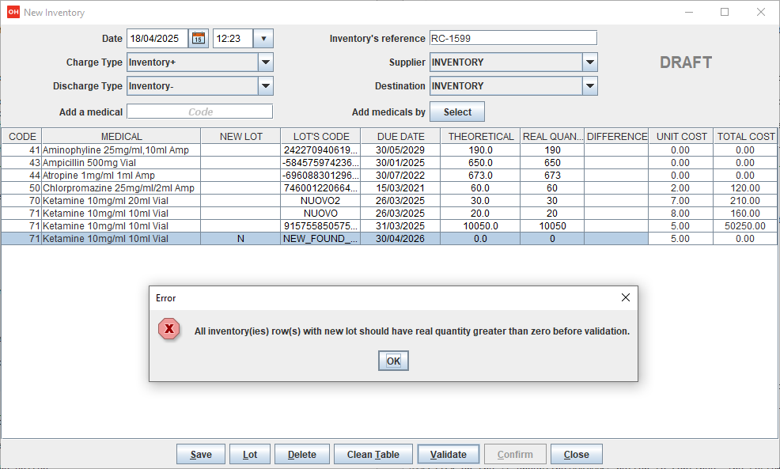

<a id="_4_4_2_2_edit_inventory_edit_inventory"></a>

##### 4.4.2.2 Edit Inventory (Edit Inventory)

To modify an inventory, select the inventory in the **_Inventory Browser_** window. Once the inventory has been highlighted, click the **Edit** button to enter on the **_Edit Inventory_** window. The record is available for the editing of all the data of the inventory including inventory(ies) row(s) of the inventory.

> [!NOTE]
>
> only inventories in DRAFT and VALIDATED states can be edited.

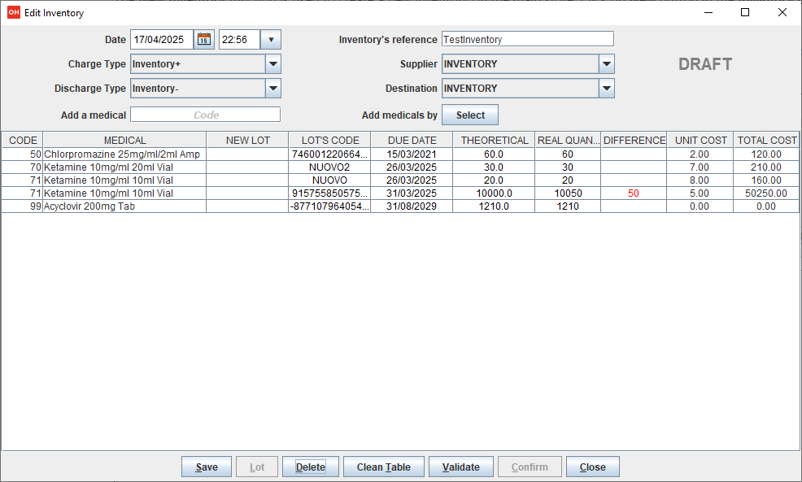

<a id="_4_4_2_3_validate_inventory_validate"></a>

##### 4.4.2.3 Validate Inventory (Validate)

During modification it is possible to validate the inventory by clicking on the **Validate** button. This may result in the following dialog:

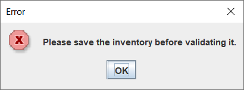

If the inventory has unsaved changes.


This Information window asks whether to check for any medicals on the stock or just the ones that are in the list:

-   **Yes, all medicals**: the system checks if new movements are made on the main store for any medical and shows the changes in a new dialog. See below.
    
-   **No, only the medicals in the list**: the system checks if new movements are made on the main store for the specific medicals that are in the list. E.g., see the image below.
    


Click on the **Ok** button to continue. The system may also show another information message that specifies the date of the inventory will be updated as a new more recent movement has been found:


> [!NOTE]
>
> Since the inventory results in a number of charges/discharges actions in [Pharmaceutical Stock](#pharmaceutical-stock) to align the stock levels to the real quantities (physical count), so the date cannot be prior an already existing movement. The system always checks if the current inventory is the latest operation to be recorded.

Click on the **Ok** button to continue. If new movements are found, the system shows the following dialog in order to update the current inventory:


By clicking the **Yes** button the system will actualize the inventory by adding new inventory row(s) and updating its date/time and status, see the picture below:


Otherwise, by clicking the **No** button, nothing is changed and the inventory remains (or goes back) to DRAFT state.

<a id="_4_4_2_4_confirm_inventory_confirm"></a>

##### 4.4.2.4 Confirm Inventory (Confirm

During modification only after validation is performed it is possible to confirm the inventory by clicking on **Confirm** button. The following dialog is generated:


By clicking the **yes** button, the system converts all differences between real and theoretical quantities into charge/discharge movements and signals the process is completed with the following information message:


> [!NOTE]
>
> Every confirmation has an implicit validation, which means that every time the Confirm button is clicked, the Validation is performed to ensure that the inventory is fully validated before confirmation.


Every difference is reflected either as a charge or a discharge Stock Movement:


<a id="_4_4_2_5_view_inventory_view"></a>

##### 4.4.2.5 View Inventory (View)

To view an inventory, highlight the inventory in the **_Inventory Browser_** window. Once the inventory is highlighted, click the **View** button to enter the **_View Browser_** window.


This function allows viewing all the data for the inventory including inventory(ies) row(s) of the inventory. There is also an option to **Print** the data.

> [!NOTE]
>
> In view mode it is not possible to change anything.

<a id="_4_4_2_6_print_inventory_print"></a>

##### 4.4.2.6 Print Inventory (Print)

To print the inventory, click the **Print** button, See the resulting image below:


Click on **Yes** button, which results in the JasperViewer® showing the generated report without real quantities as follows:


If the **No** button is selected, the JasperViewer® shows the generated report with real quantities as follows:


<a id="_4_4_2_7_delete_inventory_delete"></a>

##### 4.4.2.7 Delete Inventory (Delete)

The delete button is used to cancel an inventory. Select the inventory in the **_Inventory Browser_** window, when the inventory is highlighted click the **Delete** button. A confirmation window is shown:


<a id="inventory-ward"></a>

### 4.5 Ward Inventory (Ward Inventory)

<a id="_4_5_1_main_characteristics"></a>

#### 4.5.1 Main Characteristics

The _Ward Inventory_ feature is used to manage the stock levels in a **_Ward_**. These are the main features:

-   Theoretical and real quantity evidence
    
-   Print working paper to hand write real quantities
    
-   Rotational (partial) inventories
    
-   In line lots creation and editing
    
-   Status workflow: (Save) DRAFT $\rightarrow$ (Validate) VALIDATED $\rightarrow$ (Confirm) DONE
    

<a id="_4_5_2_functions_of_ward_inventory"></a>

#### 4.5.2 Functions of Ward Inventory

To access the Ward Inventory feature, click on **Ward Inventory** on the Pharmacy menu.


All the features available under **Ward Inventory** are accessible from the **_Manage Ward Inventory_** window. By default, the system shows all the inventories recorded in the period. If the "All" filter for Status is selected, the window shows "open" (draft, validated) inventories regardless the date range:


The **_Manage Ward Inventory_** window is composed of three areas: the **Search panel** at the top, the **Ward Inventory table** in the center and the **Buttons panel** on the bottom. See the image below.

The **Search panel** at the top, allows narrowing or sub-setting the inventory list by:

-   **Date From** and **Date To**: dates selectors used to select a period.
    
-   **Status** selector (e.g., 'All'): the status used to filter inventory.
    

The **Inventory table** in the center identifies the inventory by:

-   **REFERENCE**: indicates the reference of the ward inventory.
    
-   **WARD**: indicates the ward related to the inventory.
    
-   **DATE**: indicates the date with which the ward inventory was entered into the system.
    
-   **STATUS**: indicates the status of the ward inventory.
    
-   **USER**: indicates the user who entered the ward inventory.
    

The **Buttons panel** has all the functions of the ward inventory, the following choices are available:

-   **New**: this button is used to create a new ward inventory.
    
-   **Edit**: this button is used to modify an existing ward inventory.
    
-   **View**: this button is used to show an existing ward inventory.
    
-   **Delete**: this button is used to cancel an existing ward inventory.
    
-   **Close**: this button is used to close the window and return to the main menu.
    

<a id="_4_5_2_1_create_a_new_ward_inventory_new"></a>

##### 4.5.2.1 Create a New ward Inventory (New)

The **New Inventory** function is used to create a new inventory for a ward. Click on **New** button in the **_Manage Ward Inventory_** window to access the **_New Inventory_** window.


After the selection of the ward (FEMALE WARD in this example), the **_New Inventory_** window is shown, allowing for the management of the FEMALE WARD inventory:


The **_New Inventory_** window is composed of three areas: the **Inventory panel** at the top, the **Inventory row table** in the center and the **Buttons panel** on the bottom.

The data shown in the **Upper panel** area are:

-   **Select ward**: the ward that is associated with this inventory.
    
-   **Date**: the date of the inventory.
    
    > [!NOTE]
    >
    > This affects the _validation_ step, when the system checks all further charges and/or discharges recorded after this date and which potentially affects the theoretical and real quantities in the current inventory.
    
-   **Inventory’s reference**: the reference associated to the inventory.
    
-   **Add a medical**: this field is used to add an inventory row for a medical.
    
-   **Add medicals by**: This button is used to add an inventory row for a set of medicals.
    

The data shown in the **Center panel** area represents an inventory row. The data are:

-   **CODE**: the code of the pharmaceutical.
    
-   **MEDICAL**: the description of the pharmaceutical.
    
-   **NEW LOT**: indicates if the inventory row introduces a new lot (never recorded before) for the system.
    
-   **LOT’s CODE.**: the lot code of the pharmaceutical.
    
-   **DUE DATE**: the due date of the lot.
    
-   **THEORETICAL**: the theoretic quantity of the lot of the pharmaceutical.
    
-   **REAL QUANTITY**: the real(physical) quantity of the lot of the pharmaceutical.
    
-   **DIFFERENCE**: the difference between real and theoretical quantities, if any.
    
-   **UNIT COST**: the unit cost of the pharmaceutical.
    
-   **TOTAL COST**: the total cost or real value of the lot.
    

The **Buttons panel** is used to perform some action:

-   **Save**: this button is used to save the inventory.
    
-   **Lot**: this button is used to link a new lot to a new specific product (the inventory row that column **New Lot** as value **N**). To perform the operation, first highlighted the product and then click this button.
    
    > [!NOTE]
    >
    > This button is enabled only for the inventory row where the column **New Lot** has value **N**.
    
-   **Delete**: this button is used to remove one or a set of inventory rows.
    
-   **Clean Table**: this button is used to remove all the inventory rows.
    
-   **Validate**: this button is used to validate the inventory.
    
-   **Confirm**: this button is used to confirm the inventory.
    
    > [!NOTE]
    >
    > The Confirm button is enabled only if the inventory is validated.
    
-   **Close**: this button is used to return to the **_Inventory Browser_** window.
    
    > [!NOTE]
    >
    > It is possible to insert inventory row(s) either for specific products or for a set of products.
    

<a id="_4_5_2_1_1_insert_inventory_row_by_using_the_code_or_description"></a>

###### 4.5.2.1.1 Insert Inventory Row By Using The Code Or Description

<a id="_4_5_2_1_2_insert_inventory_rows_by_type_and_usage"></a>

###### 4.5.2.1.2 Insert Inventory Rows By Type And Usage

<a id="_4_5_2_1_3_insert_inventory_row_with_new_lot"></a>

###### 4.5.2.1.3 Insert Inventory Row With New Lot

See [4.4.2.1.x Insert Inventory Row for Main Inventory](#insert-inventory-row) chapters.

<a id="_4_5_2_2_edit_ward_inventory_edit"></a>

##### 4.5.2.2 Edit Ward Inventory (Edit)

To modify a ward inventory, select the inventory in the **_Manage Ward Inventory_** window. Once the inventory is highlighted, click the **Edit** button or use the **return** key in the **_Edit Inventory_** window. Now the record is available for changes. This function permits editing all the data for the inventory, including inventory(ies) row(s).


<a id="_4_4_2_3_validate_inventory_validate_2"></a>

##### 4.4.2.3 Validate Inventory (Validate)

During modification it is possible to validate the inventory by clicking on **Validate** button. This results in a dialog like the one below:


<a id="_4_4_2_4_confirm_inventory_confirm_2"></a>

##### 4.4.2.4 Confirm Inventory (Confirm)

During modification it is possible to Confirm the inventory by clicking the **Confirm** button. The action results in the dialog shown below:


> [!NOTE]
>
> Every confirmation has an implicit validation, which means that every time the Confirm button is clicked, the Validation is automatically clicked too before confirmation. This ensures that the inventory is fully validated before confirmation.


Every difference is reflected either as a charge or a discharge Ward Stock Movement for the same ward:


<a id="_4_5_2_5_view_ward_inventory_view"></a>

##### 4.5.2.5 View Ward Inventory (View)

To view a ward inventory, highlight the inventory in the **_Manage Ward Inventory_** window. Once the inventory is highlighted, click the **View** button to show the **_View Inventory_** window.


This function is used to view all the data for the inventory including inventory(ies) row(s) of the inventory. There is an option to **Print** the data.

> [!NOTE]
>
> While in view mode it is not possible to change anything.

<a id="_4_5_2_6_print_ward_inventory_print"></a>

##### 4.5.2.6 Print Ward Inventory (Print)

To print the inventory, click the **Print** button shown the image below:


Click on **Yes** button, after some time the JasperViewer® will show the generated report without real quantities as follows:


Click on **No** button, after some time the JasperViewer® will show the generated report with real quantities as follows:


<a id="_4_5_2_7_delete_ward_inventory_delete"></a>

##### 4.5.2.7 Delete Ward Inventory (Delete)

The delete button is used to cancel an inventory. First, highlight the inventory in the **_Inventory Browser_** window, when the inventory is highlighted, click the **Delete** button in the **Buttons panel**. A confirmation window is shown:


<a id="lot-management"></a>

### 4.6 Lot Management (Lot Management)

<a id="_4_6_1_main_characteristics"></a>

#### 4.6.1 Main Characteristics

The _Lot Management_ feature provides a standalone view to inspect and edit the lots of a selected pharmaceutical, for the whole hospital regardless of where the medicals are stored. These are the main features:

-   Selection of a pharmaceutical to list all of its lots
    
-   Editing of the preparation date, expiring (due) date and unit cost of a lot
    
-   Read-only display of the lot id and of the current quantity of each lot (main store, wards and overall)
    
-   Detail view of the distribution of a lot within the hospital (main store and wards)
    
-   Lots listed in their order of creation
    

<a id="_4_6_2_functions_of_lot_management"></a>

#### 4.6.2 Functions of Lot Management

To access the Lot Management feature, click on **Lot Management** on the Pharmacy menu.

Select a pharmaceutical from the **Pharmaceutical** drop-down at the top of the **_Lot Management_** window: the table lists all the lots of the selected medical.

The search field next to the drop-down filters the pharmaceuticals by code or description; when the typed text is an existing lot id, pressing Enter (or the search button) selects the lot’s pharmaceutical and highlights the lot in the table.


The **_Lot Management_** window is composed of the **Pharmaceutical selector** at the top, the **Lot table** in the center and the **Buttons panel** at the bottom.

The **Lot table** lists the lots newest first and identifies each lot by:

-   **LOT ID**: the identifier of the lot; it is read-only.
    
-   **PREP DATE**: the preparation date of the lot.
    
-   **DUE DATE**: the expiring date of the lot.
    
-   **UNIT COST**: the unit cost of the lot.
    
-   **MAIN STORE QTY**: the remaining quantity of the lot in the main store.
    
-   **WARDS QTY**: the remaining quantity of the lot in the wards.
    
-   **OVERALL QTY**: the total remaining quantity of the lot in the hospital.
    

The **Buttons panel** has the following choices:

-   **Edit**: this button is used to edit the selected lot.
    
-   **Distribution**: this button is used to show how the selected lot is distributed within the hospital.
    
-   **Close**: this button is used to close the window.
    

<a id="_4_6_2_1_edit_lot_edit"></a>

##### 4.6.2.1 Edit Lot (Edit)

To edit a lot, highlight it in the **Lot table** and click the **Edit** button in the **Buttons panel**. The **_Edit Lot_** window is shown:


The pharmaceutical, the lot ID and the overall quantity are read-only. The **Prep Date**, the **Due Date** and the **Unit Cost** can be modified. Click the **OK** button to save the changes: the due date cannot be before the preparation date, and the cost cannot be negative.

<a id="_4_6_2_2_lot_distribution_distribution"></a>

##### 4.6.2.2 Lot Distribution (Distribution)

To see how the remaining quantity of a lot is distributed within the hospital, highlight the lot in the **Lot table** and click the **Distribution** button in the **Buttons panel**. The **_Lot Distribution_** window is shown:


The window lists, for the selected lot, the remaining quantity in the main store and in each ward holding the lot, with the overall total shown below the table.

<a id="laboratory"></a>

## 5 Laboratory (Laboratory)

<a id="_5_1_main_characteristics"></a>

### 5.1 Main Characteristics

The Laboratory features are used to manage the laboratory exams.

Press the **Laboratory** button or “Alt + L”.


It is possible to create, modify or delete exams.

-   Insert a new laboratory exam
    
-   Delete (or edit) an existing exam
    
-   Select some exams with the Search button (select the exam’s name and the range of dates for the exam)
    

<a id="_5_2_functions_of_laboratory"></a>

### 5.2 Functions of Laboratory

To access the Laboratory’s functions, press **Laboratory** on the main menu of Open Hospital. The **_Laboratory Browser_** window is shown:

All functions available under **Laboratory** are accessible from the **_Laboratory Browser_** window, shown below. By default, the system shows all the laboratory exams recorded in the last week.


Data that identify laboratory exams are the following:

-   **Date**: indicates the date and time when the exam was entered
    
-   **Exam**: the description of the exam
    
-   **Result**: the result of the exam
    

To access the other functions of the laboratory in the **Buttons panel**, the following choices are available:

-   **New**: enter a new laboratory exam.
    
-   **Edit**: modify an existing laboratory exam.
    
-   **Delete**: delete an existing laboratory exam.
    
-   **Print Table**: print the list of laboratory exams shown in the table.
    
-   **Print Label**: print the labels of the samples for laboratory exams.
    
-   **Close**: close the window and return to the main menu.
    

Furthermore, a search function (**Search)** is available using the **Selection panel** on the left of the window.

<a id="_5_2_1_search_laboratory_exams_search"></a>

#### 5.2.1 Search Laboratory Exams (Search)

The search function allows for selecting and showing laboratory exams on the **Data table** of the **_Laboratory Browser_** window.

In the example below, all types of exams executed from the date 01.12.2017 to 01.10.2025 by the patient with ID 558 are shown in the **Data table**.


Data about exams can be selected by choosing specific fields among the following:

-   **Pat.Id**: Search laboratory exams by Patient ID. Valid values are:
    
    -   Empty: Do not apply this filter to the search. All patients are considered.
        
    -   _Integer_: Valid Patient ID. If there is no patient with this ID, the table will be cleared.
        
    
-   **Select an exam**: Valid values are:
    
    -   _All_: exams of all types are shown.
        
    -   Pick a single exam from the list; only exams of the selected type are shown.
        
    
-   **Date**: “Date From” and “Date To” only shows the exams executed within the requested time period.
    

After the selection, press the **Search** button; the system shows in the table results of the search applying the criteria requested. Furthermore, when pressing "ENTER" while completing the Patient ID field, only the results with the patient ID are shown.

<a id="create-a-new-laboratory-exam"></a>

#### 5.2.2 Create a New Laboratory Exam (New)

Press the **New** button in the **_Laboratory Browser_** window. The **_New Laboratory Exam_** window is shown:


To record the visit, enter the following fields:

-   **Date**: the date of the exam; the application defaults to the current date.
    
-   **Material**: choose from the available values the material used in the exam.
    
-   **Exam**: choose the exam.
    
-   **Patient In**: it activates itself if the selected patient is currently admitted; it is possible to change it if needed.
    
-   **Select a patient**: select the patient that is examined. The field is not mandatory as the patient’s data be input into the following fields.
    
-   **Name**: the first and last name of the patient _(automatically filled if a patient is selected)_.
    
-   **Age**: the age of the patient (range 0-120) _(automatically filled if a patient is selected)_.
    
-   **Sex**: the value _M_ for male or the value _F_ for female _(automatically filled if a patient is selected)_.
    
-   [!NOTE]: a free-form area for notes and/or description.
    
-   **Result**: based on the exam chosen the panel is populated with all available results for selection.
    

<a id="_5_2_2_1_results"></a>

##### 5.2.2.1 Results

In Open Hospital, there are two kinds of possible results for each exam:

-   **Single Result**: selection of a single result from a list (Procedure 1)
    
-   **Multiple Results**: selection of many results from a list of positive/negative values (Procedure 2)
    
-   Or manually inputting the precise result (Procedure 3)
    


> [!NOTE]
>
> Exams, Exam Type, and Results can be defined by the Administrator. Ask the Administrator or check the [Settings](#settings) chapter.

When the data is specified, the **Buttons panel** provides the following choices:

-   **OK**: confirm and record the data.
    
-   **Print**: print the result.
    
-   **Cancel**: close the window and return to the **_Laboratory Browser_** window.
    

<a id="_5_2_3_modify_a_laboratory_exam_edit"></a>

#### 5.2.3 Modify a Laboratory Exam (Edit)

To modify an exam, highlight the exam in the **_Laboratory Browser_** window. Once the exam has been highlighted, press the **Edit** button to enter the **_Edit Laboratory Exam_** window, shown below. Now the record is available for changes. This function allows for editing all the data for the exam including setting the result of the exam.


<a id="_5_2_4_delete_laboratory_exam_delete"></a>

#### 5.2.4 Delete Laboratory Exam (Delete)

To delete an exam, highlight the exam in the **_Laboratory Browser_** window. Once the exam has been highlighted, press the **Delete** button, and a confirmation window is shown:


<a id="_5_3_laboratory_extended"></a>

### 5.3 Laboratory Extended

The Laboratory functionality can be extended by changing the _LABEXTENDED_ flag in the configuration file. Ask the Administrator or refer to the _Administrator’s Guide_.

<a id="_5_3_1_extended_laboratory_browsing"></a>

#### 5.3.1 Extended Laboratory Browsing

If the extended Laboratory functionality is enabled, the Laboratory Browser window shows a new column containing the name of the patient.


The presence of the patient name column is required by this mode.

<a id="_5_3_2_new_laboratory_exam_new"></a>

#### 5.3.2 New Laboratory Exam (New)

The **_New Laboratory Exam_** window is now strictly related to the patient, that is to say, the exam must be assigned to a patient previously registered in the system.

Before one closes the window with the exam result, a patient must be selected from the list; the fields in the **Patient’s Data** panel provide some simple patient details.

A search field can be used to find a patient by typing part of his/her name or his/her Open Hospital code (which is specified in the Patient window, see **_Patient Extended_**).

The **_New Laboratory Exam_** window is shown:


The **Patient’s Data** panel cannot be modified except for the [!NOTE] field which only shows the information related to the selected patient.

<a id="laboratory-multiple-insert"></a>

#### 5.3.3 Laboratory Multiple Insert

The _New Laboratory_ functionality can be extended by changing the _LABMULTIPLEINSERT_ flag in the configuration file. The flag _LABEXTENDED_ has to be enabled too. Refer to the _Administration’s Guide_.

The New Laboratory Multiple allows multiple exam insertions for each patient, avoiding repeating the new laboratory exam procedure (**New**) for every exam for the same patient.

<a id="_5_3_3_1_new_patient_exams_new"></a>

##### 5.3.3.1 New Patient Exams (New)

Press the **New** button in the **_Laboratory Browser_** window: The **_New Patient Exams_** window is shown (including sample exam data):


To record the visit, enter the following fields:

-   **Date**: the date of the exam, the application defaults to the current date.
    
-   **Patient**: select a patient by pressing the **Find Patient** button.
    
-   **OPD/IPD**: the window automatically checks if the patient is admitted or not in the hospital; the value can be changed if needed.
    
-   **Exam**: choose the exam. The first window asks for the material. Then a second window asks for the exam. Finally, a third window asks for the result if the exam allows only a single result; otherwise, the list of multiple results is shown in the right panel, together with the chosen material.
    
-   **Remove**: remove a selected exam.
    
-   [!NOTE]: additional exam reporting (different for each exam).
    

> [!NOTE]
>
> At any time, before pressing **OK**, modifications can be made to every exam by clicking on it in the list and changing material, results, or notes in the related panels.

<a id="_6_accounting_accounting"></a>

## 6 Accounting (Accounting)

<a id="_6_1_main_characteristics"></a>

### 6.1 Main Characteristics

Accounting is the function that is used to manage the billing process where bills for pharmaceuticals, operations, exams, and other costs of a patient are created and managed. Currently, the billing process is not linked with other functions of **Open Hospital** and therefore the application does not generate the accompanying billing information based on the therapy followed by the patient: the billing information must be input for all items manually.

In addition, the accounting function supports the management of bill payments (total or partial) and the generation of reports.

<table class="tableblock frame-none grid-none stretch"><caption class="title">Submenu: Press the <strong>A<span class="underline">c</span>counting</strong> button or “Alt + C” to open the Accounting submenu</caption> 
<colgroup>
<col width="50%"> 
<col width="50%">
</colgroup>
<tbody>
<tr>
<td class="tableblock halign-left valign-top"><p class="tableblock"><span class="image"></span></p>
</td>
<td class="tableblock halign-left valign-top"><p class="tableblock"><span class="image"></span></p>
</td>
</tr>
</tbody>
</table>

<a id="_6_2_functions_of_accounting"></a>

### 6.2 Functions of Accounting

All functions available under **Accounting** are accessible from the **_Patients Bills Management_** window, shown below. To access the **_Patient Bills Management_** window, press **Bill Manager** on the **_Accounting_** menu.

By default, the window shows in the **Data table** all the bills for today (current day).


For each bill, the following data are shown in the **Data table**:

-   **USER**: the user who initially created or later updated the bill
    
-   **ID**: the number of the bill (created automatically by the application).
    
-   **DATE**: the date and time of the bill creation.
    
-   **PAT ID**: the patient’s ID (created automatically by the application at the registration time).
    
-   **PATIENT**: the patient’s name.
    
-   **AMOUNT**: the total amount of the bill.
    
-   **LAST PAYMENT**: the date and time of the last payment.
    
-   **STATUS**: the status of the bill; values are: ”O” (open) if not fully paid; ”C” (closed) if fully paid; ”D” (deleted) if the bill has been deleted.
    
-   **BALANCE**: the bill amount which has not yet been paid.
    
-   **IN/OUT**: the bill refers to an admission or OPD
    

The following filter options are available at the **Upper panel** of the **_Patient Bills Management_** window:

-   **\[user\]** selector (e.g. 'admin'): users (cashiers) filter
    
-   **Today**: shows in the **Data table** only the bills for the current day.
    
-   **Date From** and **Date To**: dates selectors used to select a period
    
-   **\[Month\]** selector (e.g. 'December'): to quickly select one month in **Date From** and **Date To** field
    
-   **\[year\]** selector (e.g. '2022'): to quickly select a year in **Date From** and **Date To** field
    
-   **Find Patient** button: to filter bills for a patient within the specified **Date From** and **Date To** period
    

The following functions are accessible from the **Buttons panel** of the **_Patient Bills Management_** window:

-   **New Bill**: insert a new bill.
    
-   **Edit Bill**: modify a stored bill if its status is “O” (Open).
    
-   **Delete Bill**: delete a stored bill (does not remove the bill but changes the status to “D”).
    
-   **Receipt**: print a bill receipt.
    
-   **Report**: print a variety of reports.
    
-   **Close**: exit from **_Patients Bills Management_** and return to the main menu
    

Furthermore, the **_Patient Bills Management_** window shows an **Incomes Table** with the following information:

-   **First Row**: the **PAID** and **UNPAID** amounts (in the specified currency) for **Today**
    
-   **Second Row**: the **PAID** and **UNPAID** amounts (in the specified currency) for the visualized **Period**
    
-   **Third Row**: the amount **PAID** for **Today** and within the selected **Period** for the selected **User**
    

> [!NOTE]
>
> The USER column, The \[User\] selector and the **Third Row** are shown only in multi-user mode (see [6.2.1.9 Save Function (Save)](#save-function-accounting))

<a id="insert-a-new-bill"></a>

#### 6.2.1 Insert a New Bill (New Bill)

The **New Bill** function is used to generate a new bill for a patient. Press the **New Bill** button in the **_Patients Bills Management_** window to access the **_New Patient Bill_** window, shown below.

To record a new bill, it must be saved with the **Save** function (see description below).

Before describing the function of the **_New Patient Bill_** window, the components of the window are described.

The **_New Patient Bill_** window is composed of four areas: the **Bill panel** at the top, the **Item panel** in the center, the **Payments panel** at the bottom, and the **Buttons panel** on the right.

Bills are composed of items. A billing item is a cost related to either a pharmaceutical, an operation, an exam, or other/custom costs.

Data shown in the **Bill panel** area are:

-   **Date**: the date and time of the bill.
    
-   **Patient**: the patient associated with the bill.
    
-   **List**: the Price List that will be used for this bill  
      
    NOTE: Price Lists can be defined by the Administrator. Ask the Administrator or check the [Settings](#settings) chapter.
    

Data shown in the **Item Panel** area are:

-   **ITEM, QTY, AMOUNT**: the descriptions of the bill entry, the selected quantity, and the amount; the amount is calculated as the unit cost of the item multiplied by the quantity;
    
-   **TOTAL**: the total amount of the bill  
      
    NOTE: Prices, or unit costs, can be defined by the Administrator. Ask the Administrator or check the [Settings](#settings) chapter.
    

Data shown in the **Payments panel** area are:

-   **Date**: the date and time of the payment.
    
-   **Amount**: the amount of the payment.
    
-   **BALANCE**: the remaining amount to be paid (the difference between the Total (\*) and the sum of the payments).
    


To insert a new bill, the **Date field** value is required. The application defaults to the current date and time, but the values can be modified.

In addition, a patient must be selected. To do that, press the **Find Patient** button on top of the screen. The **_Patient Selection_** window is shown:


Once the patient is selected, start entering the data related to the bill.

> [!NOTE]
>
> A patient can have several pending bills only if the parameter ALLOWMULTIPLEOPENEDBILL is enabled (see the Administrator Manual). Otherwise, if the patient has a pending bill, the bill will be recalled to edit it. A new bill cannot be started for a patient before closing the previous bill.

There are several types of bill categories (or types) identified by the buttons in the **Buttons panel** on the right of the window:

-   **Medical**: enter bill entries for pharmaceuticals.
    
-   **Operation**: enter bill entries for operations.
    
-   **Exam**: enter bill entries for exams.
    
-   **Other**: enter other prices defined in the Price List.
    
-   **Custom**: enter custom items defined on the fly.
    

> [!NOTE]
>
> Types can be defined by the Administrator. Ask the Administrator or check the [Settings](#settings) chapter.

<a id="_6_2_1_1_insert_a_bill_entry_related_to_medicals_operations_or_exams_medical_operation_exam"></a>

##### 6.2.1.1 Insert a Bill Entry Related to Medicals, Operations or Exams (Medical, Operation, Exam)

We show here how to insert a bill entry for pharmaceutical (**Medical**); the function to insert a bill entry for operation (**Operation)** and exam (**Exam)** is the same with the only difference that for the last two the quantity is not required (the quantity is always 1).


To insert a bill entry, press the **Medical** button. The **_Medical_** window is shown:


Using the mouse, highlight the required pharmaceutical (medical).

The **Buttons panel** of the **_Medical_** window has the following choices:

-   **OK**: select the highlighted pharmaceutical
    
-   **Cancel**: return to the **_New Patient Bill_** window without selecting any pharmaceutical
    

If **OK** is selected, the **_Quantity_** window is shown, where the quantity of the pharmaceutical used by the patient can be entered:


The **Buttons panel** of the **_Quantity_** window has the following choices:

-   **OK**: select the highlighted pharmaceutical and return to the **_New Patient Bill_** window.
    
-   **Cancel**: return to the **_New Patient Bill_** window without selecting any pharmaceutical.
    

<a id="_6_2_1_2_insert_a_bill_entry_related_to_various_custom_reasons_custom"></a>

##### 6.2.1.2 Insert a Bill Entry Related to Various Custom Reasons (Custom)

To insert a custom bill entry, press the **Custom** button. The application will show the **_Custom Item_** window, shown below.


In this window, enter a description for the custom item (in the example above, it is “Number of days of hospitalization”).

The **Buttons panel** of the **_Custom Item_** window has the following choices:

-   **OK**: go to another **_Custom Item_** window (to enter the quantity, see below).
    
-   **Cancel**: return to the **_New Patient Bill_** window without inserting any custom bill entry.
    


In the **_Custom Item_** window, enter the amount related to the bill entry (in the example above, the “20” is in the local currency, i.e., it is in US dollars if the country is the USA).

The **Buttons panel** of the **_Custom Item_** window has the following choices:

-   **OK**: confirm the bill entry and return to the **_New Patient Bill_** window.
    
-   **Cancel**: return to the **_New Patient Bill_** window without inserting any bill entry.
    

<a id="_6_2_1_3_remove_a_bill_entry_of_a_bill_remove_item"></a>

##### 6.2.1.3 Remove a Bill Entry of a Bill (Remove Item)

To remove a bill entry, select the bill in the **_New Patient Bill_** window and then press the **Remove Item** button. The selected bill entry is removed. Bill entries can be removed before or after the final saving (see the [Save function](#save-function-accounting) described below).

<a id="_6_2_1_4_insert_a_payment_payment"></a>

##### 6.2.1.4 Insert a Payment (Payment)

To insert a payment, press the **Payment** button. The application shows the **_Quantity_** window, shown below.


Provide the amount of the payment (in the example above, the “12” is in the local currency, i.e. it is US dollars if the country is the USA) in the text field.

The **Buttons panel** of the **_Quantity_** window has the following choices:

-   **OK**: confirm the payment and return to the **_New Patient Bill_** window.
    
-   **Cancel**: return to the **_New Patient Bill_** window without inserting any payment.
    

<a id="_6_2_1_5_insert_a_refund_refund"></a>

##### 6.2.1.5 Insert a Refund (Refund)

Sometimes the cashier has to process a refund for the patient; in this case, press the **Refund** button and insert the amount of the refund. The amount is converted to a negative value and added to the payments list.

<a id="_6_2_1_6_payment_receipt_payment_receipt"></a>

##### 6.2.1.6 Payment Receipt (Payment Receipt)

A Payment receipt can be printed at any time given that at least one payment is made. Click the **Payment Receipt** button.

<a id="_6_2_1_7_remove_a_payment_remove_payment"></a>

##### 6.2.1.7 Remove a Payment (Remove Payment)

A payment can be removed by selecting the payment in the **_New Patient Bill_** window and then pressing the **Remove Payment** button.

<a id="_6_2_1_8_give_change_give_change"></a>

##### 6.2.1.8 Give Change (Give Change)

Sometimes it could be useful to calculate the difference between the bill balance and the payment amount the patient is making when paying their bill. By pressing the **Give Change** button, the amount the patient is paying must be specified and the program calculates the difference between the payment and the current bill balance. If the amount being paid is greater than the bill balance (i.e., they are overpaying), the amount of change to give to the patient is displayed.

<a id="save-function-accounting"></a>

##### 6.2.1.9 Save Function (Save)

When all the data input for a bill is completed (bill or payments), press the **Save** button in the **Buttons panel** of the **_New Patient Bill_** window.

The application saves the bill and returns to the **_Patient Bills Management_** window; the status of the bill is “O” (Open) until it is PAID (**Paid**).

<a id="_6_2_1_10_paid_function_paid"></a>

##### 6.2.1.10 Paid Function (Paid)

If the patient is going to pay the complete amount of the bill, press the **Paid** button. If the balance is not equal to zero, the system automatically adds a payment in the payments list equal to the balance and sets the bill as “C” (Closed).

<a id="_6_2_1_11_print_receipt_function"></a>

##### 6.2.1.11 Print Receipt Function

A receipt can be printed at any time by pressing the **Paid** button_. To enable this feature, the RECEIPTPRINTER_ flag in the configuration file must be set and a proper printer device must be connected to the system. Ask the Administrator or refer to the _Administrator’s Guide_.

<a id="_6_2_1_12_close_function_close"></a>

##### 6.2.1.12 Close Function (Close)

The close function allows for optionally exiting from the **_New Patient Bill_** window without saving changes. Press the **Close** button to access the close function. The confirmation window is shown:


<a id="_6_2_2_edit_an_existing_bill_edit_bill"></a>

#### 6.2.2 Edit an Existing Bill (Edit Bill)

To modify an existing bill, select the bill in the **_Patient Bills Management_** window and then press the **Edit Bill** button. The **_Edit Patient Bill_** window is shown:


> [!NOTE]
>
> Only bills with a status of “O” (Open) can be modified by enabled users (See [User & Groups](#users-groups)); otherwise, an A4 report is shown.

If the bill, at the time of creation, was related to an admitted patient, the related ward is shown in the upper right.

If the patient’s status has changed, the application prompts for the next action:

**Case 1)**


If the answer selected is "Yes", the bill is updated and belongs to the "OPD" category (no admission).


If the answer selected is "No", the bill remains unchanged and continues to belong to the original admission.


**Case 2)**


If the answer selected is "Yes", the bill is updated and belongs to the current admission.


If the answer selected is "No", the bill is unchanged and is associated with the "OPD" category (no admission)


**Case 3)**


If the answer selected is "Yes", the bill is updated and belongs to the current admission.


If the answer selected is "No", the bill is unchanged and belongs to the original admission.


The relation of a bill with a patient admission is found in the last column in the "Patient Bills Management" window:


<a id="delete-a-bill"></a>

#### 6.2.3 Delete a Bill (Delete Bill)

To delete an existing bill, select the bill in the **_Patient Bills Management_** window and press the **Delete Bill** button. The **_Delete_** window is shown:


> [!NOTE]
>
> Generally, this functionality is not allowed for regular users and should be performed only by the Administrator. For auditing purposes, the bill will not be deleted but its status updated to "Deleted" (see [1.1.2 Soft Deletion and Disabling Features](#soft-deletion-and-disabling-features)).

<a id="_6_2_4_receipt_receipt"></a>

#### 6.2.4 Receipt (Receipt)

A bill receipt can be printed directly from the **_Patient Bills Management_** window. Highlight the bill and click the **Receipt** button. A proper printer device must be connected to the system.

<a id="_6_2_5_reports_report"></a>

#### 6.2.5 Reports (Report)

The Open Hospital accounting module comes with a set of reports hereby listed:

-   **Today (Closure)**: a report that shows the current user incomes
    
-   **Today**: a report that shows a statement with all paid and unpaid bills for today
    
-   **Period**: a report that shows a statement with all paid and unpaid bills within the period currently selected
    
-   **This month**: a report that shows a statement with all paid and unpaid bills within the current month
    
-   **Select month**: a report that shows a statement with all paid and unpaid bills within the specified month
    
-   **Patient’s Statement**: a report that shows a statement with all paid and unpaid bills for the selected patient
    


For each report, except Today (Closure), one of the following options must be chosen:

-   **Short Report (only BadDebts bills)**: a report that shows a statement with only the unpaid bills and the total for the others
    
-   **Full Report (all bills)**: a report that shows a statement with all paid and unpaid bills
    


Once the choice has been made, after some time the JasperViewer® will show the generated report as follows:


> [!NOTE]
>
> By default, an internal PDF viewer is used. An external PDF reader can be used by modifying the INTERNALVIEWER flag in the configuration file. Ask the Administrator or refer to the _Administrator’s Guide_.

The PDF report can be saved by clicking on the save button (). The report can also be printed by clicking on the print button ().

> [!NOTE]
>
> A PDF copy of every report is always saved within the folders of Open Hospital. Ask the Administrator or refer to the _Administrator’s Guide_.

<a id="functions-accounting"></a>

### 6.3 Functions of Accounting in Multi-user Mode

In multi-user mode, the Incomes Table will show only the Incomes for the logged user:


So, the **Incomes Table** will show the following information:

-   **First Row**: the **PAID** and **UNPAID** for **Today**
    
-   **Second Row**: the **PAID** and **UNPAID** for the specified **Period**
    
-   **Third Row**: the **PAID** and **UNPAID** for the current **user** for **Today**
    

The Administrator, or any enabled user (See [User & Groups](#users-groups)), can filter all incomes for all users with a payment amount:


<a id="vaccines"></a>

## 7 Vaccines (Vaccines)

<a id="_7_1_main_characteristics"></a>

### 7.1 Main Characteristics

The vaccines functions are used to manage vaccines for all the registered patients. It is possible to register vaccinations, modify or delete them. A specific search function is also available.

Click with the mouse on the button or press "Alt + V" to enter the **_Patient Vaccine Browser_** window


<a id="_7_2_functions_of_vaccines"></a>

### 7.2 Functions of Vaccines

All functions available under **Vaccines** are accessible from the window **_Patient Vaccine Browser_** window, shown below.

By default, the window shows in the **Data table** all the vaccinations added to the system in the last week.


The following functions are accessible from the **Buttons panel** of the **_Patient Vaccine Browser_** window:

-   **New**: insert a new vaccination.
    
-   **Edit**: modify a stored vaccination.
    
-   **Delete**: delete a stored vaccination.
    
-   **Close**: exit from the **_Patient Vaccine Browser_** window and return to the main menu.
    

Furthermore, there is a search function available in the **Selection panel** on the left of the window.

<a id="_7_2_1_search_vaccinations"></a>

#### 7.2.1 Search Vaccinations

Queries about vaccinations can be done using the search criteria available in the **Selection panel** area of the window (left side of the window). The results of the search are shown in the **Data table** area.

Vaccinations can be selected by choosing specific field values from the following list:

-   **Vaccine type**: selection of a vaccine type to filter the vaccines list
    
-   **Vaccine**: select a specific vaccine or all vaccines with "All vaccines”
    
-   **Date**: “**Date: From**” and “**Date: To**” subsets the vaccinations to a specific time period
    
-   **Age**: “**Age From**” and “**Age To**” subsets the patients subject to vaccinations by an age range
    
-   **Sex**: All / Male / Female
    

> [!NOTE]
>
> Vaccine Types and Vaccines can be defined by the Administrator. Ask the Administrator or check the [Settings](#settings) chapter.

After the selection, press the **Search** button; the system shows in the **Data table** the results of applying the search criteria requested.

The function also shows in the field “Count:” the number of vaccinations that are shown in the **Data table** (in the example, there are 26).


<a id="_7_2_2_insert_a_new_patient_vaccination_new"></a>

#### 7.2.2 Insert a New Patient Vaccination (New)

This function is used to register a new patient vaccination.

Press the **New** button in the **_Patient Vaccine Browser_** window to access the **_New Patient Vaccine_** window, shown below.


To record a new patient vaccination, enter the following fields:

-   **Date**: the date of the vaccination
    
-   **Progressive**: the progressive number in the year (set automatically by the system)
    
-   **Patient**: select the patient by entering the **Patient code** or selecting a patient
    
-   **Vaccine Type**: the Vaccine Type
    
-   **Vaccine**: the vaccine
    

> [!NOTE]
>
> Vaccine Types and Vaccines can be defined by the Administrator. Ask the Administrator or check the [Settings](#settings) chapter.

When all the required information is entered, the **Buttons panel** has the following choices:

-   **OK**: confirm the data and record the patient vaccination.
    
-   **Cancel**: close the window and return to the **_Patient Vaccine Browser_** window without recording the patient vaccination,
    

<a id="_7_2_3_modify_data_of_a_recorded_patient_vaccination_edit"></a>

#### 7.2.3 Modify Data of a Recorded Patient Vaccination (Edit)

To modify data of a patient vaccination, select the vaccination in the **_Patient Vaccine Browser_** window and then press the **Edit** button. When the **_Edit Patient Vaccine_** window is shown, the record is available for changes. Date, vaccine type, and the vaccine can be changed:


All the data for the vaccination can be changed except for the patient associated with the vaccination.

Once all the changes are made, the **Buttons panel** has the following choices:

-   **OK**: confirm the new values (all the previous values will be lost).
    
-   **Cancel**: close the window and return to the **_Patient Vaccine Browser_** window without changing any values.
    

<a id="_7_2_4_delete_a_patient_vaccination_delete"></a>

#### 7.2.4 Delete a Patient Vaccination (Delete)

To delete a stored patient vaccination, select the vaccination in the table in the **_Patient Vaccine Browser_** window. Next, press the **Delete** button. The confirmation window is shown. The vaccination can then be deleted. Deleted vaccinations are no longer available.


<a id="_7_3_vaccines_extended_vaccines"></a>

### 7.3 Vaccines Extended (Vaccines)

The vaccine functionality can be extended by changing the _PATIENTVACCINEEXTENDED_ flag in the configuration file. Ask the Administrator or refer to the _Administrator’s Guide_.

<a id="_7_3_1_extended_vaccine_browsing"></a>

#### 7.3.1 Extended Vaccine Browsing

The extended version of the window looks like the following:


The only difference is that there is a new column containing the name of the patient.

<a id="admission-patient"></a>

## 8 Admission/Patient (Admission/Patient)

<a id="_8_1_main_characteristics"></a>

### 8.1 Main Characteristics

The Admission/Patient functionality allows registering a new patient, modifying their personal details, browsing their history, and admitting them to a hospital ward.

Click with the mouse on the button or press "Alt + A" to enter the **_Patient Browser_** window


> [!NOTE]
>
> An OPD registration can be started from here if the OPDEXTENDED flag is set to YES. Ask the Administrator or refer to the _Administrator’s Guide_.

<a id="_8_2_functions_of_admissionpatients"></a>

### 8.2 Functions of Admission/Patients

All the functions available under **Admission/Patient** are accessible from the **_Patient Browser_** window, shown below.

By default, the window shows a **Data table** with all of the patients currently present in the system.


> [!NOTE]
>
> If the list of patients becomes very large, it is likely to result in a slowdown of the system, depending on the network settings. It is possible to optimize the use of memory by changing the flag ENHANCEDSEARCH in the configuration file. Ask the Administrator or refer to the _Administrator’s Guide_.

The following data are shown in the **_Patient Browser_** window:

-   **Code**: the patient’s code (automatically generated by the application)
    
-   **Name**: the patient’s full name
    
-   **Age**: the patient’s age in years, months, and days
    
-   **Sex**: the patient’s sex
    
-   **City / Address / Telephone / Note**: all this information separated by a “-“
    
-   **Ward**: the ward where this patient is currently admitted; this field is blank if the patient is not admitted to the hospital at the current time
    

The following functions are accessible from the **Buttons panel** of the window **_Patient Browser_** window:

-   **New**: insert a new patient.
    
-   **Edit**: modify an existing patient.
    
-   **Delete**: delete an existing patient.
    
-   **Admission**: manage the admission of the patient in the hospital.
    
-   **Anamnesis**: manage the medical history, case history, or anamnesis of a patient.
    
-   **Examination**: manage the patient examination.
    
-   **OPD**: start an OPD visit on the selected patient.
    
-   **Laboratory**: start a new laboratory exam on the selected patient.
    
-   **Bill**: start a bill on the selected patient.
    
-   **Data**: modify data for a patient, including the history of their admissions/out of patient visits as well as their malnutrition data.
    
-   **Clinical Sheet**: analyze the clinical sheet of a patient and print it.
    
-   **Therapy**: manage the therapy of a patient.
    
-   **Close**: exit from the **_Patient Browser_** window and return to the main menu.
    

> [!NOTE]
>
> It is possible to have an **Imaging** function that allows for the loading and viewing of image files for the selected patient by changing the flag DICOMMODULEENABLED in the configuration file. Ask the Administrator or refer to the _Administrator’s Guide_.

> [!NOTE]
>
> It is possible to have a **Merge** function that can be used in the case of double patient registration, by changing the flag MERGEFUNCTION in the configuration file. Ask the Administrator or refer to the _Administrator’s Guide_.

Furthermore, a search function is available using the **Selection panel** on the left of the window.

<a id="_8_2_1_search_patient"></a>

#### 8.2.1 Search Patient

Queries about patients can be done using the search criteria available in the **Selection panel** area of the window (left side of the window). The results of the search are shown in the **Data table** area.

Patient selection can be accomplished by specifying a specific value for the fields in the following list:

-   **Admission Status.** The choices are:
    
    -   **All**: all patients are included in the selection
        
    -   **Admitted**: only patients admitted are included in the selection
        
    -   **Not Admitted**: only patients not admitted are included in the selection
        
    
-   **Ward.** Select one or more wards:
    
    -   **Children Ward**
        
    -   **Female Ward**
        
    -   **Male Ward**
        
    -   **Maternity Ward**
        
    
-   **Age.** Specify the patient’s age range
    
-   **Sex.** Specify the patient’s gender:
    
    -   **All**
        
    -   **Male**
        
    -   **Female**
        
    
-   **Search Key** Any character string entered is matched against the patient’s name and address. A complete string or only some characters can be entered, and the system will show all the patients matching the string. For example, entering, “isabe”, will result in all patients who have “isabe” in their name being selected and displayed; so both "Glennis Isabelle" and "Isaiah Isabelle" are shown.
    


> [!NOTE]
>
> Wards can be defined by the Administrator. Ask the Administrator or check the [Settings](#settings) chapter.

<a id="_8_2_2_search_patient_enhanced"></a>

#### 8.2.2 Search Patient Enhanced

When the number of registered patients becomes huge, memory usage can be optimized by changing the _ENHANCEDSEARCH_ flag in the configuration file. Ask the Administrator or refer to the _Administrator’s Guide_.

Once the enhanced search has been enabled, the new **_Patient Browser_** window looks like the following:


Initially, the list is empty. To show some patients, enter a search criterion in the **Search Key** field and then press the search () button and the window will show only patients matching the specified criteria.


Moreover, further search criteria are added in this mode:

-   **Admission Date**: search for all patients admitted in between the specified dates, regardless if they are still admitted or not
    
-   **Discharge Date**: search for all patients discharged in between the specified dates, regardless if they were admitted again later on
    

> [!NOTE]
>
> To show the full patient list again, just press the search button with an empty search criterion.

<a id="_8_3_insert_a_new_patient_new"></a>

### 8.3 Insert a New Patient (New)

This function is used to register a new patient into the hospital.

Press the **New** button in the **_Patient Browser_** window to access the **_New Patient_** window, shown below.


To record a new patient, enter the following fields:

-   **First Name**: the patient’s first name
    
-   **Second Name**: the patient’s last name or other names
    
-   **Age**: the patient’s age in years
    
-   **Sex**: the patient’s sex: male or female
    
-   **Address**: the address of where the patient lives
    
-   **City**: the city where the patient lives
    
-   **Next of Kin**: the name of the patient’s closest relative
    
-   **Telephone**: the patient’s telephone number
    
-   [!NOTE]: a free text for adding notes about the patient
    

When data entry has been completed, observe that the **Buttons panel** has two choices:

-   **OK**: confirm the data and add the patient’s record.
    
-   **Cancel**: close the window and return to the **_Patient Browser_** window without adding the patient.
    

<a id="_8_3_1_modify_data_of_a_patient_edit"></a>

#### 8.3.1 Modify Data of a Patient (Edit)

To modify the data of a patient, select the patient in the **_Patient Browser_** window and then press the **Edit** button. When the **_New Patient_** window is shown, the record is available for changes. All the data can be changed.


When modification of the data has been completed, observe that the **Buttons panel** has two choices:

-   **OK**: confirm the new values (all the previous values will be lost).
    
-   **Cancel**: close the window and return to the **_Patient Browser_** window without changing the patient’s data.
    

<a id="_8_3_2_delete_a_patient_delete"></a>

#### 8.3.2 Delete a Patient (Delete)

To delete a stored patient, select the patient in the **_Patient Browser_** window. Next, press the **Delete** button. The name of the patient is shown in the **_Question_** window below: by pressing "yes", the patient’s data is deleted. Deleted information is no longer available in the system. _The patient is not completely removed from the system; ask the Administrator to restore the data if needed._


In the **Buttons panel**, the choices are:

-   **Yes**: confirm the deletion of the patient.
    
-   **No**: close the window and return to the previous window.
    

<a id="insert-a-new-patient-extended"></a>

### 8.4 Insert a New Patient Extended (New)

The New Patient functionality can be extended by changing the _PATIENTEXTENDED_ flag in the configuration file. Ask the Administrator or refer to the _Administrator’s Guide_.

<a id="_8_4_1_additional_features"></a>

#### 8.4.1 Additional Features

The **New Patient Extended** module affords the following improvements:


To record a new patient, the following fields are available:

-   **Tax Number ID**: is the national ID or other ID that uniquely identifies the patient
    
-   **Age / BirthDate / Description**: the age can be specified in three different ways:  
      
    Regardless of how it is entered, the age is converted to an age in years in the **_Patient Browser_** window.
    

> [!NOTE]
>
> The date picker includes a "Clear" option (lower right corner) to remove or clear the current date value. 

-   **BloodType**: valid values are 0+, A+, B+, AB+, 0-, A-, B-
    
-   **Marital Status**: valid values are Single, Married, Divorced, and Widowed. If left empty, the default is Unknown
    
-   **Profession**: valid values are Other, Farming, Construction, Medicine, Food/Hospitality, Homemaker, Mechanic, Business, Janitorial Services, Mining, and Engineering. If left empty, the default is Unknown
    
-   **Father’s Name**: specify the name of the patient’s father and if he is still alive
    
-   **Mother’s Name**: specify the name of the patient’s mother and if she is still alive
    
-   **Parents Together**: specify if the parents are still together
    
-   **Has Insurance**: specify if the patient has a health financial protection plan (insurance)
    
-   **Load File**: a button used to load a patient’s picture (which will be cropped and squared)
    

> [!NOTE]
>
> Age Types (Descriptions) can be defined by the Administrator. Ask the Administrator or check the [Settings](#settings) chapter.

<a id="_8_4_2_height_and_weight_functionality_height_and_weight"></a>

#### 8.4.2 Height and Weight Functionality (Height and Weight)

The height and weight of the patient are not required when registering a new patient. It is done through the examination module available in the **_Patient Browser_** window.

<a id="_8_4_3_patient_photo_new_photo"></a>

#### 8.4.3 Patient Photo (New Photo)

The New Patient functionality can be extended by changing the _VIDEOMODULEENABLED_ flag in the configuration file. Ask the Administrator or refer to the _Administrator’s Guide_.

Once the video module has been enabled, the **_New Patient_** window looks as follows:


By clicking on the **New Photo** button, the webcam should be activated (check for any lights on the device). The **Patient Photo** window should show what the camera is pointing at.


By clicking on the **Capture** button a picture is taken and the location of the selection is shown in red.


By clicking on the **OK** button the picture is attached to the patient information.


By clicking again on the **New Photo** button, a picture is taken ready to be attached to the patient information.

> [!NOTE]
>
> If the camera does not function, then change the flag to DEBUG in the configuration file to generate additional diagnostic information. Ask the Administrator or refer to the _Administrator’s Guide_.

<a id="_8_4_4_anamnesis"></a>

#### 8.4.4 Anamnesis

The medical history, case history, or anamnesis of a patient is information gained by a physician by asking specific questions either of the patient or of other people who know the person and can give suitable information. The aim is to obtain information useful in formulating a diagnosis and providing medical care to the patient.

To modify the anamnesis data of a patient, select the patient in the **_Patient Browser_** window and then press the **Edit** button. When the **_Edit Patient_** window is shown, click on the **_Anamnesis_** button and the record is available for changes. All the data can be changed.


<a id="_8_4_5_patient_consensus"></a>

#### 8.4.5 Patient Consensus

Consent from a patient is needed regardless of the procedure, whether it’s a physical examination or something else. The principle of consent is an important part of medical ethics and international human rights law. In Open Hospital there are two types of Patient consent: - Consent to treatment: consent to treatment means a person must give permission before they receive any type of medical treatment, test or examination. This field is mandatory. - Consent to additional services - consent to additional services means that the person consents to the use of the registered data for additional services, such as communications, mails, calls, follow ups reminders, digital services, etc. This field is NOT mandatory, but one hospital may decide to introduce it in its paper forms.

<a id="_8_5_admission_functions_admission"></a>

### 8.5 Admission Functions (Admission)

The admission functions include the managing of patient admission, including surgery, delivery, and discharge.

To access the Admission function, first highlight the patient in the **_Patient Browser_** window. Next, press the **Admission** button.

If the patient is not admitted, then the **_New Admission_** window is shown.

If the patient is already admitted, then the **_Edit Admission Record_** is shown.

<a id="start-the-admission-of-a-patient"></a>

#### 8.5.1 Start the Admission of a Patient (Admission)

Once a patient is registered, they can be admitted to a hospital ward.

First, to insert the admission of a patient, highlight the patient in the **_Patient Browser_** window. Once this is done, press the **Admission** button. The **_New Admission_** window is shown (if the patient is already admitted the **_Edit Admission Record_** window is shown):


To start an admission, enter the appropriate date into the following fields (on the right side of the window):

-   **Ward**: the ward where the patient is admitted
    
-   **From Health Unit**: (not mandatory) in case of referral, optionally enter the name of the facility where the patient came from
    
-   **Progressive in Year**: is the progressive number per year and per ward automatically set by the system; the value can be changed as needed
    
-   **Admission Date**: the date of the admission, automatically set to today
    
-   **Admission Type**: the type of admission (i.e. Ambulance, Self, Referral, etc.)
    
-   **Malnutrition**: (not mandatory) in case of malnutrition, optionally check this box so management of the malnutrition control can be done in the **_Patient Data_** window (see the Malnutrition control function).
    
-   **Diagnosis IN**: the diagnosis the patient was admitted with
    

> [!TIP]
>
> It is possible to filter to find diseases more easily. To do this, enter a text fragment in the search field that is part of the disease name. The closer the search text comes to the name of the disease being searched for, the more precise the search is.

> [!NOTE]
>
> Wards, Admission Types, and Diagnosis can be defined by the Administrator. Ask the Administrator or check the [Settings](#settings) chapter.

> [!NOTE]
>
> The "Progressive in Year" field is automatically populated by the program; in the case of maternity, the counter starts from the first of January or from the first of June based on the current norm for the health facility. To change the behavior please ask the Administrator to set the MATERNITYRESTARTINJUNE flag in the configuration file or refer to the _Administrator’s Guide_.

When data entry has been completed, observe that the **Buttons panel** has the following choices:

-   **Save**: confirm and persist the current values.
    
-   **Examination**: open the **_Examination_** window (see [Patient examination](#patient-examination)).
    
-   **Close**: close the window and return to the **_Patient Browser_** window without applying any changes.
    

Once the **Save** button is pressed, the **_New Admission_** window closes and the patient’s status is changed in the **_Patient Browser_** window as shown in the following figure:


<a id="patient-examination"></a>

#### 8.5.2 Patient Examination

During a patient examination patient, general parameters such as weight, height, arterial pressure, heart rate, temperature, saturation, respiratory rate, and auscultation can be recorded. Open Hospital calculates the patient’s BMI automatically.

There are two ways to access the module. In the **_Patient Browser_** window, highlight the patient and click **Examination.** Or in the **_New Admission_** or **_Edit Admission Record_** window, click the **Examination** button. The following window is shown:


The name of the patient is shown at the top of the window.

The window is divided into two areas: the upper panel is where new information is entered and the lower table displays the examination history.

Enter the following information:

-   **Date**: the date of the examination; by default, it is set to the current date and time
    
-   **Height**: the patient’s height (in cm)
    
-   **Weight**: the patient’s weight (in Kg)
    
-   **Arterial Pressure**: the patient’s arterial pressure (in mmHg)
    
-   **Heart rate**: the patient’s heart rate (in bpm)
    
-   **Temperature**: the patient’s temperature (in °C)
    
-   **Saturation**: the patient’s saturation (%)
    
-   **HGT**: the result of the Hemo Glucose test (in mg/dl)
    
-   **Respiratory Rate**: the patient’s respiratory rate (in bpm)
    
-   **Diuresis Vol 24H**: the patient’s daily urine volume (in ml)
    
-   **Diuresis**: the Diuresis description
    
-   **Bowel**: the description of bowel function
    
-   **Auscultation**: the patient’s auscultation. This will default to unknown if not specified. Options are: Unknown, Normal, Bronchial, Crackles, Rhonchi, Stridor, and Wheezes
    
-   **Complain**: any additional notes concerning the examination
    

After entering the data, Open Hospital automatically calculates the BMI and displays the result on the human figure at the left.

When all the data has been entered, click **Save** to save the examination.

To remove an examination, select one or more records in the lower table and click **Delete** to delete them.

<a id="insert-or-modify-surgery-data"></a>

#### 8.5.3 Insert or Modify Surgery Data

To insert/modify operations data of a patient admission, first highlight the patient in the **_Patient Browser_** window and then press the **Admission** button. The **_Edit Admission Record_** window is shown.

Operation related data can be inserted or modified directly by selecting the **Operation** tab at the top of the window during the admission or modification process of the admission.

Operations data that can be managed are:

-   **Operation**: the operation type
    
-   **Date**: the operation date (must be at least older than, or equal to the admission date and at most, more recent than, or equal to the discharge date)
    
-   **Result**: the result of the operation
    
-   **Trans Unit**: (not mandatory) the number of transfusion units of blood used
    
-   **Remarks**: (not mandatory) comments about the operation
    


It is possible to record several operations at once. The buttons **New**, **Save** and **Delete** at the top right of the table allow the manipulation of the items of the table.

To add a new operation, click on the button **New** and enter the data as mentioned above, and then click on **Save**.

> [!WARNING]
>
> Clicking on the button **Save** just adds the operation to the table; it is not yet permanently recorded.

To delete a line from the table, select the line to delete by clicking on it (it automatically highlights), then click on the button **Delete**. When finished, click on the button **Save** below the table to save the changes.

> [!NOTE]
>
> Operation Type and Operations can be defined by the Administrator. Ask the Administrator or check the [Settings](#settings) chapter.

<a id="insert-or-modify-delivery-data"></a>

#### 8.5.4 Insert or Modify Delivery Data

If a female patient is admitted, the Maternity ward will be present in the ward list, and, by selecting it, the **_Edit Admission Record_** window will change as shown below:

In the Delivery tab, information about the Maternity case can be specified including:

-   **Visit Date**: the date of a visit before the delivery, if any
    
-   **Weight**: the weight of the mother before the delivery, if measured
    
-   **Treatment Type**: the treatment type given to the mother, if any
    
-   **Delivery Date**: the date of the delivery
    
-   **Delivery Type**: the type of the delivery
    
-   **Delivery Result Type**: the result of the delivery
    
-   **Control Dates**: the dates of control after the delivery
    
-   **Abort Date**: the date of the abort if the result of the delivery was an abortion
    


> [!NOTE]
>
> Treatment Type, Delivery Type, and Delivery Result Type can be defined by the Administrator. Ask the Administrator or check the [Settings](#settings) chapter.

<a id="discharge-of-a-patient"></a>

#### 8.5.5 Discharge of a Patient (Admission)

To discharge a patient from the hospital, highlight the patient in the **_Patient Browser_** window and then press the **Admission** button. The **_Edit Admission Record_** window is shown.

To complete the discharge of the patient, enter the following data:

-   **Discharge Date**: the date of the discharge
    
-   **Bed Days**: the number of days admitted. Computed by the system as the difference between the admission date and discharge date
    
-   **Discharge Type**: the type of the discharge
    
-   **Diagnosis OUT**: the diagnosis the patient was discharged with
    

> [!TIP]
>
> As in the case of **_Diagnosis IN_**, it is possible to filter to find diseases more easily.


> [!NOTE]
>
> Discharge Types and Diseases can be defined by the Administrator. Ask the Administrator or check the [Settings](#settings) chapter.

When data entry has been completed, observe that the **Buttons panel** has the following choices:

-   **Save**: confirm the values on the window.
    
-   **Examination**: to open the **_Examination_** window (See [Patient examination](#patient-examination)).
    
-   **Close**: close the window and return to the **_Patient Browser_** window without applying any changes.
    

Once the **Save** button is pressed, the **_Edit Admission Record_** window closes and the patient’s status is changed in the **_Patient Browser_** window as shown in the following figure:


<a id="_8_6_opd_opd"></a>

### 8.6 OPD (OPD)

If the _OPDEXTENDED_ flag is set as YES in the configuration file (ask the Administrator), the button **OPD** in the **_Patient Browser_** window allows for starting an OPD by selecting the related patient first (see [Create a new patient visit](#create-a-new-patient-visit) for more information).

<a id="_8_7_bill_bill"></a>

### 8.7 Bill (Bill)

The button **Bill** in the **_Patient Browser_** window is used to start a bill for a selected patient (see [Insert a new bill](#insert-a-new-bill) for more information).

<a id="_8_8_manage_patient_historical_data_data"></a>

### 8.8 Manage Patient Historical Data (Data)

This function allows modifying data about a patient and modifying or deleting the history of admissions and discharges of a patient. Malnutrition can also be managed with this function.

To access the patient historical data function, first highlight the patient in the **_Patient Browser_** window. Next, press the **Data** button. The **_Patient Data_** window is shown:


The screen is divided into three areas:

-   **Patient summary** (on the left)
    
-   **Data table** (on the right)
    
-   **Buttons panel**
    

The **Patient summary** area shows a summary of the patient’s data.

The **Data table** shows a summary of all the outpatients (OPD) visits and all the admissions related to the patient.

The following functions are accessible from the **Buttons panel** of the window **_Patient Data_**:

-   **Edit**: modify the data of an admission or an outpatient visit.
    
-   **Delete**: delete an existing admission.
    
-   **Malnutrition Control**: create, modify or delete malnutrition control data of a patient.
    
-   **Close**: exit from the function **_Patient Data_** and return to the **_Patient Browser_** window.
    

<a id="_8_8_1_modify_data_of_an_admission_edit"></a>

#### 8.8.1 Modify Data of an Admission (Edit)

To modify the data of an admission, select the admission in the **Data table** of the **_Patient Data_** window and then press the **Edit** button. When the **_Edit Admission Record_** window is shown, the record is available for changes. All data can be changed.


When the changes have been completed, observe that the **Buttons panel** has the following choices:

-   **Save**: confirm new values (all the previous values are lost).
    
-   **Examination**: open the **_Examination_** window (See [Patient examination](#patient-examination)).
    
-   **Close**: close the window and return to the **_Patient Data_** window without applying any changes.
    

<a id="_8_8_2_modify_data_of_an_outpatient_visit_edit"></a>

#### 8.8.2 Modify Data of an Outpatient Visit (Edit)

To modify the data of an outpatient visit, select the OPD in the **Data table** of the **_Patient Data_** window and then press the **Edit** button. When the **_Edit OPD Registration_** window is shown, the record is available for changes. All data can be changed.


When the changes have been completed, observe that the **Buttons panel** has the following choices:

-   **Save**: confirm new values (all the previous values are lost).
    
-   **Examination**: open the **_Examination_** window (See [Patient examination](#patient-examination)).
    
-   **Cancel**: close the window and return to the **_Patient Data_** window without applying any changes.
    

<a id="_8_8_3_delete_an_admission_delete"></a>

#### 8.8.3 Delete an Admission (Delete)

To delete a stored admission, select the admission in the **_Patient Data_** window. Next, press the **Delete** button. A confirmation window is shown; now the admission can be deleted. Deleted admissions are no longer available.


The **Buttons panel** has the following choices:

-   **Yes**: confirm the deletion.
    
-   **No**: close the window and return to the previous window.
    

<a id="_8_8_4_delete_an_outpatient_visit_delete"></a>

#### 8.8.4 Delete an Outpatient Visit (Delete)

To delete a stored outpatient visit (OPD), highlight it in the **_Patient Data_** window. Next, press the **Delete** button. A confirmation window is shown; now the OPD can be deleted. Deleted outpatient visits are no longer available.


The **Buttons panel** has the following choices:

-   **Yes**: confirm the deletion.
    
-   **No**: close the window and return to the previous window.
    

<a id="_8_8_5_manage_malnutrition_control_of_a_patient_malnutrition_control"></a>

#### 8.8.5 Manage Malnutrition Control of a Patient (Malnutrition Control)

The malnutrition control function is available only for the admissions who have concerns about malnutrition (malnutrition field activated in the **_New Admission_** window, see the next page).

The Malnutrition control function allows the registration of specified visits for those patients who need to control their weight/height index.

To access the Malnutrition control function, highlight the appropriate admission in the **_Patient Data_** window. Next, press the **Malnutrition Control** button. The **_Malnutrition Browser_** window is shown:


This function supports the insertion (**New**) of a new malnutrition control, the modification (**Edit**) or deletion (**Delete**) of an existing malnutrition control.

<a id="_8_8_5_1_insert_a_new_control_new"></a>

##### 8.8.5.1 Insert a New Control (New)

By pressing the **New** button in the **_Malnutrition Browser_** window, the **_New Malnutrition_** window, shown below, is available:


To record a new control, enter the following fields:

-   **Date of this control**: the system automatically sets the date to today
    
-   **Date of next control**: the date of the next planned control
    
-   **Weight**: the weight of the patient; use any kind of measure with decimal notation
    
-   **Height**: the height of the patient; use any kind of measure with decimal notation
    

<a id="_8_9_clinical_sheet_clinical_sheet"></a>

### 8.9 Clinical Sheet (Clinical Sheet)

The Clinical Sheet functionality is very similar to the **Data** functionality (see **_Patient Browser_** window).

To access the Clinical sheet function, highlight the patient in the **_Patient Browser_** window. Next, press the **Clinical Sheet** button. The **_Patient Data_** window is shown:


The window does not allow changing the data, but for the selected patient, it shows all the outpatient (OPD) visits, the Admissions, his/her Laboratory exams and the various surgeries they underwent; by clicking on a row in the **Data table** at the top of the window, the related laboratory exams will be shown as follows:

-   the selected row is an Admission: all the exams done between the admission date and the discharge date are shown in the **Data table**, in the **_Exams_** tab;
    
-   the selected row is an outpatient (OPD) visit: all the exams done after the selected OPD visit until the next one (if any) or next admission date (if any) are shown in the **Data table**, in the **_Exams_** tab.
    

The tab **_Operations_** shows the various operations recorded for the selected patient between the admission date and the discharge date.

The tab **_Drugs_** shows the drugs recorded for the selected patient.

The **Buttons panel** has the following choices:

-   **OPD Chart**: print the OPD chart if the selected row in the grid on top is an OPD visit.
    
-   **Admission Chart**: print the Admission chart if the selected row in the grid on top is an Admission.
    
-   **Discharge Chart**: print the Discharge chart if the selected row in the grid on top is an Admission and the patient is already discharged.
    
-   **Launch Report**: print the clinical sheet of a patient.
    
-   **Imaging**: launch the imaging viewer.
    
-   **Close**: close the window and return to the **_Patient Browser_** window without applying any changes.
    

> [!NOTE]
>
> The DICOM flag in the configuration file must be changed to activate the imaging functionality. Ask the Administrator or refer to the _Administrator’s Guide_.

By pressing the **Launch Report** button in the **_Patient Data_** window, a new window is shown:


The application is set to get the entire history of the patient, but this can be changed by querying different date ranges and a specific set of information.

> [!NOTE]
>
> it is possible to double-click an item on any table to automatically restrict the Clinical Sheet report to the selected date ranges and item’s category.

<a id="imaging-viewer"></a>

#### 8.9.1 Imaging (Imaging)

The DICOM flag in the configuration file must be changed to activate the imaging functionality. Ask the Administrator or refer to the _Administrator’s Guide_.

In the **_Patient Data_** window, click the Imaging button to access the **_Imaging Viewer_** window as shown below.


This module allows attaching image files to the patient’s folder. To do this, click the **Load Image** button. The following window is shown:


In the case of a multi-frame image, the whole folder can be selected:


Next, the following data to be used for the image is prompted for (or the multi-frame image series):

-   **Date**: the system will propose the current date or other dates provided by the image file itself
    
-   **Category**: optionally select an image category (see [Imaging Types](#imaging-types)):
    
-   **Description**: the description to be used.
    


If the patient already has one or more image series, a window is then shown to choose where to load the file: either into a **New series** or into one of the existing series. The series currently selected in the thumbnails (if any) is preselected.


Choosing an existing series adds the image to that series instead of creating a new one.

**N.B.** There is no **Edit Image**, so if a mistake is made, delete the image file (**Delete Image**) and then reload it (**Load Image**) again.

Find the image file and click the **Open Image** button to load the file into the **_Imaging viewer_**.


To view the file in the main window, double-click on it.


The **Zoom** slider can be used to Zoom in or out of the image.

More than one image file can be loaded into a patient folder. It is possible to delete an image file from the patient’s folder. First, select the file in the left view and then click the **Delete Image** button.

The thumbnails on the left can be hidden by changing the _DICOMTHUMBNAILS_ flag in the configuration file. Ask the Administrator or refer to the _Administrator’s Guide_.

<a id="therapy-management"></a>

### 8.10 Therapy Management (Therapy)

To manage the therapy of a patient, select the patient in the **_Patient Browser_** window. Next, press the **Therapy** button. The specific window for therapy management of the selected patient is shown. The window has no name, but it is typically referred to as the **_Therapy_** window. The name of the selected patient is shown at the top.

In the **_Therapy_** window, it is possible to insert, modify or remove a therapy for the selected patient.

In addition, from the **_Therapy_** window, it is possible to insert or remove (not modify) scheduled visits for the selected patient.

The window is complex, see the comments below to understand the structure.


<a id="add-a-therapy"></a>

#### 8.10.1 Add a Therapy (Add Therapy)

To add a new therapy for the patient, press the **Add Therapy** button on the right of the window. The **_New Therapy Entry Form_** window is shown.

A therapy defines for every pharmaceutical: the quantity, frequency, and period of use.

More than one therapy for the same patient can be added. The set of therapies defined for a patient is called a “Therapy plan”.


> [!NOTE]
>
> To better explain how the function **Add a therapy** works, the **Therapy** window below shows the results of the therapy defined in the **_New Therapy Entry Form_** shown above.

To add a therapy, the following information is required:

-   **Pharmaceutical**: the pharmaceutical of the therapy; in the example above, this is _Cyclophosphamide 500mg_ (highlight the desired pharmaceutical)
    
-   **Quantity**: set the quantity; this can be done by clicking on the small up/down arrows (for small quantities) or moving the cursor on the right (for large quantities); in the example above, the selected value is “4”
    
-   **Frequency within day**: set how many times (frequency) the dose has to be given during one day (possible choices are: one, two, three, four); in the example above, “One” means once per day
    
-   **Frequency within period**: set the periodicity of the therapy; in the example above, this is every two days (a quantity of 4 _Cyclophosphamide 500mg_ every two days has to be given)
    
-   **Period**: set the length of therapy. To do this, select days, weeks, and months; in the example above, the therapy is 11 days long (4 days and 1 week)
    
-   **Starts – Ends**: set start and end dates of the therapy; in the example, the therapy starts on November 20th and finishes on November 30th
    
-   [!NOTE]: an optional area for free text or notes
    

When data entry has been completed, observe that the **Buttons panel** has the following choices:

-   **OK**: confirm the data of the therapy. The therapy is not saved until it is confirmed with the **Save** button in the **_Therapy_** window (see the [Save function](#save-function-therapy) described below).
    
-   **Cancel**: close the window and return to the **_Therapy_** window.
    


<a id="_8_10_2_modify_a_therapy_edit_therapy"></a>

#### 8.10.2 Modify a Therapy (Edit Therapy)

To modify a therapy, highlight one occurrence of the therapy (see box above) in the **_Therapy_** window and then press the **Edit Therapy** button. The **_Edit Therapy Entry Form_** window will appear. Any of the data can be modified as in the **Add a therapy** function.

See [Add a therapy](#add-a-therapy) function for a detailed description.

<a id="_8_10_3_remove_a_therapy_remove_therapy"></a>

#### 8.10.3 Remove a Therapy (Remove Therapy)

To remove a therapy, highlight one occurrence of the therapy (see box above) in the **_Therapy_** window and then press the **Remove Therapy** button and the therapy is removed from the window and the **Save** button will be enabled (if not already enabled). The removal of a therapy is not effective until it is confirmed with the **Save** button (see [Save function](#save-function-therapy)).

<a id="check-availability-of-the-pharmaceuticals"></a>

#### 8.10.4 Check Availability of the Pharmaceuticals (Check Availability)

When the therapy plan is entered (all the therapies of a patient), press the _Check Availability_ button in the **Buttons panel** on the right side of the **_Therapy_** window to check the availability of the related pharmaceuticals in the hospital. If the pharmaceutical checked is present in the quantity requested by the therapy plan, a green-colored checkmark is shown.


If insufficient quantities are available, the application shows the small window (shown below), called **_Therapy Not Available:_**


This window provides information that the therapy is not available, but it does not block the input of the Therapy plan. Click the **OK** button to dismiss the window.

After the check, in the **Buttons panel** of the **_Therapy_** window if there is a red X and the text “NOT AVAILABLE” this means that at least one of the involved drugs is not available.

> [!NOTE]
>
> The check can also be done therapy by therapy and not only at the end of the input of all the therapies.

The check function is not mandatory, the therapy plan can be saved without checking the presence of the pharmaceuticals in the hospital (see [Save function](#save-function-therapy) below).

<a id="save-function-therapy"></a>

#### 8.10.5 Save Function (Save)

When the input of the therapy plan is completed, press the **Save** button in the **Buttons panel** of the **_Therapy_** window. Be aware that the therapy plan is saved when the **_Message_** window is shown:


If the availability check has not been executed yet (see [Check availability of the pharmaceuticals](#check-availability-of-the-pharmaceuticals)), the **_Not checked_** window is shown:


The **Buttons panel** has the following choices:

-   **OK**: confirm the therapy plan; if the check for the existence of the pharmaceuticals in the hospital has not been done the application saves the therapy plan and shows the confirmation window shown above.
    
-   **Cancel**: return to the **_Therapy_** window without saving the therapy plan.
    

If the availability check is done (see [Check availability of the pharmaceuticals](#check-availability-of-the-pharmaceuticals)), but the drugs requested by the therapy plan are not available in the hospital, the **_Not Available_** window is shown:


The **Buttons panel** has the following choices:

-   **OK**: confirm the therapy plan; the therapy is saved, but the requested pharmaceuticals are not in the hospital. The application saves the therapy plan and shows the confirmation window, shown below.
    
-   **Cancel**: return to the **_Therapy_** window without saving the therapy plan.
    

Whether or not the availability check that the pharmaceuticals are present in the hospital is done, when the application shows the notification window below, the therapies plan is saved.


Press **OK** to finish.

<a id="_8_10_6_close_function_close"></a>

#### 8.10.6 Close Function (Close)

The close function exits from the **_Therapy_** window. Press the **Close** button to access the Close function. The **_Select an Option_** window is shown:

The **Buttons panel** has the following choices:


-   **Yes**: this function is the same as the **Save function (Save)** described above.
    
-   **No**: return to the **_Therapy_** window without saving the therapy plan.
    
-   **Cancel**: exit the function and return to the **_Therapy_** window without applying any changes.
    

<a id="_8_10_7_notify_sms"></a>

#### 8.10.7 Notify & SMS


Use these two checkboxes to set the therapies plan for this patient as important (_not implemented yet_) and notifiable via SMS.

Briefly, the SMS notification works in the following way:

-   therapies: a notification will be sent to the patient with an SMS at 8:00 am, with the text **“REMINDER: “ + therapy details**;
    
-   visits: a notification will be sent to the patient with an SMS 24 hours before the scheduled date and time, with the text **“REMINDER VISIT: “ + visit details** (see [SMS Manager](#sms-manager)).
    

<a id="_8_10_8_visits"></a>

#### 8.10.8 Visits

By clicking on the **Add Visit** button, the following window is shown:


The patient is already selected, while other fields need to be set:

-   **Ward**: to specify the ward where the patient has to be received (it will be shown in the Worksheet, see [Worksheet](#worksheet))
    
-   **Service**: a brief description of the service that will be provided to the patient (optional)
    
-   **Duration (Min)**: the estimated duration of the service that will be provided (optional, default is 30 minutes)
    
-   **Date**: the date and the time for the appointment
    

Press **OK** to save the appointment and it will be shown in the calendar, along with the therapies.


> [!TIP]
>
> By pressing the **Worksheet** button, a visit can also be added there, after checking the actual workload for a specific date.

<a id="appointment-validation-rules"></a>

##### 8.10.8.1 Appointments rules

A patient appointment/visit is valid if it does not overlap with:

-   other appointments within the same ward
    
-   an existing appointment for the same patient in a different ward
    

<a id="_8_11_merge_function_merge"></a>

### 8.11 Merge Function (Merge)

The merge function is used to merge two patients’ histories into a single case. This is used to fix the case of two different registrations when a patient is admitted to the Hospital.

Merging data of two patients requires highlighting both of them in the **_Patient Browser_** window.


Once the two patients are selected, press the **Merge** button. The **_Merge_** window is shown:


By pressing _Yes_, the patient with the smaller code is deleted and all their history is transferred to the other newer patient record, that is to say:

-   Admission History
    
-   Height & Weight History
    
-   Laboratory History
    
-   OPD History
    
-   Bills History
    
-   Pharmaceuticals Stock Ward History
    
-   Therapy History
    
-   Visit History
    
-   Vaccine History
    

The other (older) patient is then deleted.

<a id="_8_11_1_different_names"></a>

#### 8.11.1 Different Names

If two patients with different names are merged, the final name must be chosen in the window, shown below:


<a id="_8_11_2_different_sex"></a>

#### 8.11.2 Different Sex

If two patients with a different sex are merged, the operation is not allowed, with the window shown below:


<a id="statistics"></a>

## 9 Statistics (Statistics)

<a id="_9_1_main_characteristics"></a>

### 9.1 Main Characteristics

The purpose of this function is to extract data registered in the application and present it in a useful fashion.

Click with the mouse on the button or press "Alt + T" to enter the **Statistics Report Launcher**


Open Hospital provides a set of reports designed for the Ugandan Ministry of Health (HMIS) and for the Kenyan Ministry of Health (MOH) as well as national independent reports (OH). All of these reports may be useful for any organization and can be added or removed as explained in the Administrator Manual’s chapter “6 – Reports”.

Open Hospital ships with the following set of reports:

-   OH001 - Registered patients
    
-   OH002 - Registered patients by origin
    
-   OH003 - Registered patients by Age and Sex
    
-   OH004 - All incomes by price codes
    
-   OH005 - Count outpatient
    
-   OH006 - Count outpatient diagnosis
    
-   OH007 - Lab monthly basic
    
-   OH008 - Lab summary for OPD
    
-   OH009 – InPatient Report
    
-   OH010 – OutPatient Report
    
-   OH011A - Revenues, Incomes & Receivables (All)
    
-   OH011B - Revenues, Incomes & Receivables (Pending)
    
-   OH011C - Revenues, Incomes & Receivables (Month)
    
-   OH011D - Revenues, Incomes & Receivables (Ward / Month)
    
-   HMIS 108 - page 1 - 1. census info
    
-   HMIS 108 - page 1 - 2. referrals
    
-   HMIS 108 - page 1 - 3. operations
    
-   HMIS 108 - In Patient (diagnosis In)
    
-   HMIS 108 - In Patient (diagnosis Out)
    
-   HMIS 105 - Opd attendance
    
-   HMIS 105 - Opd referrals
    
-   HMIS 105 - Opd by diagnosis
    
-   HMIS 55b - Lab monthly formatted
    
-   HMIS 33b - Weekly epidemiological surveillance
    
-   HMIS 33b - Weekly epidemiological surveillance over 5 years old
    
-   HMIS 33b - Weekly epidemiological surveillance under 5 years old
    
-   MOH 717 - Monthly Workload Report for Hospitals (Page1)
    
-   MOH 717 - Monthly Workload Report for Hospitals (Page2)
    
-   MOH 705A - Under 5 - Daily Outpatient Morbidity Summary Sheet
    
-   MOH 705A - Over 5 - Daily Outpatient Morbidity Summary Sheet
    
-   OH23A1 - Open bills list: a report that shows the list of opened bills (pending bills) per period
    
-   OH23B1 - Revenues, Incomes & Receivables: gives the list of incomes per period
    

<a id="_9_2_report_launcher_launch_report"></a>

### 9.2 Report Launcher (Launch Report)

This function is used to produce all reports listed in the previous paragraph. Pressing the **Statistics** button on the main menu the **_Report Launcher_** window is shown:


To produce one report:

-   Select a report from the list
    
-   Specify the period (it could be _month-year_ or _from date-to date_ depending on the report)
    
-   Press the **Launch Report** button for PDF or **Excel** for CSV (Comma Separated Values) format
    

After some time passes, the JasperViewer® will show the generated report as follows:


> [!NOTE]
>
> By default, an internal PDF viewer is used. An external PDF reader can be used by modifying the INTERNALVIEWER flag in the configuration file. Ask the Administrator or refer to the _Administrator’s Guide_.

The report can be saved as a PDF by clicking on the save button () or printing it by clicking on the print button ().

> [!NOTE]
>
> A PDF copy of every report is always saved within the folders of Open Hospital. Ask the Administrator or refer to the _Administrator’s Guide_.

<a id="_10_reports_reports"></a>

## 10 Reports (Reports)

<a id="_10_1_main_characteristics"></a>

### 10.1 Main Characteristics

This function is used to generate reports about the hospital like a list of exams, diseases, etc.

Click with the mouse on the button or press "Alt + R" to enter the **Reports** submenu


Open Hospital currently only has these three reports:

-   Exams List
    
-   Diseases List
    
-   Operations List
    

<a id="_10_2_reports"></a>

### 10.2 Reports

By pressing **Reports** from the main menu, the **_Reports_** menu is accessed. From this menu, the following types of reports are available: **Exams List**, **Disease List** and **Operation List.**


<a id="_10_2_1_exams_list_exams_list"></a>

#### 10.2.1 Exams List (Exams List)

This report is a list of exams, divided by types, as defined by the Administrator.

<a id="_10_2_2_disease_list_disease_list"></a>

#### 10.2.2 Disease List (Disease List)

This report is a list of diseases, divided by types, as defined by the Administrator.

<a id="_10_2_3_operation_list_operation_list"></a>

#### 10.2.3 Operation List (Operation List)

This report is a list of operations, divided by types, as defined by the Administrator.

<a id="_11_communication_communication"></a>

## 11 Communication (Communication)

<a id="_11_1_main_characteristics"></a>

### 11.1 Main Characteristics

The Communication module can be enabled by changing the _XMPPMODULEENABLED_ flag in the configuration file. Ask the Administrator or refer to the _Administrator’s Guide_.

Through the communication module events and notifications can be shared among users logged into the system,

Click with the mouse on the button or press "Alt + M" to enter the **Communication** window.


This function is used to chat and share information with other users logged in the system if in turn the application has been set in multi-user mode and an XMPP Server is active and running (Ask the Administrator or refer to the _Administrator’s Guide_).

The functionality allows the following tasks:

-   Chat
    
-   Admissions notifications
    
-   Pharmaceutical Stock critical levels notifications
    
-   Report sharing
    

<a id="_11_2_chat"></a>

### 11.2 Chat

By pressing the **Communication**, the **_Communication_** window is shown:


It shows all users logged into the system. Some of them have a green circle near their name: it means that they are currently logged in the system and they are the only ones that can be interacted with. Others have the grey circle near their name: it means that they logged in at least one time in the past but are not currently using the system.

By double-clicking on an active user (i.e. Allan in the figure above), a chat session can be started, as shown in the figures below:


To send a message to Allan, type the message into the white box at the bottom and then press “ENTER”; the message is immediately sent to Allan; when Allan does the same, his response is immediately received. Other users logged in (i.e. Mary in the figures above) cannot see this private conversation.

<a id="_11_3_admissiondischarge_notifications"></a>

### 11.3 Admission/Discharge Notifications

In the **_New Admission_** window, in the **Buttons panel** there is a dropdown box, as shown below:


The box lists all users currently logged into the system (those with the green circle near the name) and allows them to send an alert or not (nobody) when the **Save** button is pressed.

<a id="_11_3_1_admission_notifications"></a>

#### 11.3.1 Admission Notifications

If the decision is to send a notification about a new admission for user Allan, when the **Save** button is pressed, Allan sees in his **_Communication_** window a message like “new patient admission:” followed by the patient’s name and the related ward.

An example of the Allan **_Communication_** window is shown below:


<a id="_11_3_2_discharge_notifications"></a>

#### 11.3.2 Discharge Notifications

Similarly, notifications can be sent for discharge events. If the decision is to send a notification about a discharge to user Allan when the **Save** button is pressed, Allan sees in his **_Communication_** window a message like “discharged patient:” followed by the patient’s name and the related Discharge Type.

An example of the Allan **_Communication_** window is shown below:


<a id="_11_4_pharmaceuticals_critical_level_notifications"></a>

### 11.4 Pharmaceuticals Critical Level Notifications

In the **_Stock Movement_** window, there is a new box at the bottom, as shown below:


The box becomes active and useful only if the movement is going to reduce the selected pharmaceutical below the critical level. Given such an occurrence the event can be shared with another user logged into the system at the given time when the **OK** button is pressed.

Assuming such a notification about this discharging movement is to be shared with user Allan when the **OK** button is pressed, Allan receives in his **_Communication_** window a message like “ALERT:” followed by the pharmaceutical name and the text “is about to end” as shown below:


<a id="_11_5_report_sharing"></a>

### 11.5 Report Sharing

In the **_Report Launcher_** window, there is a new box at the bottom, as shown below:


This allows for the decision to share a new report with another user logged into the system when the **Launch Report** button is pressed.

Assuming such a notification about this report is to be shared with user Allan when the **Launch Report** button is pressed, Allan sees in his **_Communication_** window a message like “\*\* admin wants to share with you this report:” followed by the report name and a clickable icon that links Allan to the related report. An example of this message is shown below:


<a id="settings"></a>

## 12 Settings (Settings)

<a id="_12_1_main_characteristics"></a>

### 12.1 Main Characteristics

Setup and customization of Open Hospital can be performed through the **Settings** functionality. This feature allows the configuration of all “types” and “data” used in the current Open Hospital implementation.

<table class="tableblock frame-none grid-none stretch"><caption class="title">Submenu: Press the <strong><span class="underline">S</span>ettings</strong> button or “Alt + S” to open the Settings submenu.</caption> 
<colgroup>
<col width="50%"> 
<col width="50%">
</colgroup>
<tbody>
<tr>
<td class="tableblock halign-left valign-top"><p class="tableblock"><span class="image"></span></p>
</td>
<td class="tableblock halign-left valign-top"><p class="tableblock"><span class="image"></span></p>
</td>
</tr>
</tbody>
</table>

Pressing the **Settings** button main menu provides access to the **_Settings_** menu. From the **_Settings_** menu, the following functions are available:

-   **Types**: define and manage the various _types_ listed in the menu
    
-   **Hospital**: set some Hospital information (name, address, telephone, email, etc.)
    
-   **Ward**: define which departments are in the hospital
    
-   **Disease**: define which diseases are diagnosed in the hospital
    
-   **Exams**: define which laboratory exams are performed in the hospital
    
-   **Operation**: define which surgical operations are provided by the hospital
    
-   **Vaccine**: define which vaccines are given in the hospital
    
-   **Prices lists**: define unitary costs of the services provided by the hospital
    
-   **Supplier**: manage medicals suppliers
    
-   **SMS Manager**: send an SMS or schedule an SMS sending
    
-   **Users & Groups**: manage information about various users and groups
    

<a id="_12_2_types_types"></a>

### 12.2 Types (Types)

Once the **Types** button is pressed in the **_Settings_** menu, the **_Types_** menu is presented:

<table class="tableblock frame-none grid-none stretch"><caption class="title">Settings Menu: Press the <strong><span class="underline">T</span>ypes</strong> button or “Alt + T” to open the Types Menu</caption> 
<colgroup>
<col width="50%"> 
<col width="50%">
</colgroup>
<tbody>
<tr>
<td class="tableblock halign-left valign-top"><p class="tableblock"><span class="image"></span></p>
</td>
<td class="tableblock halign-left valign-top"><p class="tableblock"><span class="image"></span></p>
</td>
</tr>
</tbody>
</table>

From the **_Types_** menu, the definition and management of the following types of functions are possible:

-   **Admission Type**: the way the patient is admitted to the hospital  
    _i.e. Ambulance, Self, Referral, etc._
    
-   **Discharge Type**: the way the patient is discharged from the hospital  
    _i.e. Healed, Unchanged, Dead, etc._
    
-   **Delivery Result Type**: the various childbirth results for reporting  
    _i.e. Live Birth, Newborn Death, Fresh Still Birth, etc._
    
-   **Delivery Type**: the ways the mothers are assisted in childbirth  
    _i.e. Normal Delivery, Caesarean Section, etc._
    
-   **Disease Type**: the way similar diseases are grouped  
    _i.e. Epidemic, Maternal, etc._
    
-   **Exam Type**: the way similar laboratory exams are grouped+ _i.e. Haematology, Parasitology, Serology, etc._
    
-   **Medicals Stock Mov Type**: the kind of movements, meant as charge or discharge, that are performed in the Medical Store  
    _i.e. Charge, Discharge, Donation, Correction, etc._
    
-   **Medicals Type**: the way similar pharmaceuticals are grouped  
    _i.e. Drugs, Chemical, Laboratory, etc._
    
-   **Operation Type**: the way similar surgical operations are grouped  
    _i.e. Abdominal, Obstetrical, Orthopaedic, etc._
    
-   **Pregnant Treatment**: the treatments provided to expectant mothers  
    _i.e. First dose with SP, Second dose with SP, etc._
    
-   **Other Prices**: extra services the hospital provides (it will be reflected in Prices lists)  
    _i.e. Admission Fee, Food, POP, etc._
    
-   **Age Type**: the age classifications used by the hospital  
    _i.e. Newborn, Childhood, Adult, Elderly, etc._
    
-   **Vaccine Type**: the way similar vaccines are grouped  
    _i.e. Child, Adult, Pregnant, etc._
    
-   **Imaging Type**: the way similar imaging types are grouped  
    _i.e. X-Ray, CT-Scan, NMR, etc._
    

<a id="_12_2_1_admission_types_admission_type"></a>

#### 12.2.1 Admission Types (Admission Type)

Once the **Admission Type** button in the **_Types_** menu is pressed, the **_Admission Type Browser_** window is shown:


The functions available in this window (similar to other windows in the **_Types_** menu) are:

-   **New**: enter a new type (cannot use an existing code).
    
-   **Edit**: edit an existing type (the code cannot be changed).
    
-   **Delete**: delete an existing type (cannot be deleted if it is still used somewhere in the application).
    
-   **Close**: close the window.
    

The Admission Types defined are used in the Admission function (see [Start the admission of a patient](#start-the-admission-of-a-patient) and [Discharge of a patient](#discharge-of-a-patient) in this document).

<a id="_12_2_2_discharge_types_discharge_type"></a>

#### 12.2.2 Discharge Types (Discharge Type)

Once the **Discharge Type** button in the **_Types_** menu is pressed, the **_Discharge Type Browser_** window is shown:


The functions available in this window (similar to other windows in the **_Types_** menu) are:

-   **New**: enter a new type (cannot use an existing code).
    
-   **Edit**: edit an existing type (the code cannot be changed).
    
-   **Delete**: delete an existing type (cannot be deleted if still used somewhere in the application).
    
-   **Close**: close the window.
    

The Discharge Types defined are used in the Admission function (see [Start the admission of a patient](#start-the-admission-of-a-patient) and [Discharge of a patient](#discharge-of-a-patient) in this document).

<a id="_12_2_3_delivery_result_types_delivery_result_type"></a>

#### 12.2.3 Delivery Result Types (Delivery Result Type)

Once the **Delivery Result Type** button in the **_Types_** is pressed, the **_Delivery Result Type Browser_** window is shown:


The functions available in this window (similar to other windows in the **_Types_** menu) are:

-   **New**: enter a new type (cannot use an existing code).
    
-   **Edit**: edit an existing type (the code cannot be changed).
    
-   **Delete**: delete an existing type (cannot be deleted if still used somewhere in the application).
    
-   **Close**: close the window.
    

The Delivery Result Types defined are used in the Admission function (see [Insert or Modify Delivery data](#insert-or-modify-delivery-data) in this document).

<a id="_12_2_4_delivery_types_delivery_type"></a>

#### 12.2.4 Delivery Types (Delivery Type)

Once the **Delivery Type** button in the **_Types_** menu is pressed, the **_Delivery Type Browser_** window is shown:


The functions available in this window (similar to other windows in the **_Types_** menu) are:

-   **New**: enter a new type (cannot use an existing code).
    
-   **Edit**: edit an existing type (the code cannot be changed).
    
-   **Delete**: delete an existing type (cannot be deleted if still used somewhere in the application).
    
-   **Close**: close the window.
    

The Delivery Types defined are used in the Admission function (see [Insert or Modify Delivery data](#insert-or-modify-delivery-data) in this document).

<a id="_12_2_5_disease_types_disease_type"></a>

#### 12.2.5 Disease Types (Disease Type)

Once the **Disease Type** button in the **_Types_** menu is pressed, the **_Disease Type Browser_** window is shown:


The functions available in this window (similar to other windows in the **_Types_** menu) are:

-   **New**: enter a new type (cannot use an existing code).
    
-   **Edit**: edit an existing type (the code cannot be changed).
    
-   **Delete**: delete an existing type (cannot be deleted if still used somewhere in the application).
    
-   **Close**: close the window.
    

The Disease Types defined are used throughout the application (for example, in the definition of Diseases or in OPD - see [Disease](#disease) and [Create a new patient visit](#create-a-new-patient-visit) in this document).

<a id="exam-types"></a>

#### 12.2.6 Exam Types (Exam Type)

Once the **Exam Type** button in the **_Types_** menu is pressed, the **_Exam Type Browser_** window is shown:


The functions available in this window (similar to other windows in the **_Types_** menu) are:

-   **New**: enter a new type (cannot use an existing code).
    
-   **Edit**: edit an existing type (the code cannot be changed).
    
-   **Delete**: delete an existing type (cannot be deleted if still used somewhere in the application).
    
-   **Close**: close the window.
    

The Exam Types defined are used in the Laboratory function (see [Laboratory](#laboratory) in this document).

<a id="_12_2_7_medicals_stock_movement_types_medicals_stock_mov_type"></a>

#### 12.2.7 Medicals Stock Movement Types (Medicals Stock Mov Type)

Once the **Medicals Stock Mov Type** button in the **_Types_** menu is pressed, the **_Medicals Stock Movement Types Browser_** window is shown:


The functions available in this window (similar to other windows in the **_Types_** menu) are:

-   **New**: enter a new type (cannot use an existing code).
    
-   **Edit**: edit an existing type (the code cannot be changed).
    
-   **Delete**: delete an existing type (cannot be deleted if still used somewhere in the application).
    
-   **Close**: close the window.
    

By pressing the **New** button, the **_New Medical Stock Movement Type_** window is shown:


The allowed types are “+” and “-“ and this means that any kind of movements is either a charging (+) or a discharging (-) of the stock.

The allowed categories are “Operational” and “Non-Operational”.

**Operational** movements encompass all transactions related to the day-to-day functioning of the warehouse. These movements directly affect the operational stock levels and are crucial for managing the supply chain efficiently. They include receiving goods from suppliers, transferring goods to wards, shipping products to customers, and other routine activities necessary for maintaining the flow of inventory.

**Non-Operational** movements include transactions that do not directly impact the core operational activities of the warehouse. These movements are typically one-time or irregular transactions that are not part of the regular warehouse management process. They include adjustments due to inventory discrepancies.

Examples are:

-   Operational - Charge (+)
    
-   Operational - Discharge (-)
    
-   Operational - Donation (+)
    
-   Non-Operational - Inventory (+)
    
-   Non-Operational - Inventory (-)
    
-   Non-Operational - Expired (-)
    
-   Non-Operational - Lost (-)
    
-   …​
    

Operational movements will be used to calculate effective consumptions in some reports, like the **Average Monthly Consumption** report (see [Pharmaceuticals](#pharmaceuticals)).

The Medical Stock Movement Types defined are used in the Pharmaceutical Stock function (see [Insert Stock Discharging Movement](#insert-stock-discharging-movement) in this document).

<a id="medicals-types"></a>

#### 12.2.8 Medicals Types (Medicals Type)

Once the **Medicals Type** button in the **_Types_** menu is pressed, the **_Medical Type Browser_** window is shown:


The functions available in this window (similar to other windows in the **_Types_** menu) are:

-   **New**: enter a new type (cannot use an existing code).
    
-   **Edit**: edit an existing type (the code cannot be changed).
    
-   **Delete**: delete an existing type. \*
    
-   **Close**: close the window.
    

\*DELETION - Medical Types cannot be deleted if still used somewhere in the application (i.e., linked to previous data) but can be marked as “Deleted” here and will not be shown in the list of Medical Types in the rest of the application. If a Medical Type has never been used or is not linked to any previous data, the deletion will be completed with the actual record removal from the database. (see [1.1.2 Soft Deletion and Disabling Features](#soft-deletion-and-disabling-features))

The Medical Types defined are used throughout the application (for example, in the Pharmacy function and Pharmaceutical Stock Ward - see [Insert a new pharmaceutical](#insert-a-new-pharmaceutical) and [Search Ward Pharmacy movements](#search-ward-pharmacy-movements) in this document).

<a id="_12_2_9_operation_types_operation_type"></a>

#### 12.2.9 Operation Types (Operation Type)

Once the **Operation Type** button in the **_Types_** menu is pressed, the **_Operation Type Browser_** window is shown:


The functions available in this window (similar to other windows in the **_Types_** menu) are:

-   **New**: enter a new type (cannot use an existing code).
    
-   **Edit**: edit an existing type (the code cannot be changed).
    
-   **Delete**: delete an existing type (cannot be deleted if still used somewhere in the application).
    
-   **Close**: close the window.
    

The Operation Types defined are used in the Admission function (see [Insert or Modify Surgery Data](#insert-or-modify-surgery-data) in this document).

<a id="_12_2_10_pregnant_treatment_types_pregnant_treatment_type"></a>

#### 12.2.10 Pregnant Treatment Types (Pregnant Treatment Type)

Once the **Pregnant Treatment** button in the **_Types_** menu is pressed, the **_Pregnant Treatment Type Browser_** window is shown:


The functions available in this window (similar to other windows in the **_Types_** menu) are:

-   **New**: enter a new type (cannot use an existing code).
    
-   **Edit**: edit an existing type (the code cannot be changed).
    
-   **Delete**: delete an existing type (cannot be deleted if still used somewhere in the application).
    
-   **Close**: close the window.
    

The Pregnant Treatment Types defined are used in the Admission function (see [Insert or Modify Delivery data](#insert-or-modify-delivery-data) in this document).

<a id="other-prices"></a>

#### 12.2.11 Other Prices (Other Prices)

Once the **Other Prices** button in the **_Types_** menu is pressed, the **_Other Prices Browser_** window is shown:


The functions available in this window (similar to other windows in the **_Types_** menu) are:

-   **New**: enter a new price (cannot use an existing code).
    
-   **Edit**: edit an existing price (the code can be changed).
    
-   **Delete**: delete an existing price (cannot be deleted if still used somewhere in the application).
    
-   **Close**: close the window.
    

To create a new price, press the **New** button, and the **_New Price_** window is shown:


To insert a new price, provide the following data:

-   **Code**: the price code and which should be unique; there are no restrictions on this field since the application uses an internal code to uniquely identify the item
    
-   **Description**: the price description that may include the code for a faster search
    
-   **OPD**: if the price is applicable with OPD (not yet implemented)
    
-   **IPD**: if the price is applicable with IPD (not yet implemented)
    
-   **Daily**: if the price should be applied for every bed-day (not yet implemented) or just once; if checked, provide a value for “How many days?” when using this item while managing a patient’s bill; see the following **_Days_** window:
    


-   **Discharge**: if the item must be treated as a negative value to act as a discharge in the billing statement (i.e., Charge-Off, Free-of-charge, etc.).
    
-   **Undefined**: if the item has no value in the Price List and the amount was set as “on the fly” while editing a bill; if checked, a value for “How much is it?” in the following **_Undefined_** window must be provided:
    


The Other Prices defined are used in the Accounting and Price List functions (see [Insert a new bill](#insert-a-new-bill) and [Prices](#prices) in this document).

<a id="_12_2_12_age_types_age_type"></a>

#### 12.2.12 Age Types (Age Type)

Once the **Age Type** button in the **_Types_** menu is pressed, the **_Age Type Browser_** window is shown:


Note that age ranges are fixed and only the Administrator can change their values to best fit the health normative in the country.

By pressing the **Edit** button, the table allows modification of the age values and the button changes to **Save**.


By double-clicking on each value, the value is changed by typing a new value. Then pressing the **Save** button, the new information is stored in the system.

Only integer values are allowed; also, every range must be **contiguous** and may not **overlap** any previous or following value.

For example, in the following case, the ranges _Late Childhood_ and _Adolescent_ are not **contiguous** and ages 14 and 15 are not defined in any range:


In the following example, the ranges _Late Childhood_ and _Adolescent_ **overlap** since both start with age 6:


The Age Types defined are used in the Patient Extended functionality (see [Insert a new Patient Extended](#insert-a-new-patient-extended) in this document).

<a id="_12_2_13_vaccine_types_vaccine_type"></a>

#### 12.2.13 Vaccine Types (Vaccine Type)

Once the **Vaccine Type** button in the **_Types_** menu is pressed, the **_Vaccine Type Browser_** window is shown:


The functions available in this window (similar to other windows in the **_Types_** menu) are:

-   **New**: enter a new type (cannot use an existing code).
    
-   **Edit**: edit an existing type (the code cannot be changed).
    
-   **Delete**: delete an existing type (cannot be deleted if still used somewhere in the application).
    
-   **Close**: close the window.
    

The Vaccine Types defined are used in the Vaccine function (see [Vaccines](#vaccines) in this document).

<a id="imaging-types"></a>

#### 12.2.14 Imaging Type (Imaging Type)

Once the **Imaging Type** button in the **_Types_** menu is pressed, the **_Imaging Type Browser_** window is shown:


The functions available in this window (similar to other windows in the **_Types_** menu) are:

-   **New**: enter a new type (cannot use an existing code).
    
-   **Edit**: edit an existing type (the code cannot be changed).
    
-   **Delete**: delete an existing type (cannot be deleted if still used somewhere in the application).
    
-   **Close**: close the window.
    

The Imaging Types defined are used in the imaging Load function (see [Imaging Viewer](#imaging-viewer) in this document).

<a id="_12_3_hospital_hospital"></a>

### 12.3 Hospital (Hospital)

Once the **Hospital** button in the **_Settings_** menu is pressed, the **_Hospital Information_** window is shown:


By pressing the **Edit** button, it is possible to modify the hospital information:


By pressing the **Update** button, the new information is stored in the system and is reflected throughout the entire application (for example, in the reports heading - see [Statistics](#statistics) in this document).

<a id="ward"></a>

### 12.4 Ward (Ward)

Once the **Ward** button in the **_Settings_** menu is pressed, the **_Ward Browser_** window is shown:


The functions available in this window are:

-   **New**: enter a new ward (cannot use an existing code).
    
-   **Edit**: edit an existing ward (the code cannot be changed).
    
-   **Delete**: delete an existing ward (cannot be deleted if still used somewhere in the application).
    
-   **Close**: close the window.
    

By pressing the **New** button, the **_New Ward_** window is shown:


To insert a new ward, provide the following required inputs:

-   **Code**: the ward code (it must be unique)
    
-   **Name**: the name of the ward
    
-   **Number of beds**: the value is shown in the admission module to check for available beds; 0 – zero beds wards will be not shown in the admission module
    
-   **Number of nurses**: it may be shown in some reports (0 – zero is allowed)
    
-   **Number of doctors**: it may be shown in some reports (0 – zero is allowed)
    
-   **Visit duration**: length of a visit (in minutes and must be greater than zero)
    
-   **Ward with OPD**: if checked, it means that the ward will also be available in the [OPD Extended](#opd-extended) mode
    
-   **Ward with pharmacy**: it is used in Pharmaceuticals Stock; if checked, it means that the ward can be a destination for discharging movements; otherwise it will be not shown in the list
    
-   **Male Ward**: if it is a male Ward
    
-   **Female Ward**: if it is a female Ward
    

> [!NOTE]
>
> Maternity (M) and OPD (OPD) wards are _built-in_ wards and cannot be deleted, although they can be modified as needed.

The wards defined here are used throughout the entire application. See, for example, the Admission module, Pharmaceuticals Stock and Pharmaceuticals Stock Ward (see [Admission/Patient](#admission-patient), [Pharmaceutical Stock](#pharmaceutical-stock) and [Pharmaceuticals Stock Ward](#pharmaceutical-stock-ward) in this document).

<a id="disease"></a>

### 12.5 Disease (Disease)

Once the **Disease** button in the **_Settings_** menu is pressed, the **_Diseases Browser_** window is shown:


The functions available in this window are:

-   **Selected Type**: filter the list by selecting only one Disease Type.
    
-   **New**: enter a new disease (cannot use an existing code).
    
-   **Edit**: edit an existing disease (the code cannot be changed).
    
-   **Delete**: delete an existing disease (it is set as not present in OPD or in IPD).
    
-   **Close**: close the window.
    

By pressing the **Edit** button, the **_Edit Disease_** window is shown:


In editing mode, the code cannot be changed and the only modifications allowed are to the Type, the Description and if the disease should appear only in OPD, or Admissions, or in both.

By removing the check from all the checkboxes (OPD, IPD -IN-, and IPD -OUT-), a **Delete** action is performed, disabling the disease from appearing in the application. This action can be undone by editing the disease again.

The diseases defined are reflected throughout the entire application, like in the Admission module and the OPD module (see [Admission/Patient](#admission-patient) and [Outpatient Department Management](#outpatient-department-management) in this document).

<a id="exam"></a>

### 12.6 Exam (Exams)

Once the **Exams** button in the **_Settings_** menu is pressed, the **_Exam Browser_** window is shown:


The functions available in this window are:

-   **Search**: subset the list by typing a keyword.
    
-   **Select Type**: subset the list by selecting only one Exam Type.
    
-   **New**: enter a new exam (cannot use an existing code).
    
-   **Edit**: edit an existing exam (the code cannot be changed).
    
-   **Delete**: delete an existing exam (it is set as not present in OPD or in IPD).
    
-   **Results**: define possible results for the selected exam.
    
-   **Close**: close the window.
    

By pressing the **Edit** button, the **_Edit Exam_** window is shown:


In editing mode, the code or procedure cannot be changed and the only modifications allowed are to the Type, the Description and the default value.

By pressing the **New** button, the **_New Exam_** window is shown:


To insert a new Exam, the following data must be provided:

-   **Type**: the Exam Type (see [Exam Types](#exam-types) in this document).
    
-   **Code**: a unique code; a warning window will appear if not unique.
    
-   **Description**: the exam name.
    
-   **Procedure**: the kind of results for this exam (see [Results](#results) in this document).
    
-   **Default**: a default value among the results that are going to be defined (see [Results](#results) in this document).
    

<a id="results"></a>

#### 12.6.1 Results (Results)

Once an exam is defined, the next step is the definition of the set of results the exam can have. First, select the exam in the **_Exam Browser_** window and then press the **Results** button.

In Open Hospital, three kinds of results can be defined, called “Procedure”:

-   **Procedure 1**: a set of values as description; only one will be selectable as exam **Single Result**
    
-   **Procedure 2**: a set of Positive/Negative values; all of them will figure as exam **Multiple Results**
    
-   **Procedure 3**: a specific value to be input manually; it will show an **input field** at the time of the exam registration
    

The difference between **Procedures (1, 2, 3)** can be seen in the Laboratory module (see [Create a new laboratory exam](#create-a-new-laboratory-exam) and [Laboratory Multiple Insert](#laboratory-multiple-insert) in this document).

Because for Procedure 3 the exact value is not known, the **Result** button is disabled in this case:


The two remaining possibilities are shown below:


The functions available in both windows are:

-   **New**: enter a new result.
    
-   **Delete**: delete a defined result.
    
-   **Close**: close the window.
    

<a id="operations"></a>

### 12.7 Operations (Operation)

Once the **Operation** button in the **_Settings_** menu is pressed, the **_Operations Browser_** window is shown:


The functions available in this window are:

-   **Selected type**: filter the list by selecting only one Operation Type.
    
-   **New**: enter a new operation (cannot use an existing code).
    
-   **Edit**: edit an existing operation (the code cannot be changed).
    
-   **Delete**: delete an existing operation (it is set as not present in OPD or in IPD).
    
-   **Close**: close the window.
    

By pressing the **Edit** button, the **_Edit Operation_** window is shown:


In editing mode, the code cannot be changed; only modification of the Type, the Description and whether the operation concerns Major or Minor surgery for statistical purposes (not yet implemented) are allowed.

The operation’s context can also be changed: _OPD / ADMISSION_, _ADMISSION_, _OPD_.

The Operations defined are used throughout the entire application, like in the Admission module (see [Insert or Modify Surgery data](#insert-or-modify-surgery-data) in this document).

<a id="_12_8_vaccine_vaccine"></a>

### 12.8 Vaccine (Vaccine)

Once the **Vaccine** button in the **_Settings_** menu is pressed, the **_Vaccine Browser_** window as shown below:


The functions available in this window are:

-   **Selected type**: filter the list by selecting only one Vaccine Type.
    
-   **New**: enter a new vaccine (cannot use an existing code).
    
-   **Edit**: edit an existing vaccine (the code cannot be changed).
    
-   **Delete**: delete an existing vaccine (it is set as not present in OPD or in IPD).
    
-   **Close**: close the window.
    

By pressing the **Edit** button, the **_Edit Vaccine_** window is shown:


In editing mode, the code cannot be changed; only modification of the Type and the Description is permitted.

The vaccines defined are used throughout the entire application, like in the Vaccine module (see [Vaccines](#vaccines) in this document).

<a id="prices"></a>

### 12.9 Prices (Price Lists)

Once the **Price Lists** button in the **_Settings_** menu is pressed, the **_Price Browser_** window is shown:


The functions available in this window are:

-   **Save**: save any modifications made to the price list.
    
-   **Printing**: print the current price list.
    
-   **Cancel**: close the window.
    
-   Switch price list: focus on a different price list by selecting it in the upper-left corner of the window.
    
-   **Manage Lists**: define how many and which price list will be available in the application (see [Price Lists](#pricelists) in this document).
    

The **_Price Browser_** window shows the list of all prices in the selected price lists; the system automatically creates a price for every exam (see [Exam](#exam)), operation (see [Operations](#operations)) and medical (see [Pharmaceuticals](#pharmaceuticals)) defined in the system, plus other prices defined in Other Prices module (see [Other Prices](#other-prices)).

To modify a price, just double-click on it and type the new price.

> [!NOTE]
>
> If a price has been defined as “undefined” (see [Other Prices](#other-prices)), it will appear as 0 (zero) and cannot be modified.

> [!NOTE]
>
> Exams', operations' and medicals' prices are automatically created as OPD, IPD, not “daily”, not “undefined”, and not “discharge”; see [Other Prices](#other-prices) for more information.

When all the modifications are made, the changes can be stored permanently in the system by pressing the **Save** button. A confirmation message reports the success of the operation:


<a id="pricelists"></a>

#### 12.9.1 Price Lists (Manage Lists)

Once the **_Manage Lists_** button in the **_Price Browser_** window is pressed, the **_List Browser_** window is shown:


The functions available in this window are:

-   **New**: enter a new price list.
    
-   **Copy**: create a new price list as a copy of another one.
    
-   **Edit**: edit an existing price list.
    
-   **Delete**: delete an existing price list.
    
-   **Close**: close the window.
    

After selecting a list to copy, press the **Copy** button and the system prompts with a series of windows asking:

1.  a **Name** of the new price list
    
2.  a **Multiplier** for all prices in the selected price list
    
3.  a **Rounding Factor** for all prices in the new price list
    

A confirmation message reports the success of the operation:


By default, the new list is created with the following information:

**ID**: “aCode”

**NAME**: the same name provided in the step-by-step copying procedure

**DESCRIPTION**: “a Description”

**CURRENCY**: the currency of the selected price list

Once the copy has been created, the information can be changed by editing the price list just created.

By pressing the **Edit** button, the **_Edit List_** window is shown:


In editing mode, any of the data related to the list can be changed, except the **Currency**.

> [!NOTE]
>
> The **Currency** is no longer entered manually: all price lists share the hospital’s global currency (defined in the Hospital information). The field is shown read-only for reference.

The lists defined are used in the Accounting module (see [Insert a new bill](#insert-a-new-bill) in this document).

<a id="_12_10_supplier_supplier"></a>

### 12.10 Supplier (Supplier)

Once the **Supplier** button in the **_Settings_** menu is pressed, the **_Supplier Browser_** window is shown:


The functions available in this window are:

-   **New**: insert a new supplier.
    
-   **Edit**: edit an existing supplier.
    
-   **Delete**: delete a supplier.
    
-   **Close**: close the window.
    

The **_Supplier Browser_** window shows the list of all the suppliers in the system.

To add a supplier, click the **New** button to access the **_New Supplier_** window as shown below:


The information associated with a new supplier is:

-   **Name**: is the supplier’s name (it is the only required field).
    
-   **Address**: is the supplier’s address.
    
-   **Tax Number ID**: is the supplier’s tax number.
    
-   **Telephone**: is the supplier’s phone number.
    
-   **Fax number**: is the supplier’s FAX number.
    
-   **E-mail**: is the supplier’s email address.
    
-   [!NOTE]: Additional notes about the supplier.
    

When the data is entered, click the **OK** button to save the new supplier.

To edit the supplier’s information, in the **_Supplier Browser_** highlight the supplier and click on the **Edit** button to open the **_Edit Supplier_** window. After performing the necessary modifications, click the **OK** button to save the changes.

To delete a supplier, in the **_Supplier Browser_** highlight the supplier and click on the **Delete** button to remove the selected Supplier.

<a id="sms-manager"></a>

### 12.11 SMS Manager (SMS Manager)

> [!WARNING]
>
> SMS pricing is set and collected by the SMS Provider (GSM or HTTP) and is related to or controlled by this software.

> [!NOTE]
>
> Sending SMS in Open Hospital requires that the Gateway is well configured. Either a GSM gateway or WebApi Gateway can be used. Ask the Administrator about enabling this function or refer to the _Administrator’s Guide_.

Once the **SMS Manager** button in the **_Settings_** menu is pressed, the **_SMS Manager_** window is shown:


The functions available in this window are:

-   **New**: send a new SMS.
    
-   **Delete**: delete an SMS.
    
-   **Close**: close the window.
    

It is also possible to filter the SMS list by a date range.

To send a new SMS, click the **New** button to access the **_New SMS_** window:


In order to insert a new SMS, the following data is required:

-   **Scheduled Date**: use this field to send an SMS in the future. Use the current date and time to send the SMS immediately.
    
-   **Number**: the recipient of the SMS. Select a patient by clicking the button . The phone number of the selected patient is automatically inserted.
    
-   **SMS**: type the text of the SMS in the white space (maximum of 160 characters).
    

Then click **OK** to save the new SMS. If the scheduled date and time are now, the SMS is sent immediately.

To delete an SMS, highlight the SMS and click the **Delete** button to delete the SMS.

<a id="users-groups"></a>

### 12.12 Users & Groups (Users & Groups)

The User Menu can be enabled or disabled by changing the _SINGLEUSER_ flag in the configuration file**.** Ask the Administrator to enable/disable this function or refer to the _Administrator’s Guide_.

If _SINGLEUSER_ is set to NO, the following login window is shown when the program starts:


Once one has successfully logged into the system, the **_Users & Groups_** button in the **_Settings_** submenu is available, if enabled by the Administrator.

Once the **_Users & Groups_** button in the **_Settings_** submenu is pressed, the **_Users & Groups_** submenu is shown:


Open Hospital allows the management of users organized into groups; each group is characterized by different permissions assigned by the Administrator.

Before registering a new user in the system, ensure that there is a group defined with the related permissions to which the user should have access.

<a id="groups"></a>

#### 12.12.1 Groups (Groups)

Once the **Groups** button in the **_Users_** submenu is pressed, the **_Groups Browser_** window is shown:


The last column, **DISABLED**, if checked indicates that the group has been marked as “Deleted” and cannot be assigned to new users.

The functions available in this window are:

-   **Edit**: edit an existing group (only the description can be changed).
    
-   **New**: enter a new group.
    
-   **GroupMenu**: define rights and permission for a selected group.
    
-   **Delete**: delete an existing group. If the group is already used in the system, then the application will prompt you to mark it as deleted instead.
    
-   **Close**: close the window.
    

By pressing the **Edit** button, the **_Edit Group_** window is shown:


In editing mode, the description, and whether the user group is marked as “Deleted” can be modified. To mark an user as “Deleted” or restore it from “Deleted” status, check or uncheck the box after **Deleted:**. If a group has never been used or is not linked to any previous data, the deletion will be completed with the actual record removed from the database. (see [1.1.2 Soft Deletion and Disabling Features](#soft-deletion-and-disabling-features))

By pressing the **GroupMenu** button, the **_Menu Item Browser_** window is shown:


The window shows the full set of functions available in Open Hospital in a tree format:

-   main is the “trunk”: the main menu
    
-   **Blue** nodes are the “branches”: menus and windows
    
-   **Black** nodes are the “leaves”: buttons and functions
    

Double-clicking on each branch or leaf enables or disables that function or set of functions for the selected group.

For instance, the group “Registration Office” and the group “Cashiers” may have the following group permission configurations:


So, the Registration Office group can only use the Admission/Patient module to insert and edit patients, while the Cashiers group can only use the Accounting module to produce bills.

So, the “main menu” for each user registered in the Registration Office group and for each one in the Cashiers group is shown as follows:

<table class="tableblock frame-all grid-all stretch">
<colgroup>
<col width="50%"> 
<col width="50%">
</colgroup>
<tbody>
<tr>
<td class="tableblock halign-left valign-top"><p class="tableblock"><span class="image"></span></p>
</td>
<td class="tableblock halign-left valign-top"><p class="tableblock"><span class="image"></span></p>
</td>
</tr>
</tbody>
</table>

<a id="users"></a>

#### 12.12.2 Users (Users)

Once the **Users** button in the **_Users & Groups_** submenu is pressed, the **_User Browser_** window is shown:


The column, **LOCKED**, if checked indicates that the user is currently locked out from logging into the system.

The last column, **DELETED**, if checked indicates that the user has been marked as “Deleted” and, unlike the locked user, it cannot even try to login.

The functions available in this window are:

-   **Select group**: filter the list by selecting only one group.
    
-   **New**: enter a new user (cannot use the same name). Valid characters are a-z, 0-9, dash, period and underscore.
    
-   **Edit**: edit an existing user (the password cannot be changed).
    
-   **Reset Password**: change the password for an existing user.
    
-   **Delete**: delete an existing user. If the user is already used in the system, then the application will prompt you to mark it as deleted instead.
    
-   **Close**: close the window.
    

By pressing the **Edit** button, the **_Edit User_** window is shown:


In editing mode, the group, the description, whether the user is marked as “Deleted” and whether the user is locked out from logging into the system can be modified. To **lock** or **unlock** a user account check or uncheck the box after **Locked**. To mark a user as “Deleted” or restore it from “Deleted” status, check or uncheck the box after **Deleted:**. If a user has never been used or is not linked to any previous data, the deletion will be completed with the actual record removal from the database. (see [1.1.2 Soft Deletion and Disabling Features](#soft-deletion-and-disabling-features))

<a id="worksheet"></a>

## 13 Worksheet (Worksheet)

The **Worksheet** function allows the management and printing of the list of appointments scheduled.

Click the mouse on the button or press "Alt + W" to enter the **Worksheet** page:


The _Worksheet_ module works at the Ward (Department) level; therefore, a ward must first be selected:


Once one has selected the ward (it is possible to switch to another ward at any time), a two-column appointment schedule is shown with the appointments/services scheduled for today (on the left) and tomorrow (on the right):


One can either select another date with the **Go to date** field or reset the schedule back to today with the button **Today**. In either case, the window _always_ shows the chosen date on the left and the following day on the right.

> [!NOTE]
>
> The section [8.10.8.1 Appointments rules](#appointment-validation-rules) describes the constraints to create a valid appointment/visit.

The functions available in this window are:

-   **Add Visit**: schedule a new visit for a specific date (on the left or on the right).
    
-   **Remove Visit**: remove a visit for a specific date (on the left or on the right).
    
-   **Print this day’s visits**: print the specific date scheduled visits.
    
-   **Next→**: see the schedule for the following day.
    
-   **←Prev.**: see the schedule for the previous day.
    
-   **Close**: close the window.
    

> [!TIP]
>
> Scheduling a visit can also be done in the **Therapy Management** module; see [Therapy Management](#therapy-management)

<a id="_14_license"></a>

## 14 License

[](https://creativecommons.org/licenses/by-sa/4.0/) Informatici Senza Frontiere Onlus, 2026  
User’s Guide, © 2026 by [Informatici Senza Frontiere Onlus](https://www.informaticisenzafrontiere.org/)  
Policies is made available under a [Creative Commons Attribution-ShareAlike 4.0](https://creativecommons.org/licenses/by-sa/4.0//) International License: [https://creativecommons.org/licenses/by-sa/4.0//](https://creativecommons.org/licenses/by-sa/4.0//).

---

<a id="_footnotedef_1"></a>[1](#_footnoteref_1). Informatici Senza Frontiere - [https://www.informaticisenzafrontiere.org](https://www.informaticisenzafrontiere.org)
